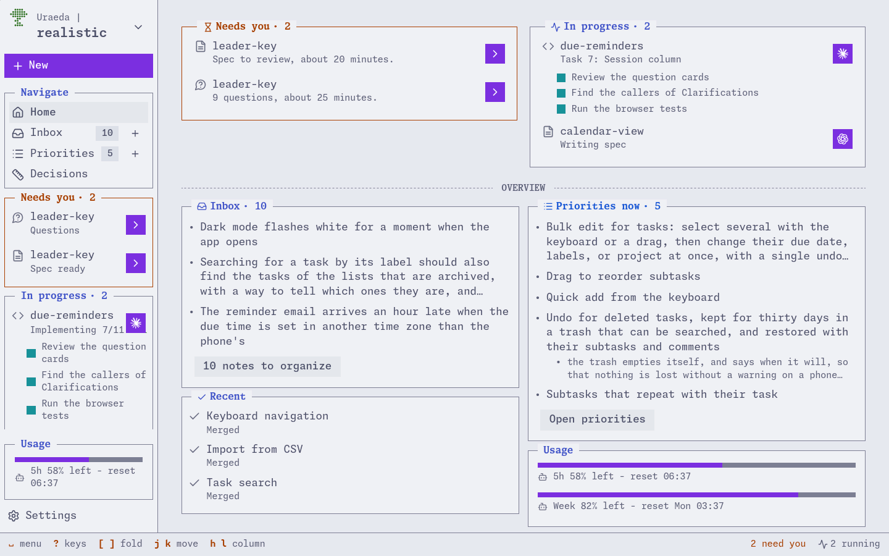
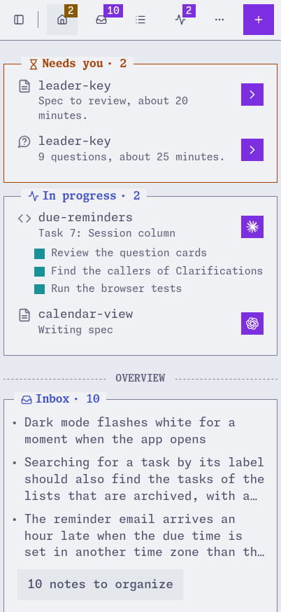
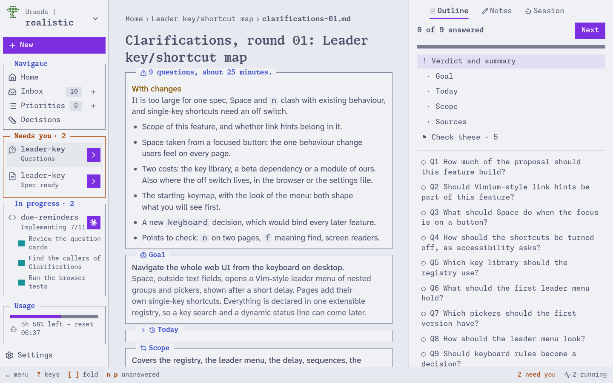
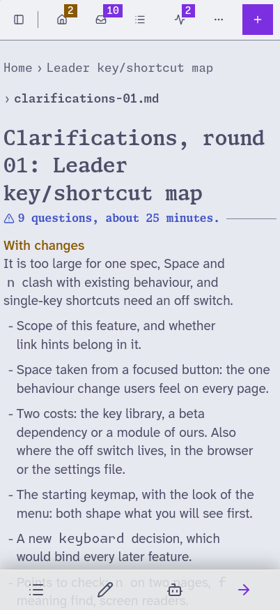
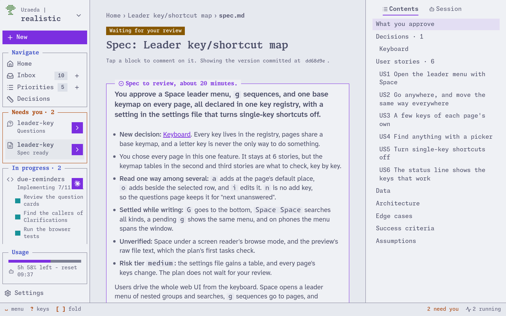
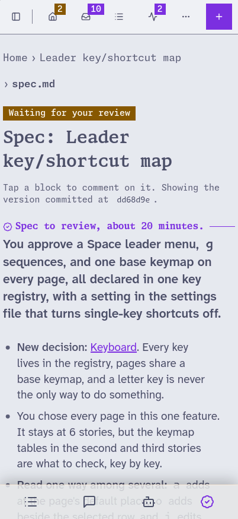

<p align="center">
  <picture>
    <source media="(prefers-color-scheme: dark)" srcset="docs/images/banner-dark.svg">
    
  </picture>
</p>

<table>
  <tr>
    <td><picture><source media="(prefers-color-scheme: dark)" srcset="docs/images/screenshots/home-desktop-dark.webp"></picture></td>
    <td><picture><source media="(prefers-color-scheme: dark)" srcset="docs/images/screenshots/home-phone-dark.webp"></picture></td>
  </tr>
  <tr>
    <td><picture><source media="(prefers-color-scheme: dark)" srcset="docs/images/screenshots/questions-desktop-dark.webp"></picture></td>
    <td><picture><source media="(prefers-color-scheme: dark)" srcset="docs/images/screenshots/questions-phone-dark.webp"></picture></td>
  </tr>
  <tr>
    <td><picture><source media="(prefers-color-scheme: dark)" srcset="docs/images/screenshots/spec-desktop-dark.webp"></picture></td>
    <td><picture><source media="(prefers-color-scheme: dark)" srcset="docs/images/screenshots/spec-phone-dark.webp"></picture></td>
  </tr>
</table>

**An asynchronous, git-driven development workflow for coding agents.**

You write a short proposal. An agent investigates it in depth, comes back with the questions only
you can answer, then with a complete spec to approve. Then it plans, implements, and opens a pull
request. Every step is a plain text file, committed to git, and you answer whenever you have time.

Uraeda has three parts, each optional but the first:

- **A workflow**, shipped as an [agent skill](skills/uraeda/SKILL.md), with templates and a
  filled-in example. It works with any agent that reads
  [Agent Skills](https://agentskills.io/specification), like Claude Code, Codex, or OpenCode.
- **`ura`**, a command-line tool that checks the workflow's files and performs its mechanical steps,
  for you and for agents.
- **A web UI** that drives it. It shows every feature and file, performs every human step, and holds
  your sessions with the agent, from a phone too. Only these sessions need a local, signed-in Claude
  Code, for now.

> [!WARNING]
>
> Uraeda is an early proof of concept.

## Why Uraeda

Spec Kit and Kiro give you spec files to fill in with an agent. superpowers gives you an excellent
design conversation, for as long as you stay in the chat. Uraeda aims for the quality of that
conversation without the conversation.

- **Deep discovery before any question.** The agent reads the code, the documentation, and how other
  products solve the problem, and settles what it can.
- **Questions built for thinking, not searching.** Each has its context, options with pros and cons,
  and a recommended answer.
- **A ledger of your decisions.** High-impact choices become decision files that later features must
  follow.
- **Review scales with risk.** Each spec proposes a risk tier, and the plan waits for you only if
  you ask.
- **Plain text in git, no service.** Markdown in a `specs/` folder. No Jira, no Linear.

It is built for technical users, and for features worth a spec. For a one-line fix, just ask your
agent. It assumes a capable model with web access.

## What it looks like

The [example project](skills/uraeda/assets/example/specs/), a small todo app, took its recurring
tasks feature through the whole workflow:

1. **You write the
   [proposal](skills/uraeda/assets/example/specs/2026-10-06-recurring-tasks/proposal.md)**: tasks
   that come back once completed, simple enough for "my parents".
2. **The agent investigates** in
   [discovery-01.md](skills/uraeda/assets/example/specs/2026-10-06-recurring-tasks/discovery-01.md):
   how Todoist and others handle repeats, and a due-date bug across daylight saving changes.
3. **It asks you 7 questions** in
   [clarifications-01.md](skills/uraeda/assets/example/specs/2026-10-06-recurring-tasks/clarifications-01.md).
   One of them, trimmed:

   ```md
   ## Q2: When does the next occurrence appear?

   - **A (recommended). Create the next occurrence as a new task when the current one is
     completed.**
     - [pro] completed tasks stay in the list as a history.
     - [con] the list grows by one task per completion.
   - **B. Create the next 4 occurrences in advance.** [...]
   - **C. Keep a single task, and move its due date, like Todoist.** [...]

   **Answer:** C, we want a simple feature.
   ```

4. **It writes the [spec](skills/uraeda/assets/example/specs/2026-10-06-recurring-tasks/spec.md)**,
   with two new [decisions](skills/uraeda/assets/example/specs/decisions/), and you approve it.
5. **It writes the [plan](skills/uraeda/assets/example/specs/2026-10-06-recurring-tasks/plan.md)**,
   tasks with their failing tests written out, implements it, and opens a pull request.
6. **It finishes the feature**: one
   [record](skills/uraeda/assets/example/specs/done/2026-10-06-recurring-tasks.md) replaces the
   folder, with each question and its answer.

## Getting started

Install `ura`, the skill, and the web UI. [INSTALL.md](INSTALL.md) has every other way.

> [!WARNING] At the moment, only Claude Code is supported by the Web UI

```sh
curl --proto '=https' --tlsv1.2 -LsSf https://github.com/mrtolkien/uraeda/releases/latest/download/uraeda-cli-installer.sh | sh
ura install                                     # the skill, for your user
npx @uraeda/ui                                  # the web UI, in your repository
```

Without `ura`, install the skill with `npx skills add mrtolkien/uraeda`

Then:

1. **Add your repository.** `npx @uraeda/ui`, run in it, opens it in your browser.
2. **Set it up.** Home's Setup pane lists the files the workflow needs: a constitution, the
   project's principles, and two decisions. Press "Set up with the agent", then send the message.
3. **Write a first proposal.** On the New page, under Feature, write what you want and why, then
   name it: its session opens with the agent's first message, for you to send.

Without the web UI, run `ura init`, then ask your agent `/uraeda` to set the project up. Write a
proposal in `specs/proposals/`, and tell the agent to start it, then "what is next?" when you
answered.

## Learn more

- [The skill](skills/uraeda/SKILL.md) and [the example project](skills/uraeda/assets/example/specs/)
- [INSTALL.md](INSTALL.md): every way to install
- [The web UI](docs/web-ui.md): sign-in, settings, proxies, and sessions
- [The `ura` CLI](docs/cli.md) and its language server
- [The `specs/` folder](docs/specs-folder.md), changes, and the inbox
- [CONTRIBUTING.md](CONTRIBUTING.md): building Uraeda

## Inspirations

- [superpowers](https://github.com/obra/superpowers): the flow from clarification to design to plan,
  and plans with test code. Uraeda makes it asynchronous.
- [Spec Kit](https://github.com/github/spec-kit): the file names and their formats. Uraeda adds the
  decision ledger, numbered question rounds, and risk tiers.
- [Plain Text Team](https://github.com/0atman/noboilerplate/blob/main/scripts/34-Plain-Text-Team.md):
  a team's work kept as plain text in git.

## Project status

The skill came first, then `ura` and the web UI, then the web UI's sessions with Claude Code. A git
listener that starts the agent when you commit an answer is planned. What is being built now, and
next, is in [specs/PRIORITIES.md](specs/PRIORITIES.md).

## License

MIT or Apache-2.0, at your option. The bundled fonts' and icons' licenses are in
[CONTRIBUTING.md](CONTRIBUTING.md#licenses).
