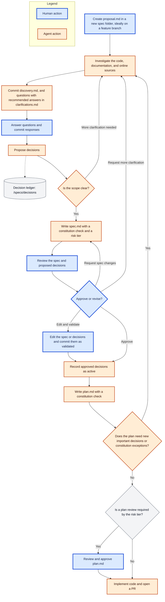

# URAEDA

裏枝 = back branch

Uraeda is a git-driven opinionated software development harness.

It will provide, once fully built:

- A structure for creating good software with LLMs -> can be used as-is with any coding agent
  - Human proposal -> Agent research and questions -> Human answers -> Agent spec -> Human approval
    -> Agent plan -> Implementation in a PR
  - History of human-made decisions so agents can't ruin your code with decisions that are _too_
    stupid
  - Text-focused system: no Jira, no Linear, just text files
- A CLI to enforce the structure above
- A server listening to git changes to automatically trigger agent runs on human proposals
  - Optional but that's how I use it

## Vision

Uraeda works like an asynchronous [superpowers](https://github.com/obra/superpowers): the same care
for design before code, without having to stay in a chat session for hours. The hard work happens
upfront, done by a capable agent on its own: in-depth investigation of the code, the documentation,
and online sources, options, and a complete design. The human only steps in where they add the most
value: the questions only they can answer, and one spec to approve. Every message to the human is a
file built so their time goes into thinking, not searching, whenever they have time.

For now, Uraeda targets technical users, who read code and designs. Support for non-technical users
is a later goal.

## Inspirations

Uraeda's files follow the formats and vocabulary of [Spec Kit](https://github.com/github/spec-kit):
constitution, spec, and plan. Spec Kit is a textual workflow run from a chat session. Uraeda is
software built around a similar workflow, but : it runs asynchronously from git commits, keeps a
ledger of human decisions, and scales human review with risk tiers.

It also borrows concepts from
[Plain Text Team](https://github.com/0atman/noboilerplate/blob/main/scripts/34-Plain-Text-Team.md)
and [superpowers](https://github.com/obra/superpowers).

> [!WARNING]
>
> **Obsolete.** The sections below describe an earlier version of the workflow, and are no longer
> kept up to date while the PoC is built. The source of truth is the Uraeda skill, in
> [`skills/uraeda/`](skills/uraeda/SKILL.md). These sections will be rewritten from the skill once
> the PoC is done, keeping only what users need.

# Files organization

## Tree

The examples in this document use a simple todo list app.

```sh
specs/
  README.md                       # status legend + conventions
  CONSTITUTION.md                 # app-specific development principles
  PRIORITIES.md                   # kanban-like list of next steps
  drafts/                         # upcoming features, human-written, no structure required
    due-date-reminders.md
  backlog/                        # nice-to-have features, not scheduled
    mobile-layout.md
  decisions/                      # decision ledger, one file per topic
    task-storage.md
    due-dates.md
  bugs/                           # one folder per bug report
    completed-tasks-reappear/
      report.md                   # human: what happens, how to reproduce it
      assessment.md               # agent: root cause and suggested fix
  001-recurring-tasks/            # one numbered folder per feature
    proposal.md                   # human: what and why
    discovery.md                   # agent: findings and options, before questions
    clarifications.md             # agent questions, human answers
    spec.md                       # agent: behaviour, reviewed by a human
    plan.md                       # agent: technical approach and implementation steps
    data-model.md                 # agent, when needed: entities and their rules
    contracts/                    # agent, when needed: exact interface definitions
```

Spec folders are numbered, so listing them shows the order in which features were started.
`spec.md`, `plan.md`, `data-model.md`, and `contracts/` keep Spec Kit's names. `discovery.md` is
Uraeda's own: the investigation before the questions. Spec Kit's `research.md`, the agent's log of
technical choices written after the spec, has no equivalent: in Uraeda, important choices become
decisions made by the human, and small ones are settled in the plan.

## Workflow status

Each workflow file tracks its step in a `status` field of its frontmatter. A git listener, or a
fresh agent, can tell from the files alone whether a step is waiting for the human, waiting for an
agent, or approved. For example, an agent must not start the spec while the human has answered only
3 of the 12 questions.

```md
---
status: awaiting-human
---
```

| File                | Set by the agent                                 | Set by the human                  |
| ------------------- | ------------------------------------------------ | --------------------------------- |
| `clarifications.md` | `awaiting-human`                                 | `answered`                        |
| `spec.md`           | `awaiting-human`                                 | `approved` or `changes-requested` |
| `plan.md`           | `awaiting-human`, or `auto-approved` (risk tier) | `approved` or `changes-requested` |

- For these files, agents only set `awaiting-human` or `auto-approved`. `answered`, `approved`, and
  `changes-requested` are set by a human, or by an agent when the human expressly asks for it, for
  example by approving the spec in a chat session. The commit message then says so.
- A git listener triggers an agent run when a human-set status is committed.
- With `changes-requested`, the human writes their feedback in a `## Review` section at the end of
  the file, so the agent knows what to change.

Alternatives considered:

- A single state file per spec folder: it duplicates information that belongs to each file, and it
  gets out of sync.
- Commit message trailers (`Uraeda-Step: spec-approved`): invisible when reading the files.

## Coming back to the human

Every file waiting for the human opens with a `> [!IMPORTANT]` block: what is asked, an honest
estimate of the time it takes to think through, where their attention matters most, and how to
answer. The block orients the human, it does not replace reading: questions and specs need their
judgement. The commit message repeats its first line, so `git log` or a git listener shows what is
waiting.

```md
> [!IMPORTANT]
>
> 4 questions on recurring tasks, about 20 minutes.
>
> - Two choices last beyond this feature: how users pick when a task repeats, which decides what
>   "every 2 weeks" would cost later, and how due dates are stored, which every future feature with
>   dates will follow, and which needs a one-time upgrade of saved tasks.
> - The questions on when the next occurrence appears and which date it counts from work together.
>
> Answer each question with an option letter, `yes` for the recommendation, or your own words. Then
> set `status: answered` and commit.
```

## Links

Any markdown file can link to any file in the repository, including source code:

- Markdown links, with a relative path (`[discovery](../001-recurring-tasks/discovery.md)`) or a
  path from the repository root (`[auth](/src/auth.ts)`)
- Wikilinks, with the file name (`[[due-dates]]`), or a partial path when the name is ambiguous
  (`[[001-recurring-tasks/spec]]`)

Agents always write markdown links, which render on GitHub and in most editors. Wikilinks are
accepted for humans, who often write them from note-taking tools.

Links replace metadata fields: instead of listing what a decision affects, the files that rely on it
link to it, and tools find them from these inbound links. Links break when files move: tools will
check them.

## Decisions

The decision ledger, in `/specs/decisions`, records the high-impact choices a human made: how the
code is organized, dependencies, the technical approach to a problem, visual direction,
cross-cutting conventions, transitions between two approaches. Agents must follow them, but would
not reliably make them on their own.

Decisions are close to the constitution or an `AGENTS.md`, except that:

- They are created as the project goes, and grow with it: the ledger becomes the record of what the
  human wants
- They change: a decision can be temporary, like two solvers kept side by side during a trial, and
  is edited when the human changes their mind
- They are short and easy to review: a reviewer understands one without reading the discovery

A choice becomes a decision only if an agent would not guess it, it shapes work beyond the feature
that raised it, and getting it wrong is costly. Behaviour inside one feature belongs in the spec,
and rules the code already enforces, with types or a schema, are recorded by the code. Most features
produce no decision, or one.

### One file per topic

Decisions are named after the question they answer, not the answer: `due-dates.md`, not
`due-dates-are-calendar-days.md`. A decision is edited in place when it changes, and deleted when it
no longer applies: git history keeps the old versions, and the ledger only holds what is true now.
When a change reverses an earlier choice, the earlier choice is kept as an alternative, with why it
was abandoned, so agents do not propose it again.

### Status and approval

The `status` field is `proposed`, for a new decision drafted by an agent, or `active` once a human
approved it. Active decisions are binding for all work. `approved-by` holds the approver's username,
when known.

Agents never edit an active decision before approval, since other work relies on it. They propose
changes in a `## Proposed change (<spec folder>)` section at the end of its file. The reviewer sees
the current and proposed versions side by side.

Approving a spec applies the decisions it links to: new decisions become active, and proposed
changes are written into their decision. A human can also edit a decision directly at any time:
features in progress check their plan against the current decisions, and go back to questions on a
conflict.

### Format

A decision opens with a plain summary, then its rules, written with MUST, SHOULD, and MUST NOT so
specs, plans, and code can be checked against them. **Why** explains the problem, with links to the
clarification question and the discovery topic. **Consequences** lists what gets easier and what
gets harder. **Applies to** links to the code it governs, so agents find the decisions relevant to
what they touch. **Alternatives considered** and **Revisit when** are optional.

```md
---
status: active
approved-by: mrtolkien
---

# Due dates

Due dates are calendar days, like `2026-10-12`, without a time or a timezone. A task due Monday
stays due Monday wherever the user is.

## Rules

- Due dates MUST be stored as `YYYY-MM-DD` strings.
- Date arithmetic MUST go through `src/lib/dates.ts`.

## Why

Recurring tasks add date arithmetic. Timestamps at local midnight drift by a day across daylight
saving changes. See
[Q4](../001-recurring-tasks/clarifications.md#q4-how-should-the-app-store-due-dates).

## Consequences

- Date bugs stay in one module, and tests need no timezone setup.
- Due times, like "at 3pm", need a change to this decision.

## Applies to

- [Date helpers](/src/lib/dates.ts), and any feature with dates
```

# Core files

## specs/README.md

`specs/README.md` is a short, static file, there for discovery. It quickly explains the layout of
the `specs/` folder and links to the Uraeda skill, which holds the full workflow. An agent that
needs more than the layout can install the skill itself.

A coding agent with no uraeda-specific instructions should still be able to navigate the `specs/`
folder through clear file names and contents.

This README.md should NEVER hold an index-like list of files: just generic information about
folders.

## CONSTITUTION.md

The CONSTITUTION.md file is a short file explaining the core rules and goals of this software
project. It follows the structure of Spec Kit's constitution:

- Named principles, listed by priority: when two principles conflict, the higher one wins
- Rules written with MUST and SHOULD, so agents and tools can check specs and plans against them
- A short rationale under each principle, to help agents handle cases the rules don't cover
- A governance section explaining how the constitution is amended
- A version and the dates it was ratified and last amended

It will be loaded in the context of all coding agents as high importance instructions.

Those should be human-written, but we can propose some templates and/or interactive setup.

Example of principles for a todo list app:

```md
### I. Simple for non-technical users

The UI MUST stay lightweight. User-facing text MUST NOT use technical jargon.

### II. Local first

Tasks MUST be stored on the user's device. The app MUST NOT send user data to an external service
without explicit human approval.

### III. Fast with thousands of tasks

List rendering MUST be benchmarked. Performance regressions MUST NOT be merged without human
approval.
```

## PRIORITIES.md

`PRIORITIES.md` is the source of truth for what the project works on, and in which order. It is a
simple `.md` file with **Now, Next, Later, and Blocked** sections:

- **Now**: work actively in progress
- **Next**: what comes after, in order
- **Later**: nice-to-have ideas, not scheduled
- **Blocked**: work waiting on something, with the reason

It is also the quickest way to capture an idea: an entry can be a single line of plain text, without
any file. Humans jot down a future feature to keep it in mind, and only write a draft once there is
more to say about it.

Entries can link to anything in `/specs`: drafts, backlog files, bugs, spec folders, ... Future
tools display the file as a kanban.

```md
# Priorities

## Now

1. [Recurring tasks](001-recurring-tasks)
2. [Completed tasks reappear after reload](bugs/completed-tasks-reappear)

## Next

1. [Due date reminders](drafts/due-date-reminders.md)
2. Keyboard shortcuts

## Later

- Tags and filters
- [Mobile layout](backlog/mobile-layout.md)

## Blocked

- [Sync between devices](drafts/device-sync.md), blocked by: decision on local-only storage
```

# Drafts and backlog

`/specs/drafts` and `/specs/backlog` hold human-written feature descriptions that have outgrown a
line in `PRIORITIES.md`, but are not spec folders yet:

- **Drafts**: upcoming features. Humans collaborate on them ahead of time, and an agent can be asked
  to review one.
- **Backlog**: nice-to-have features that are not scheduled.

The folders are a secondary structure: `PRIORITIES.md` decides the priority. A file that is not
listed there is shown in **Next** if it is in `/specs/drafts`, and in **Later** if it is in
`/specs/backlog`.

A feature usually grows in three steps:

1. A line in `PRIORITIES.md`
2. A file in `/specs/drafts` or `/specs/backlog`, once there is more to write about it
3. A spec folder: the draft is moved to a new numbered folder and renamed to `proposal.md`

# Feature flow

Each feature gets a numbered spec folder in `/specs`: this is the core of the workflow.

Every step has clear git-based checkpoints, but there's also space for direct agentic chats, for
example for quick changes to the spec.

Spec files can be committed to any branch. A dedicated branch per feature is recommended, but not
required: a single user can work on the main branch directly. Code is always delivered through a PR,
so it goes through the project's validation pipeline.



## Proposal

A proposal is a human-written description of a feature, saved as `proposal.md`. It generally comes
from promoting a draft: the draft file is moved to the new spec folder and renamed to `proposal.md`.

> [!TODO]
>
> Proposal example: what goes into it, what's a good proposal, ..

## Discovery and questions

When a `proposal.md` file is created in a spec folder, an agent picks it up and investigates it in
depth, before asking any question:

- **The code**: the files the feature touches, the existing patterns to follow, and the files it
  will likely change
- **Documentation**: local docs, and the official docs of the dependencies involved
- **Online sources**: how established products and libraries solve the same problem, libraries that
  could do the work, known pitfalls

It writes its findings in `discovery.md`: a map of the code, then one section per topic, with at
least two or three genuinely different approaches, evaluated against the same criteria, taken from
the constitution, active decisions, and the proposal. Every finding links to its source, and what
could not be checked is listed, so the next agent does not repeat dead ends.

`discovery.md` holds findings and options, never decisions: decisions come from the human's answers.
It is the evidence behind the questions' recommended answers, the basis of the spec's design, and
the map of the code the plan reuses. A different agent can resume the work without redoing it.

Like clarifications, each discovery round is a new session in the same file, so earlier findings are
kept.

## Clarifications and Decisions

At the end of its proposal analysis step, the agent generates questions for the human user. Those
are committed in the spec folder as `clarifications.md`.

There is no limit on the number of questions: early in a project, it is normal to have a lot of
them. Questions are sorted by impact, so the most important ones come first.

The human reads the file once, from top to bottom, without the discovery open next to it, so it
reads linearly. Each session opens with the `> [!IMPORTANT]` block, which names subjects rather than
question numbers the reader has not seen yet, then a short **Context** section: what the proposal
asks, and what exists today, with links to the code. Each question then:

- Explains what the reader needs to answer it: the current code, the documentation, how others solve
  it, every fact linked to its source
- Says why it matters, with a link to its discovery topic
- Lists its options as bullets: what each is in practice, when to pick it, and what it costs
- Ends with a recommendation and its reason, after the options, so the reader forms their own view
  first

Each clarification round is a new session in the same file.

```md
### Q3: Which date does the next due date count from?

Once a repeating task is completed, its next occurrence needs a due date. Todoist offers both
options below: "every" counts from the previous due date, and "every!" from the day the task was
completed
([Todoist help](https://todoist.com/help/articles/introduction-to-recurring-dates-YUYVJJAV)).

Why it matters: for a weekly task due Monday and completed on Thursday, this decides whether it
stays a Monday task. More in [discovery](discovery.md#next-due-date).

Options:

- **A. From the previous due date.** Monday tasks stay on Mondays, whenever they are completed. Pick
  it for a predictable schedule. A task completed very late can get a next due date that is already
  past: Todoist skips to the next date in the future in that case.
- **B. From the day the task was completed.** A weekly task done on Thursday comes back next
  Thursday. Pick it when the gap matters more than the day, like watering plants. The schedule
  drifts every time a task is done late.

**Recommended:** A. Schedules are what users set repeating tasks up for.

**Answer:** A, but if that date is already past, use the next one in the future.
```

The human answers each question with an option letter, `yes` to accept the recommendation, or a
short answer of their own, then commits the file to git.

Agents ask only what only the human can decide, and everything in one round: they settle the rest
themselves, as assumptions in the spec.

An agent picks up the responses and:

- Proposes new decisions in `/specs/decisions` with a **proposed** status, or changes to existing
  ones in a `## Proposed change` section. See [Decisions](#decisions) for what makes a decision.
- If necessary (based on human feedback): starts the clarification loop again, with more research
  and more human feedback.

## Spec

Once the human clearly answers the clarifications questions and the scope is clear and defined, the
agent writes the spec in `spec.md`, together with the decisions it proposes, in a single commit.

The spec says what the feature does and how it will be built, for a human to approve before any
code. It starts from Spec Kit's spec template, for the behaviour:

- User stories, ranked by priority (P1, P2, ...), each with acceptance scenarios written as Given /
  When / Then
- Edge cases
- Measurable success criteria (SC-001, ...)
- Assumptions

It adds a **Design** section, following [superpowers](https://github.com/obra/superpowers)' design
documents: the approach, the components (each with one clear purpose, how it is used, and what it
depends on), the data and how it flows, error handling, and testing. Each part is scaled to the
feature, from a few sentences to a few hundred words.

The spec is the main review of the workflow: once it is approved, most features reach the pull
request without the human. It is written for a technical reviewer, complete enough to approve with
confidence and fast to check.

Uraeda also adds:

- **Decisions**: the new decisions and proposed changes, reviewed together with the spec, and the
  active decisions it relies on
- **Constitution check**: how the spec complies with each principle of the constitution and with
  active decisions. Any conflict must be resolved by the human before approval.
- **Risk tier**: the feature's impact, proposed by the agent with a one-line reason. See
  [Risk tiers](#risk-tiers).

Before submitting it, the agent reviews the spec for placeholders, contradictions, scope (it must
fit a single plan), and ambiguity. Open questions go back to `clarifications.md`. When relevant, the
spec includes a visual mockup (HTML, AI-generated PNG, ...).

## Validation

Once a spec is written out, it is committed back to the repo, and it waits for human approval.

Approving the spec also applies the new decisions and proposed changes it links to, and confirms the
risk tier: the human can raise or lower it.

If the human does not approve the spec as-is, they should either:

- Edit the spec, the proposed decisions, or the proposed changes themselves and commit them as
  validated
- Explain the issues to an agent that can bring the work back to any previous step (clarifications
  or spec)

## Risk tiers

The risk tier decides whether the human reviews `plan.md`. The agent proposes it in the frontmatter
of `spec.md`, and the human confirms it when approving the spec.

| Tier     | Plan review                                                  | Typical features                                           |
| -------- | ------------------------------------------------------------ | ---------------------------------------------------------- |
| `low`    | none: the plan is auto-approved                              | No data format change, no new table, no new interface      |
| `medium` | chosen by the human when approving the spec, none by default | Small data format changes, minimal UI, low-impact features |
| `high`   | required                                                     | Security changes, new complex data structures or services  |

For a `medium` feature, the agent adds a `plan-review: false` field. When approving the spec, the
human sets it to `true` if they want to review the plan:

```md
---
status: approved
risk-tier: medium
plan-review: true
---
```

- When unsure between two tiers, the agent proposes the higher one.
- The constitution can set a minimum tier for the whole project, for example "every feature is
  `high`" while a project is young.
- Code is always reviewed in the PR, whatever the tier: the tier only controls the plan review.

## Plan

Once a spec has been validated by the user, an agent turns its design into a plan, in `plan.md`:

- **Files**: every file the feature adds or changes, with what changes in it
- **Constitution check**: a gate that checks the plan against the constitution and active decisions,
  for what the spec's design did not settle
- **Complexity tracking**: only filled in when the plan adds an abstraction or breaks a principle,
  with the reason and the simpler alternative that was rejected
- **Steps**: an ordered checklist of implementation steps, each one a commit with its tests. Steps
  stay coarse: the implementing agent breaks each one down further in its own session. The
  checkboxes track progress, so a different agent can resume the implementation.

The plan does not repeat the spec: the summary, approach, and testing strategy are in its design.
The project's stack and commands belong in `AGENTS.md`, not in every plan.

Spec Kit puts the steps in a separate `tasks.md`. Uraeda keeps them in the plan: a separate file
repeats the plan, gets out of sync with it, and nobody reviews it.

When the feature needs them, the plan comes with two extra files:

- `data-model.md`: the entities the feature adds or changes, their fields, relationships, validation
  rules, and state transitions. Small data changes stay in the spec's design.
- `contracts/`: exact definitions of the interfaces the feature exposes to users or other systems,
  in the format that fits the project: API schemas, CLI command definitions, file formats, ...

The plan must not introduce new decisions or constitution exceptions: those should have been settled
during clarifications. If the plan needs one, the workflow goes back to discovery and questions, so
the human makes the decision. The spec is then updated and validated again.

Since the design was already reviewed with the spec, most plans need no human review. If the
feature's risk tier requires it, the workflow waits for the human to review and approve the plan.
Otherwise, the agent sets the plan's status to `auto-approved` and moves on to the implementation.

## Implementation

> [!TODO]
>
> Explain how the coding agent runs the implementation: validation against the spec's acceptance
> scenarios, tests, documentation, commit strategy, ...

# Bugs

> [!NOTE]
>
> Later workflow: this section will get its own spec once the feature flow works.

Each bug gets a folder in `/specs/bugs`, named after a short slug: `/specs/bugs/<slug>/`.

A human commits a `report.md` describing what happens, what should happen, and how to reproduce it.
An agent picks it up and treats it directly, without going through the feature flow: it finds the
root cause and suggests a fix in `assessment.md`.

# Micro features, chores, and other low impact code changes

> [!TODO]
>
> Coding is not all big features: explain how micro features and chores integrate in this workflow,
> with an integrated way to manage them without going through the whole process.
