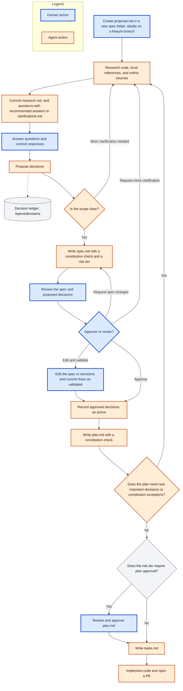

# URAEDA

裏枝 = back branch

Uraeda is a git-driven opinionated software development harness.

It will provide, once fully built:

- A structure for creating good software with LLMs -> can be used as-is with any coding agent
  - Human proposal -> Agent research and questions -> Human answers -> Agent spec -> Human approval
    -> Agent plan and tasks -> Implementation in a PR
  - History of human-made decisions so agents can't ruin your code with decisions that are _too_
    stupid
  - Text-focused system: no Jira, no Linear, just text files
- A CLI to enforce the structure above
- A server listening to git changes to automatically trigger agent runs on human proposals
  - Optional but that's how I use it

## Inspirations

Uraeda's files follow the formats and vocabulary of [Spec Kit](https://github.com/github/spec-kit):
constitution, spec, plan, and tasks. Spec Kit is a textual workflow run from a chat session. Uraeda
is software built around a similar workflow: it runs asynchronously from git commits, keeps a ledger
of human decisions, and scales human review with risk tiers.

It also borrows concepts from
[Plain Text Team](https://github.com/0atman/noboilerplate/blob/main/scripts/34-Plain-Text-Team.md)
and [superpowers](https://github.com/obra/superpowers).

> [!WARNING]
>
> The content below likely shouldn't be in a README.md, we need to reorganize this

# Files organization

## Tree

The examples in this document use a simple todo list app.

```sh
specs/
  README.md                       # status legend + conventions
  CONSTITUTION.md                 # app-specific development principles
  PRIORITIES.md                   # kanban-like list of next steps
  drafts/                         # upcoming features, human-written, no structure required
    due-date-reminders.md
  backlog/                        # nice-to-have features, not scheduled
    mobile-layout.md
  decisions/                      # Architecture Decision Record
    0001-local-storage.md
    0002-no-user-accounts.md
  bugs/                           # one folder per bug report
    completed-tasks-reappear/
      report.md                   # human: what happens, how to reproduce it
      assessment.md               # agent: root cause and suggested fix
  001-recurring-tasks/            # one numbered folder per feature
    proposal.md                   # human: what and why
    research.md                   # agent: findings and options, before questions
    clarifications.md             # agent questions, human answers
    spec.md                       # agent: behaviour, reviewed by a human
    plan.md                       # agent: technical approach
    data-model.md                 # agent, when needed: entities and their rules
    contracts/                    # agent, when needed: exact interface definitions
    tasks.md                      # agent: step-by-step implementation tasks
```

Spec folders are numbered, so listing them shows the order in which features were started. Files
inside a spec folder use the same names as Spec Kit.

## Decisions

Ledger of human-validated decisions.

Each decision has a status:

- **Proposed**: drafted by an agent from the human's answers, not binding yet
- **Active**: validated by a human, binding for all future work
- **Overridden by XXXX**: replaced by a newer decision, only once a human validates the override

Agents never accept a decision themselves: a human validates proposed decisions, either explicitly
or by approving the spec that lists them.

Specs and plans are checked against active decisions, and the agent asks the human user if some of
those can be overridden.

# Core files

## specs/README.md

`specs/README.md` is a short, static file, there for discovery. It quickly explains the layout of
the `specs/` folder and links to the Uraeda skill, which holds the full workflow. An agent that
needs more than the layout can install the skill itself.

A coding agent with no uraeda-specific instructions should still be able to navigate the `specs/`
folder through clear file names and contents.

This README.md should NEVER hold an index-like list of files: just generic information about
folders.

## CONSTITUTION.md

The CONSTITUTION.md file is a short file explaining the core rules and goals of this software
project. It follows the structure of Spec Kit's constitution:

- Named principles, listed by priority: when two principles conflict, the higher one wins
- Rules written with MUST and SHOULD, so agents and tools can check specs and plans against them
- A short rationale under each principle, to help agents handle cases the rules don't cover
- A governance section explaining how the constitution is amended
- A version and the dates it was ratified and last amended

It will be loaded in the context of all coding agents as high importance instructions.

Those should be human-written, but we can propose some templates and/or interactive setup.

Example of principles for a todo list app:

```md
### I. Simple for non-technical users

The UI MUST stay lightweight. User-facing text MUST NOT use technical jargon.

### II. Local first

Tasks MUST be stored on the user's device. The app MUST NOT send user data to an external service
without explicit human approval.

### III. Fast with thousands of tasks

List rendering MUST be benchmarked. Performance regressions MUST NOT be merged without human
approval.
```

## PRIORITIES.md

`PRIORITIES.md` is the source of truth for what the project works on, and in which order. It is a
simple `.md` file with **Now, Next, Later, and Blocked** sections:

- **Now**: work actively in progress
- **Next**: what comes after, in order
- **Later**: nice-to-have ideas, not scheduled
- **Blocked**: work waiting on something, with the reason

It is also the quickest way to capture an idea: an entry can be a single line of plain text, without
any file. Humans jot down a future feature to keep it in mind, and only write a draft once there is
more to say about it.

Entries can link to anything in `/specs`: drafts, backlog files, bugs, spec folders, ... Future
tools display the file as a kanban.

```md
# Priorities

## Now

1. [Recurring tasks](001-recurring-tasks)
2. [Completed tasks reappear after reload](bugs/completed-tasks-reappear)

## Next

1. [Due date reminders](drafts/due-date-reminders.md)
2. Keyboard shortcuts

## Later

- Tags and filters
- [Mobile layout](backlog/mobile-layout.md)

## Blocked

- [Sync between devices](drafts/device-sync.md), blocked by: decision on local-only storage
```

# Drafts and backlog

`/specs/drafts` and `/specs/backlog` hold human-written feature descriptions that have outgrown a
line in `PRIORITIES.md`, but are not spec folders yet:

- **Drafts**: upcoming features. Humans collaborate on them ahead of time, and an agent can be asked
  to review one.
- **Backlog**: nice-to-have features that are not scheduled.

The folders are a secondary structure: `PRIORITIES.md` decides the priority. A file that is not
listed there is shown in **Next** if it is in `/specs/drafts`, and in **Later** if it is in
`/specs/backlog`.

A feature usually grows in three steps:

1. A line in `PRIORITIES.md`
2. A file in `/specs/drafts` or `/specs/backlog`, once there is more to write about it
3. A spec folder: the draft is moved to a new numbered folder and renamed to `proposal.md`

# Feature flow

Each feature gets a numbered spec folder in `/specs`: this is the core of the workflow.

Every step has clear git-based checkpoints, but there's also space for direct agentic chats, for
example for quick changes to the spec.

Spec files can be committed to any branch. A dedicated branch per feature is recommended, but not
required: a single user can work on the main branch directly. Code is always delivered through a PR,
so it goes through the project's validation pipeline.



## Proposal

A proposal is a human-written description of a feature, saved as `proposal.md`. It generally comes
from promoting a draft: the draft file is moved to the new spec folder and renamed to `proposal.md`.

> [!TODO]
>
> Proposal example: what goes into it, what's a good proposal, ..

## Research and questions

When a `proposal.md` file is created in a spec folder, an agent picks it up and:

- Reads the relevant existing code in the app
- Reads the relevant local references (documentation, ...)
- Searches for necessary references and information online
- Identifies parts requiring human input: behaviour details, visual direction, library selection,
  reusability level required of the produced code, ...

The agent writes its findings in `research.md`, before asking any question. For each topic, it lists
what it found, the options it considered with their pros and cons, and its sources.

`research.md` holds findings and options, never decisions: decisions come from the human's answers.
It gives the questions a documented basis, and lets a different agent resume the work later without
redoing the research.

Like clarifications, each research round is a new session in the same file, so earlier findings are
kept.

## Clarifications and Decisions

At the end of its proposal analysis step, the agent generates questions for the human user. Those
are committed in the spec folder as `clarifications.md`.

There is no limit on the number of questions: early in a project, it is normal to have a lot of
them. Questions are sorted by impact, so the most important ones come first.

Each question follows Spec Kit's clarification format: a "Why it matters" sentence, a recommended
answer with its reasoning, and the options in a table. Each clarification round is a new session in
the same file.

```md
## Session 2026-10-07

### Q1: How should users choose when a task repeats?

Why it matters: this decides how complex the repeat settings screen is.

**Recommended:** Option A - presets cover most needs and keep the UI simple for non-technical users.

| Option | Description                                       |
| ------ | ------------------------------------------------- |
| A      | Presets: daily, weekly, monthly                   |
| B      | Presets plus custom rules (every N days, ...)     |
| C      | Free text, parsed by the app ("every 2nd Monday") |

**Answer:** yes
```

The human answers each question with an option letter, `yes` to accept the recommendation, or a
short answer of their own, then commits the file to git.

An agent picks up the responses and:

- Proposes important decisions in the `/specs/decisions` folder, with a **Proposed** status
  - Those should be important technical decisions, look and feel choices, ...
- If necessary (based on human feedback): starts the clarification loop again, with more research
  and more human feedback.

## Spec

Once the human clearly answers the clarifications questions and the scope is clear and defined, the
agent writes the spec in `spec.md`.

The spec is a human-readable document of reasonable length. It follows Spec Kit's spec template:

- User stories, ranked by priority (P1, P2, ...), each with acceptance scenarios written as Given /
  When / Then
- Edge cases
- Functional requirements (FR-001, ...) and measurable success criteria (SC-001, ...)
- Assumptions

Uraeda adds three sections to it:

- **Decisions**: the proposed and active decisions the spec relies on, so proposed decisions are
  reviewed together with the spec
- **Constitution check**: how the spec complies with each principle of the constitution and with
  active decisions. Any conflict must be resolved by the human before approval.
- **Risk tier**: the feature's impact, proposed by the agent. The risk tier decides whether the
  human must also approve the plan. The human can change it during validation.

The spec must not contain any `[NEEDS CLARIFICATION]` markers when it is submitted for review: open
questions go back to `clarifications.md`.

> [!TODO]
>
> We'll need to give some examples here. Finding the right level of abstraction for this step will
> be an important part of the workflow development.

- This step should be adapted to the user: a non technical user should be made aware of the
  tradeoffs of the decisions, while a technical user can also read the plan.
- When relevant, includes a visual mockup (HTML, AI-generated PNG, ...)

## Validation

Once a spec is written out, it is committed back to the repo, and it waits for human approval.

Approving the spec also activates the proposed decisions it lists.

If the human does not approve the spec as-is, they should either:

- Edit the spec or the proposed decisions themselves and commit them as validated
- Explain the issues to an agent that can bring the work back to any previous step (clarifications
  or spec)

## Plan

Once a spec has been validated by the user, an agent writes the technical plan in `plan.md`. It
follows Spec Kit's plan template:

- **Summary**: the main requirement and the technical approach, in a few sentences
- **Technical context**: languages, dependencies, storage, testing, constraints, ...
- **Constitution check**: a gate that checks the plan against the constitution and active decisions
- **Project structure**: the files and folders the feature adds or changes
- **Complexity tracking**: only filled in when the plan breaks a principle, with the reason and the
  simpler alternative that was rejected

When the feature needs them, the plan comes with two extra files:

- `data-model.md`: the entities the feature adds or changes, their fields, relationships, validation
  rules, and state transitions. Small data changes stay in a section of `plan.md`.
- `contracts/`: exact definitions of the interfaces the feature exposes to users or other systems,
  in the format that fits the project: API schemas, CLI command definitions, file formats, ...

The plan must not introduce new important decisions or constitution exceptions: those should have
been settled during clarifications. If the plan needs one, the workflow goes back to research and
questions, so the human makes the decision. The spec is then updated and validated again.

If the feature's risk tier requires it, the workflow waits for the human to review and approve the
plan. Otherwise, it moves on to the tasks automatically.

## Tasks

Once the plan is ready, an agent breaks it down into `tasks.md`.

The file follows Spec Kit's tasks format: a checklist of numbered tasks (T001, ...), grouped by user
story, with tasks that can run in parallel marked `[P]`. The level of detail of each task follows
the
[writing-plans skill of superpowers](https://github.com/obra/superpowers/blob/main/skills/writing-plans/SKILL.md).

The generated document will be long, technical, and pretty hostile to human review: humans review
the spec and the plan, not the tasks.

## Implementation

> [!TODO]
>
> Explain how the coding agent runs the implementation: validation against the spec's acceptance
> scenarios, tests, documentation, commit strategy, ...

# Bugs

> [!NOTE]
>
> Later workflow: this section will get its own spec once the feature flow works.

Each bug gets a folder in `/specs/bugs`, named after a short slug: `/specs/bugs/<slug>/`.

A human commits a `report.md` describing what happens, what should happen, and how to reproduce it.
An agent picks it up and treats it directly, without going through the feature flow: it finds the
root cause and suggests a fix in `assessment.md`.

# Micro features, chores, and other low impact code changes

> [!TODO]
>
> Coding is not all big features: explain how micro features and chores integrate in this workflow,
> with an integrated way to manage them without going through the whole process.
