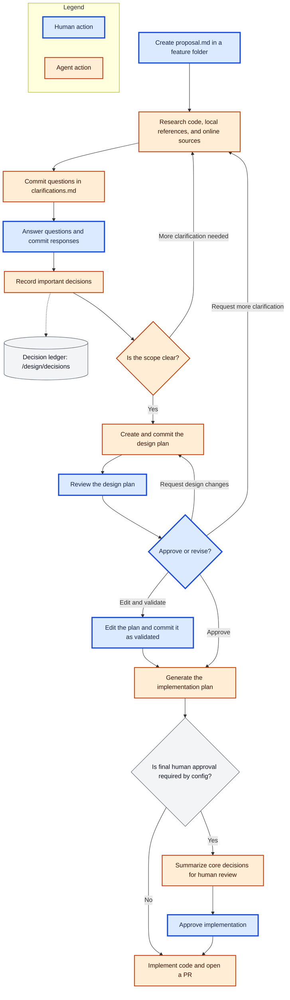

# URAEDA

裏枝 = back branch

Uraeda is a a git-driven opinionated software development harness.

It provides:

- A structure for creating good software with LLMs -> can be used as-is with any coding agent
  - Human proposal -> Agent questions -> Human decisions -> Agent plan -> Human validation ->
    Implementation
  - History of human-made decisions so agents can't ruin your code with decisions that are _too_
    stupid
- A CLI to enforce the structure above
- A server listening to git changes to automatically trigger agent runs on human proposals
  - Optional but that's how I use it

Uraeda is heavily inspired by [superpowers](https://github.com/obra/superpowers), but is more
opinionated, designed to be asynchronous, and focuses more on long-term software goals..

> [!WARNING]
>
> The content below likely shouldn't be in a README.md, we need to reorganize this

# Files organization

## Tree

```sh
design/
  README.md                       # status legend + conventions
  PRINCIPLES.md                   # app-specific development principles
  PRIORITIES.md                   # kanban-like list of next steps
  drafts/                         # inbox: rough notes, no structure required
    debounce-double-press.md      # can be linked to an item in PRIORITIES
  decisions/                      # Architecture Decision Record
    0001-firmware-zmk.md
    0002-case-material.md
  features/
    split-key-layers/
      proposal.md
      clarifications.md
      plan.md
      implementation.md
```

## Features

See dedicated Feature Flow below

## Decisions

Ledger of decisions made by the human, can be marked as OVERRIDEN BY XXXX if a new decision
contradicts an old one AND the overriding is validated by a human.

The design and implementation planner steps should validate their plans against latest decisions,
and ask the human user if some of those can be overriden.

# Core files

Those files should not change too often.

## design/README.md

We'll have a README.md in the /design folder explaining how this software development flow is
organized.

This will be a template that is populated by the CLI, and it should not change much.

In particular, this README.md should NEVER hold an index-like list of files: just generic
organization rules and information about folders.

## PRINCIPLES

The PRINCIPLES.md file is a short file explaining the core rules and goals of this software project.

It will be loaded in the context of all coding agents as high importance instructions.

Those should be human-written, but we can propose some templates and/or interactive setup.

Example of principles:

- This application is aimed at non-technical users. Technical jargon in the application should be
  kept at a minimum, and the UI should stay lightweight.
- This is a local application. Do not call any external API without explicit human approval.
- Performance is a priority: each new feature should be benchmarked and performance regressions are
  not acceptable without human approval.

## PRIORITIES

Simple `.md` file with **Now, Next, Later, and Blocked** categories.

Displayed as a Kanban board in the web UI.

Can links to files in `/design/drafts`, `design/features`, ...

```md
# Priorities

## Now

1. [Split key layers](features/split-key-layers)
2. [Debounce double press](fixes/debounce-double-press.md)

## Next

1. [Wireless pairing UX](drafts/pairing-ux.md)
2. Per-key RGB config

## Later

- Macro editor
- [Case v2](drafts/case-v2.md)

## Blocked

- [OLED support](drafts/oled.md), blocked by: decision on firmware display stack
```

# Drafts

`/design/drafts` is a staging space for future features and made for human-generated features
descriptions.

An agent can be asked to review a draft, but the goal of this folder is to let humans collaborate on
future features ahead of time.

# Feature flow

`/design/features` is the core of the workflow.



## Proposal

A proposal is a human-written description of a feature. It generally comes from promoting a draft.

> [!TODO]
>
> Proposal example: what goes into it, what's a good proposal, ..

## Research and questions

When a `proposal.md` file is created in a feature folder, an agent picks it up and:

- Reads the relevant existing code in the app
- Reads the relevant local references (documentation, ...)
- Searches for necessary references and information online
- Identifies parts requiring human input: behaviour details, visual direction, library selection,
  reusability level required of the produced code, ...

## Clarifications and Decisions

At the end of its proposal analysis step, the agent generates questions for the human user. Those
are committed in the feature folder as `clarifications.md`.

The human answers the questions and commits them to git.

An agent picks up the responses and:

- Takes note of important decisions in the `/design/decisions` folder
  - Those should be important technical decisions, look and feel choices, ...
- If necessary (based on human feedback): starts the clarification loop again, with more research
  and more human feedback.

## Design plan

Once the human clearly answers the clarifications questions and the scope is clear and defined, the
agent creates a design plan.

The design plan should be a human-readable document of reasonable length.

It should describe the feature and its behaviour as precisely as possible while outlining the
decisions taken and the rules to follow during its implementation.

> [!TODO]
>
> We'll need to give some examples here. Finding the right level of abstraction for this step will
> be an important part of the workflow development.

- This step should be adapted to the user: a technical user will want to know at least the big
  picture of the implementation strategy, while a non technical user should be made aware of the
  tradeoffs of the decisions.
- When relevant, includes a visual mockup (HTML, AI-generated PNG, ...)

## Validation

Once a design plan is written out, it is committed back to the repo, and it waits for human
approval.

If the human does not approve the design as-is, they should either:

- Edit the plan themselves and commit it as validated
- Explain the issues to an agent that can bring the work back to any previous step (clarifications
  or design plan)

## Implementation plan

Once a design plan has been validated by the user an agent generates an implementation plan.

This is pretty much the exact
[writing-plans skill of superpowers](https://github.com/obra/superpowers/blob/main/skills/writing-plans/SKILL.md).

The generated document will be long, technical, and pretty hostile to human review.

If user config requires final human approval, a small agent summarizes the core decisions made when
going from design plan to implementation plan for human review. The workflow then waits for human
approval before implementing the code and opening a PR.

Otherwise, the workflow moves automatically from the implementation plan to implementing the code
and opening a PR, without generating a summary.

## Implementation

> [!TODO]
>
> Explain how the coding agent runs the implementation: validation against the design plan, tests,
> documentation, commit strategy, ...

# Fixes, chores, and other low impact code changes

> [!TODO]
>
> Coding is not all big features: explain how small features or bugfixes should integrate in this
> workflow
