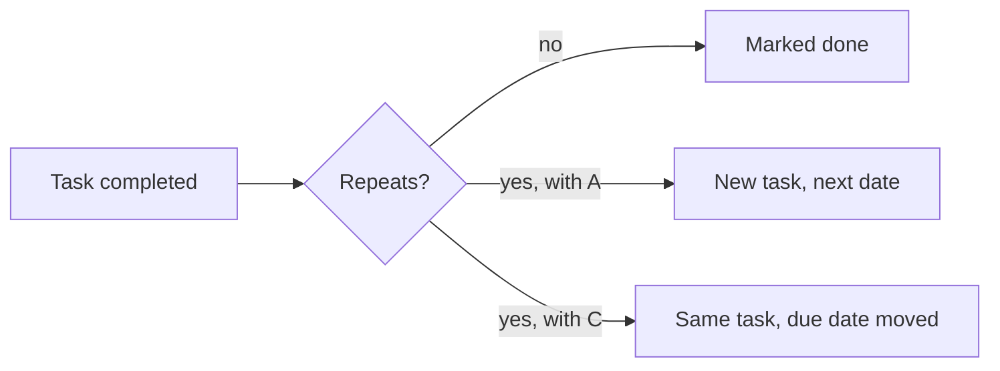

# Clarifications, round 01: Recurring tasks

> [!NOTE]
>
> Answered on 2026-10-08.
>
> - Verdict: worth building, with changes: the proposal's two clicks take three today, and a task
>   without a due date has nothing to repeat from.
> - Two choices last beyond this feature: how users pick a repeat, and how due dates are stored,
>   which every later feature with dates follows.
> - When the next occurrence appears decides what editing, deleting, and undoing a repeating task
>   mean. One of its answers comes with a follow-up.
> - Three points are settled without you, at the end: check the one under "Check these".

## Context

### Goal

The [proposal](proposal.md) asks for tasks that come back once completed, like "water the plants"
every week. Users set them in two clicks, and the app stays simple for the people who use it.

### Today

A task has a title, an optional due date, and a done flag, stored in IndexedDB by the
[task store](/src/store/tasks.ts). It is edited in a panel with two fields
([edit panel](/src/components/EditPanel.tsx)). The app only runs while it is open.

| Product         | How users pick a repeat            | Where the repeat is set             |
| --------------- | ---------------------------------- | ----------------------------------- |
| Microsoft To Do | presets, and a custom option       | the task's details, by its due date |
| Todoist         | a rule typed in the due date field | the due date field                  |
| Google Calendar | a menu, and a custom screen        | next to "Does not repeat"           |

### Scope

Repeating a task, its next due date, and how the list shows it. Reminders are left out: they are
next in the [priorities](../PRIORITIES.md).

### Sources

- The task store and the edit panel, linked above.
- The help pages of Microsoft To Do, Todoist, and Google Calendar, linked in the discovery.
- date-fns' `addMonths`, and MDN on Temporal.
- The full investigation is in [discovery](discovery-01.md). Each question links to its topic.

## Q1: How should users pick when a task repeats?

Microsoft To Do offers presets (daily, weekdays, weekly, monthly, yearly) plus a custom option.
Todoist reads a rule typed in the due date field, like "every 3 months". Google Calendar has a
custom screen, which the proposal names as what to avoid. Where the choice appears is Q6. More in
[discovery](discovery-01.md#recurrence-rules).

Why it matters: this sets how complex the edit panel gets, and what "every 2 weeks" would cost
later.

These options combine: C can come on top of A or B.

- **A (recommended). Presets only: daily, weekdays, weekly, monthly, yearly.**
  - [pro] one choice, nothing to learn.
  - [con] no "every 2 weeks", no "every Monday and Thursday".
  - Why recommended: the constitution puts simplicity first
    ([principle I](../CONSTITUTION.md#i-simple-for-non-technical-users)), and A can grow into B
    later.
- **B. The presets, plus a custom screen for intervals and days of the week ("every 2 weeks",
  "Monday and Thursday").**
  - [pro] covers almost every request, like Microsoft To Do.
  - [con] a second, more technical screen, built in the project or with the
    [`rrule`](https://github.com/jkbrzt/rrule) library.
- **C. A rule typed in the task's due date field ("every Monday"), read by the app, like Todoist.**
  - [pro] the fastest path for users who know the syntax.
  - [con] the syntax has to be learned, and the app needs a parser with clear error messages.

**Answer:** B and C: we need to easily handle weekdays vs weekend as those come up often. B will be
the UI path, and C will only happen when editing the task's title (like todoist).

## Q2: When does the next occurrence appear?

The app cannot create tasks while it is closed. Todoist keeps a single task and moves its due date
on completion. This choice also decides what editing, deleting, and undoing mean for a repeating
task. More in [discovery](discovery-01.md#generating-occurrences) and
[editing occurrences](discovery-01.md#editing-occurrences).

Why it matters: it decides whether future tasks show, whether completed ones stay as a history, and
whether the app needs a notion of series.

- **A (recommended). Create the next occurrence as a new task when the current one is completed.
  Editing a task changes that task only.**
  - [pro] completed tasks stay in the list as a history; no notion of series to learn.
  - [con] the list grows by one task per completion.
  - Why recommended: it keeps the history with the simplest model.
  - Deleting the pending task ends the repetition. Undoing a completion removes the task it created.
- **B. Create the next 4 occurrences in advance, so they are always visible.**
  - [pro] users can plan ahead.
  - [con] four times more repeating tasks in the list, and editing one occurrence needs the
    follow-up question below.
  - Deleting one occurrence follows that follow-up's answer, like editing one.
- **C. Keep a single task, and move its due date to the next occurrence when it is completed, like
  Todoist. Editing the task changes the whole repetition.**
  - [pro] the list never grows.
  - [con] completed occurrences disappear, and one occurrence can never differ from the others.
  - Deleting the task ends the repetition. Undoing a completion restores the previous due date.

**Answer:** C, we want a simple feature. The repetition is more about time management and
organization than history (we're a todo app, not a calendar)

### Q2.B: What does editing one occurrence change?

Only if you picked B in Q2. Google Calendar asks at every edit: this event, this and following
events, or all events ([Google Calendar help](https://support.google.com/calendar/answer/37113)).

- **A (recommended). That occurrence only. Changing the repeat applies to the occurrences not
  created yet.**
  - [pro] no question at every edit.
  - [con] changing all 4 visible occurrences takes 4 edits.
  - Why recommended: edits stay simple, as the constitution asks.
- **B. Ask at every edit: this one, this and following, or all, like Google Calendar.**
  - [pro] full control.
  - [con] a question at every edit, and a series with per-occurrence changes in the store.

**Answer:**

## Q3: Which date does the next due date count from?

Todoist offers both: "every" counts from the previous due date, "every!" from the day the task was
completed
([Todoist help](https://todoist.com/help/articles/introduction-to-recurring-dates-YUYVJJAV)). This
applies whatever the answer to Q2. More in [discovery](discovery-01.md#next-due-date).

Why it matters: for a weekly task due Monday and completed on Thursday, this decides whether it
stays a Monday task.

- **A (recommended). Count it from the previous due date: a task due Monday stays on Mondays. If
  that date is already past, use the next one in the future, like Todoist.**
  - [pro] a predictable schedule, even for tasks completed late.
  - [con] a task done late can come back sooner than a full period later.
  - Why recommended: schedules are what users set repeating tasks up for.
- **B. Count it from the day the task was completed: a weekly task done on Thursday comes back next
  Thursday.**
  - [pro] fits tasks where the gap matters more than the day, like watering plants.
  - [con] the schedule drifts each time a task is done late.
- **C. Let users choose, per task.**
  - [pro] covers both.
  - [con] a second setting in the edit panel.

**Answer:** A, but if that date is already past, use the next one in the future.

## Q4: How should the app store due dates?

Due dates are timestamps at local midnight. A local day lasts 23 or 25 hours when daylight saving
time changes, so adding 7 × 24 hours can land on the day before. The native `Date` also turns
January 31 plus a month into March. date-fns, already a dependency, fixes the month overflow with
`addMonths`. More in [discovery](discovery-01.md#date-handling).

Why it matters: reminders, next in the [priorities](../PRIORITIES.md), and every later feature with
dates will follow this choice.

- **A (recommended). Store due dates as calendar days (`2026-10-12`), without a time, computed with
  date-fns.**
  - [pro] a calendar day has no time, so daylight saving cannot shift it.
  - [con] a one-time upgrade of saved tasks; due times would later need a separate field.
  - Why recommended: it fixes both problems with what the project already uses. Temporal can replace
    date-fns later, inside a single module.
- **B. Store due dates as UTC timestamps.**
  - [pro] exact instants.
  - [con] a task due Monday shows as due Sunday for users west of UTC, unless every display converts
    carefully.
- **C. Store due dates as Temporal calendar dates.**
  - [pro] the right model, built into the language.
  - [con] not in Safari yet, so not on iPhones
    ([MDN](https://developer.mozilla.org/en-US/docs/Web/JavaScript/Reference/Global_Objects/Temporal)),
    and its polyfill adds to the bundle until then.

**Answer:** A

## Q5: How does a repetition end?

Google Calendar and Google Tasks let users end a repetition never, on a date, or after a number of
occurrences ([Google Calendar help](https://support.google.com/calendar/answer/37115)). The proposal
does not mention it. More in [discovery](discovery-01.md#ending-the-repetition).

Why it matters: an end date adds fields to the repeat setting.

- **A (recommended). A repetition never ends on its own: users turn the repeat off.**
  - [pro] nothing to set.
  - [con] no "until the end of the semester".
  - Why recommended: turning the repeat off covers the common case, and B can come later.
- **B. Let users end it on a date or after a number of occurrences, like Google Calendar.**
  - [pro] covers every case.
  - [con] two more fields in the repeat setting.

**Answer:** A

## Q6: Where do the two clicks start?

The proposal asks for two clicks: "task -> recurrence -> weekly". With the app's current menus,
opening the task, opening a repeat menu, and picking "weekly" takes three. With the custom screen
for intervals and days (B in Q1), it opens from a "Custom..." entry, whatever the answer here. More
in [discovery](discovery-01.md#two-clicks).

Why it matters: it decides where the repeat setting lives.

- **A (recommended). Show the presets as buttons in the edit panel: open the task, pick "weekly".**
  - [pro] two clicks from the list, as the proposal asks.
  - [con] a row of buttons in the panel, a new control built in the project.
  - Why recommended: it meets the proposal without crowding the list.
- **B. Put a repeat menu in the edit panel: open the task, open the menu, pick "weekly".**
  - [pro] the existing `Select`, no new control.
  - [con] three clicks from the list.
- **C. Add a repeat button on each task in the list: open its menu, pick "weekly".**
  - [pro] two clicks from the list, without opening the task.
  - [con] one more button on every task row, against a lightweight list.

**Answer:** B, let's not overload the interface

## Q7: What happens when a task without a due date is set to repeat?

Due dates are optional, and the proposal's path does not set one. When the next date counts from
the previous due date (A or C in Q3), a task without one has nothing to count from. More in
[discovery](discovery-01.md#repeating-a-task-without-a-due-date).

Why it matters: it decides whether the quick path from Q6 works on every task.

- **A (recommended). Setting a repeat on a task without a due date sets its due date to today.**
  - [pro] the quick path works on every task, and the new date shows right away.
  - [con] the task gets a due date the user did not pick.
  - Why recommended: it keeps the proposal's path.
- **B. A task needs a due date before it can repeat: the repeat setting stays disabled until one is
  set.**
  - [pro] no change the user did not make.
  - [con] more clicks for tasks without a date.

**Answer:** A

## Settled without the human

### Check these

- **Skipping one occurrence** gets no dedicated action: users move its due date, or complete it, as
  in Todoist. A skip action can come later without changing stored tasks. See
  [Todoist](discovery-01.md#todoist).

### Behaviour

- **Monthly repeats on the 29th to 31st** fall on the last day of shorter months, which is what
  date-fns' `addMonths` does. See [discovery](discovery-01.md#dates-in-javascript).
- **Repeating tasks show a repeat icon** in the list, next to the due date, with the project's
  existing icons. See [discovery](discovery-01.md#important-reads).

**Notes:**
