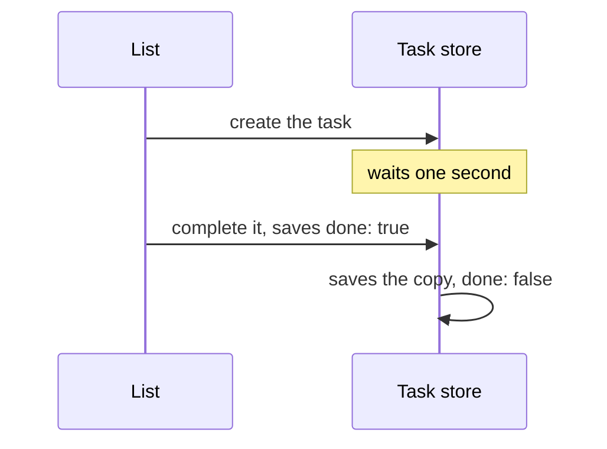

# Clarifications, round 01: Completed tasks reappear after reload

> [!IMPORTANT]
>
> 2 questions, about 10 minutes.
>
> - Verdict: worth building as proposed: the cause is found, and the fix stays in the task store.
> - The same cause loses a new task entirely when the page reloads within a second. Fixing it too
>   widens the change beyond your report.
> - A save that fails is silent today. Telling users adds a message to the list.
> - The slow save on completion is left out of this change, and noted in the inbox: check it.

## Context

### Goal

The [proposal](proposal.md) reports that a task completed right after its creation is not completed
anymore after a reload. It should stay completed.

### Today

A new task shows in the list at once, but [`createTask`](/src/store/tasks.ts) saves it one second
later. The wait lets the title's typing finish before the save. The save writes a copy of the task
taken when it was created, with `done: false`.

Completing the task within that second saves `done: true` first. The delayed save then writes the
old copy over it:

This is why it does not happen every time: only a completion within the first second loses its save.
Firefox and Chrome behave the same.

### Scope

The completion of a new task, and what the two questions below decide. Other saves of the store stay
as they are.

### Sources

- The [task store](/src/store/tasks.ts) and its tests, and the
  [task row](/src/components/TaskRow.tsx) that calls it.
- The [task storage](../../decisions/task-storage.md) decision, which keeps every save in the store.
- MDN on [IndexedDB transactions](https://developer.mozilla.org/en-US/docs/Web/API/IDBTransaction),
  for what a reload does to a save.

## Q1: Should the change also save a new task at once?

The one-second wait has a second effect. A task created less than a second before a reload is never
saved: it is gone after the reload, title included. Your report does not mention it, but the same
wait causes it.

Saving the task at once, then its title edits after the wait, fixes both. The completion then always
finds the task saved.

Why it matters: it decides whether this change fixes one symptom or the cause, and how much it
touches.

- **A (recommended). Save a new task as soon as it is created, and keep the one-second wait for its
  title edits only.**
  - [pro] fixes both the lost completion and the lost task, at their cause.
  - [con] one more save per new task, about 2 ms.
  - Why recommended: the cause is the same, and a fix of the completion alone leaves the wait in
    place.
- **B. Keep the wait, and make the delayed save write the task as it is then, not the old copy.**
  - [pro] the smallest change, within your report.
  - [con] a task created just before a reload is still lost. It would go to the inbox.

**Answer:**

## Q2: What should users see when a save fails?

A save can fail when the browser's storage is full, or in some private windows. Today the failure is
dropped: the task looks completed, and comes back after a reload. Users get no sign that anything
went wrong, which looks like the bug you reported.

Why it matters: it decides whether users learn that their change was not kept, at the cost of a new
message in the list.

- **A (recommended). Undo the change on screen, and show "Not saved: your browser's storage may be
  full" at the bottom of the list for a few seconds.**
  - [pro] users see at once that the change was not kept, in plain words.
  - [con] a new message in the list, for a rare case.
  - Why recommended: a silent failure is the same symptom as this bug, and the message adds no
    screen.
- **B. Keep failures silent, as today.**
  - [pro] nothing new in the interface.
  - [con] a failed save still looks like this bug, with no way to tell them apart.

**Answer:**

## Settled without the human

### Check these

- **The slow save on completion** is left out: completing a task rewrites all 5,000 tasks in about
  300 ms. It slows every completion, and fixing it changes how tasks are stored, beyond your report,
  so it is noted in the inbox.

### Behaviour

- **A title typed in the first second** still saves once typing stops, as today, whatever the answer
  to the first question.

### Under the hood

- **The reproduction test** creates a task, completes it 100 ms later, then reopens the store. It
  fails today, and passes with the fix.

**Notes:**
