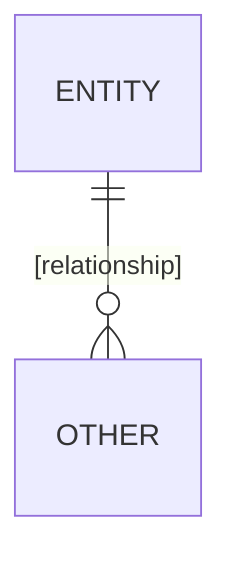

# Data model: [Feature name]

The stored data and file formats that [the spec](spec.md) adds or changes. Internal types are the
plan's.

[Optional: a `mermaid` diagram, only for relationships between three or more entities, or state
transitions.]

## [Entity]

| Field | Type | Meaning | Change                            |
| ----- | ---- | ------- | --------------------------------- |
|       |      |         | [New, Changed, Removed, or empty] |
