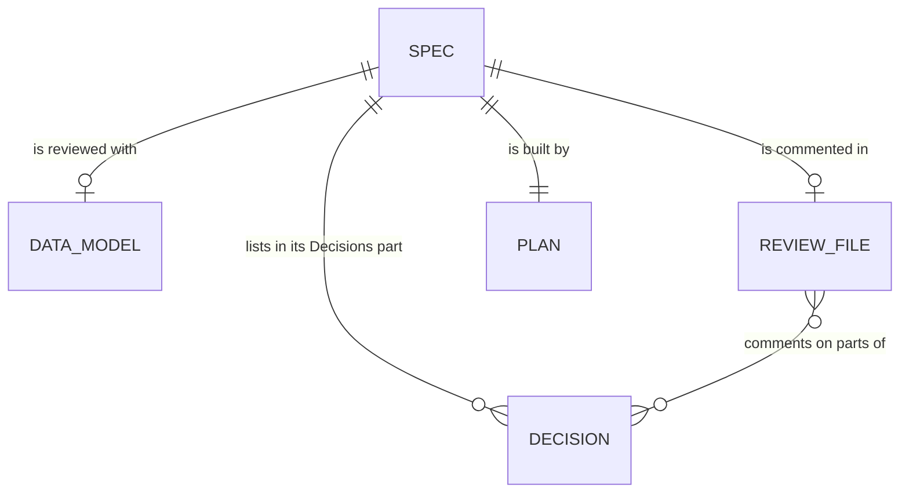

# Data model: Redesign and reword specs

The files that the [spec](spec.md) adds or changes, and the warnings `ura check` prints. Agents and
humans write these files; the core reads them.



## Spec file

The sections of `spec.md`, in order. "Change" compares with today's template.

| Section                    | Holds                                                                         | Change  |
| -------------------------- | ----------------------------------------------------------------------------- | ------- |
| frontmatter                | `status`, `revision`, `clarifications`, `risk-tier`, `plan-review`            |         |
| `# Spec: <name>`           | the title                                                                     |         |
| `> [!IMPORTANT]` block     | the time, then at most 7 items, the first starting "You approve"              | Changed |
| `## Your review`           | revision 2 on: one item per comment of the last review, with its answer       | New     |
| `## Decisions`             | the new, changed, and removed decisions, then a "Relied on" table             | Moved   |
| `## User stories`          | `### US1: <title> (P1)` stories, each with key and more scenarios             | Changed |
| `## Edge cases`            | a table: situation, what happens                                              | Changed |
| `## Success criteria`      | `SC-001` items                                                                |         |
| `## Architecture`          | the units, where each rule lives, the tradeoffs, a diagram for a flow         |         |
| `## Assumptions`           | a link to the settled points, then what the spec step settled                 | Changed |
| `## Constitution check`    | a one-row table of the principles, then a line per tension                    | Changed |
| `## Risk tier`             | the tier and its reason                                                       |         |
| `## History`               | optional: the records of earlier reviews, oldest last                         | New     |
| `## Mockups`, `## Details` | gone: mockups sit in their story, details move to the plan and the data model | Removed |

A story's parts:

| Part                | Holds                                                       | Change  |
| ------------------- | ----------------------------------------------------------- | ------- |
| journey             | one or two sentences                                        |         |
| story link          | the story's mockup, alone in its paragraph                  |         |
| "Why this priority" | optional: only when the order is not obvious                | Changed |
| "Key scenarios:"    | a numbered list of two or three **Given**/**When**/**Then** | New     |
| "More scenarios:"   | optional: the other scenarios, folded on the page           | New     |

A `## Your review` item:
`- **C2** (<the comment in a few words>): <done or declined>. <what was done, or why not>.` Its
number is the comment's in the last review file.

A `## Decisions` item:
`- **<New or Changed>: [<title>](../decisions/<name>.md)**. <One sentence: the rule, or what changed.>`
A removed decision's file is gone, so its item names it without a link:
`- **Removed: <title>** (\`<name>.md\`). <Why.>` The "Relied on" table has two columns: the
decision, linked, and what it means for this spec. Only the items count as listed, not the table's
links.

## Decision file

The headings stay. What changes is how a change is written and how long a decision is.

| Part                            | Rule                                                                   | Change  |
| ------------------------------- | ---------------------------------------------------------------------- | ------- |
| `status`                        | `proposed` on the branch, new or changed, until approval sets `active` | Changed |
| `approved-by`                   | empty while `proposed`; the approver, set at approval                  | Changed |
| intent                          | two or three sentences, before `## Rules`                              | Changed |
| `## Rules`                      | one sentence each, ending "Checked by ..."; a warning past 10          | Changed |
| `## Why`                        | a few sentences, with descriptive links                                | Changed |
| `## Proposed change (<folder>)` | gone: the spec step edits the file on its branch                       | Removed |

A decision's change is the difference between its file on the feature's branch and at the merge base
of the branch and the default branch. Both versions are cut into parts, each a paragraph or a list
item with its lines joined, so a rewrap is no change. Two parts are the same part when they sit in
the same section and keep at least 60% of the shorter one's words: they compare word by word.
Otherwise, one is new and the other removed.

## Review file comment on a decision

A comment of `spec-review.md` can point into a decision the spec lists:

```markdown
## C4: Decision task-storage, lines 20–21, under "Rules"

> > - An upgrade that cannot read a saved value MUST clear it and log it, and MUST NOT delete a
> >   task.

Log it where the user can see it, not only in the console.
```

The line numbers are those of the decision's file at the review's `commit`. A comment on a removed
part points to the default branch's lines, with `removed` after the lines.

## Data model file

`data-model.md` is written by the spec step, next to the spec, whenever the feature adds or changes
stored data or a file format, at any size. Internal types are the plan's.

| Part              | Rule                                                                        |
| ----------------- | --------------------------------------------------------------------------- |
| `## <Entity>`     | one section per entity, file, or format                                     |
| table             | field, type, meaning, and change: new, changed, removed, or empty           |
| `mermaid` diagram | only for relationships between three or more entities, or state transitions |

## Check findings

The warnings come from the clarifications redesign's `check/writing` module. This feature adds:

| Code                  | When                                                            | Message                                                 |
| --------------------- | --------------------------------------------------------------- | ------------------------------------------------------- |
| `spec.length`         | a waiting spec's reviewed part is over 2,500 words              | "the spec's reviewed part is 3,100 words: aim at 2,000" |
| `block.items`         | a waiting spec's block has more than 7 items                    | "the block has 8 items: keep at most 7"                 |
| `decision.rules`      | a decision has more than 10 rules                               | "12 rules: keep at most 10, or split the topic"         |
| `decision.unapproved` | a decision changed on a branch after its spec's approval commit | "git.md changed after the spec's approval"              |

The reviewed part of a spec is every section but "More scenarios" lists and `## History`. The
approval commit is the branch's commit whose spec first reads `status: approved`.
