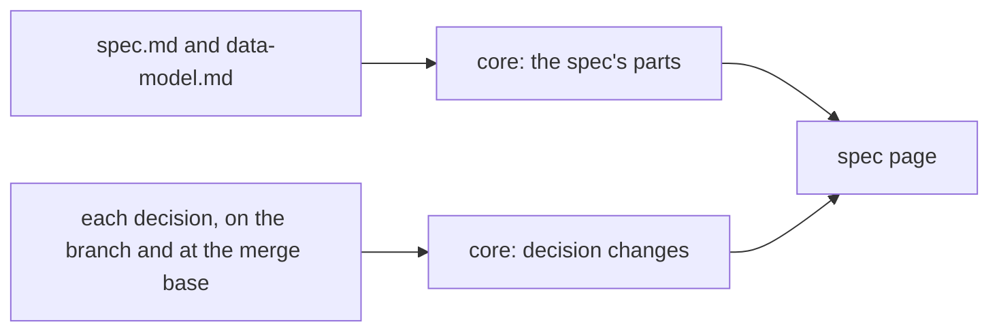

# Spec: Redesign and reword specs

> [!NOTE]
>
> Approved on 2026-10-17.
>
> - You approve specs that open with what you approve, then the decisions with their changes marked
>   in place, then the stories as cards. You also approve all 18 decisions, rewritten intent first.
> - New story: US8, "The parts after the stories read at a glance". The block's time counts what
>   changed since your review.

A spec becomes a page you approve in one sitting, without opening anything else. What you approve
comes first, then the decisions, each change shown in place, then the stories as cards, the data,
and the rest. Agents write it from one writing reference, with the build details moved to the plan.
Decisions become short statements of intent, created only from your answers. This spec is the last
one written in today's format. See the [proposal](proposal.md), [discovery](discovery-01.md), and
[clarifications](clarifications-01.md).

## Your review

- **C1** (a decision's width): done. A decision reads at the page's measure, wherever it is drawn.
- **C2** (no strikethrough): done. A rule removed whole is tinted red, readable, never struck.
  Removed words inside a changed rule are tinted red with a dotted underline, not struck either: a
  second cue besides colour, which accessibility requires.
- **C3** (hierarchy and icons for rules): done. A decision's intent is its largest text. Each rule
  has an icon of its strength, its check on a muted line, and rules come strongest first. Four
  decisions were reordered so.
- **C4** (title before the pills): done. Every card's title comes before its pills.
- **C5** (edge cases' importance): done. Edge cases carry an importance, high, normal, or niche, and
  the niche ones fold.
- **C6** (a drawing for each part): done. Each part after the stories has its own format and
  drawing. Risk and the constitution move up into what you approve.

## Decisions

Changed, applied when this spec is approved: all 18, rewritten intent first, as you asked. Each is
`proposed` on this branch. `git diff main -- specs/decisions/` shows every change until this
feature's view exists.

- **Changed: [Agents](../decisions/agents.md)**. 2,217 → 693 words, 14 → 10 rules: rules merged by
  concept; the session's field list and history dropped.
- **Changed: [Attachments](../decisions/attachments.md)**. 762 → 539 words, 9 → 7 rules: encoder
  settings left to the core's tests; limits and headers kept.
- **Changed: [CLI](../decisions/cli.md)**. 742 → 549 words, 10 → 9 rules: same rules, each with its
  check; examples of target names dropped.
- **Changed: [Code quality](../decisions/code-quality.md)**. 674 → 445 words, 9 → 7 rules: the four
  limits and marker forms kept; lint rule names dropped.
- **Changed: [Distribution](../decisions/distribution.md)**. 847 → 519 words, 8 → 8 rules: same
  rules; history and smoke-test details dropped.
- **Changed: [Git](../decisions/git.md)**. 1,540 → 611 words, 19 → 10 rules: 19 rules become 10
  concepts; every data-safety guarantee kept.
- **Changed: [Notifications](../decisions/notifications.md)**. 584 → 389 words, 8 → 5 rules: the
  list of what notifies left to its tests.
- **Changed: [Preview](../decisions/preview.md)**. 658 → 475 words, 9 → 7 rules: rules point to its
  two fields; stays `active` for this branch's Storybook.
- **Changed: [Repositories](../decisions/repositories.md)**. 860 → 452 words, 8 → 7 rules: name and
  colour limits left to the core; now says sign-in protects the server.
- **Changed: [Settings](../decisions/settings.md)**. 813 → 540 words, 9 → 8 rules: now says where
  the data folder is; its file list dropped.
- **Changed: [Sign-in](../decisions/sign-in.md)**. 832 → 614 words, 11 → 9 rules: every guarantee
  kept; the key's prefix and file name left to tests.
- **Changed: [Stack](../decisions/stack.md)**. 1,661 → 669 words, 14 → 10 rules: every boundary and
  security rule kept; exact paths shortened.
- **Changed: [Toolchain](../decisions/toolchain.md)**. 1,574 → 620 words, 18 → 10 rules: history and
  tool lists dropped; the `--workspace` trap kept.
- **Changed: [TUI](../decisions/tui.md)**. 398 → 341 words, 5 → 5 rules: same rules, each with its
  check.
- **Changed: [UI behaviour](../decisions/ui-behaviour.md)**. 1,857 → 554 words, 20 → 9 rules: UI
  strings, row heights, and timings dropped; errors, hover, keys kept.
- **Changed: [UI checks](../decisions/ui-checks.md)**. 759 → 451 words, 7 → 5 rules: viewport sizes
  left to the config; the investigation in one line.
- **Changed: [UI components](../decisions/ui-components.md)**. 578 → 364 words, 9 → 6 rules: the
  component list dropped; lint-checked rules merged.
- **Changed: [UI layout](../decisions/ui-layout.md)**. 1,372 → 550 words, 14 → 9 rules: concepts
  first, as you asked; the sidebar card's details dropped.

Relied on:

| Decision                                       | What it means for this spec                                      |
| ---------------------------------------------- | ---------------------------------------------------------------- |
| [Stack](../decisions/stack.md)                 | the core owns the format and the comparison; the page draws them |
| [UI layout](../decisions/ui-layout.md)         | "Contents" folds and resizes, its state kept in the browser      |
| [UI components](../decisions/ui-components.md) | Astryx `Card`, `Badge`, `Link`, `Collapsible`, StyleX tokens     |
| [Git](../decisions/git.md)                     | the merge base's version is read with gix, never checked out     |
| [Preview](../decisions/preview.md)             | the mockups are stories over the fixture server                  |
| [UI checks](../decisions/ui-checks.md)         | browser tests at both sizes, axe, and screenshots                |
| [Code quality](../decisions/code-quality.md)   | `document.rs`, `Blocks.tsx`, and `ReviewPage.tsx` split first    |

## User stories

### US1: An agent writes a spec in the new shape (P1)

The spec opens with its block, then the answers to your last review, then the decisions, then the
stories. Its data goes to `data-model.md`, written with it, and its build details to the plan. The
reviewed part is everything a reviewer reads by default: all but "More scenarios" and "History".

Key scenarios:

1. **Given** a spec whose `## Decisions` comes after `## User stories`, **When** `ura check` runs,
   **Then** it reports `sections.order` for "Decisions".
2. **Given** a spec waiting for review whose reviewed part is 3,100 words, **When** `ura check`
   runs, **Then** it warns `spec.length` "the spec's reviewed part is 3,100 words: aim at 2,000",
   and exits with success.
3. **Given** the skill's example spec and its `data-model.md`, **When** `ura check` runs, **Then**
   it reports neither a problem nor a warning.

More scenarios:

1. **Given** a spec with a `## Details` section, **When** `ura check` runs, **Then** it reports
   `sections.unknown` for "Details".
2. **Given** a spec waiting for review whose block has 8 items, **When** `ura check` runs, **Then**
   it warns `block.items` "the block has 8 items: keep at most 7".

### US2: Decisions come first, each change marked in place (P1)

After what you approve, each decision is a card: its title, its pills, its intent in large text,
then its rules, strongest first, each with its strength's icon and its check on a muted line. A
changed one marks added words green and underlined, removed words red with a dotted underline, never
struck. Unchanged parts fold behind a count, removed parts behind "N removed". You comment on any
part.

[Decision change](/packages/web/src/mockups/DecisionChange.stories.tsx#Change)

Key scenarios:

1. **Given** a branch where task storage's second rule reads "every earlier version" instead of "the
   previous version", **When** you open the spec, **Then** that rule shows "every earlier" green and
   underlined, and "the previous" red with a dotted underline, unstruck, under a "Changed" badge.
2. **Given** a branch that merges task storage's second rule into its first, **When** you tap "1
   removed", **Then** the merged-away rule shows whole on a red tint, unstruck.
3. **Given** a changed decision card, **When** you tap its third rule and save "Log it where I can
   see it", **Then** `spec-review.md` holds a comment headed
   `## C1: Decision task-storage, lines 19–20, under "Rules"`.

More scenarios:

1. **Given** a decision whose rules hold a MUST, a SHOULD, and a MUST NOT, **When** you open its
   card, **Then** each rule shows its icon: two chevrons up, one chevron up, two chevrons down,
   named "Must", "Should", and "Must not" for screen readers.
2. **Given** a decision whose second rule is a MUST after a SHOULD, **When** `ura check` runs,
   **Then** it warns `decision.order` "a MUST rule after a SHOULD one: put the strongest first".
3. **Given** a window 1440 px wide, **When** a decision card draws, **Then** its text lines hold at
   most 75 characters.
4. **Given** a decision paragraph rewrapped without a word changed, **When** you open the spec,
   **Then** that paragraph counts as unchanged.
5. **Given** a spec's link to `../decisions/task-storage.md#rules`, **When** you follow it, **Then**
   the decision opens as the branch has it, at its rules, with its change marked.
6. **Given** a branch that changes `due-dates.md` without listing it in `## Decisions`, **When** you
   open the spec, **Then** a "Changed" card for it shows, marked "Not listed in the spec".
7. **Given** a change's round whose question links a decision the change edits, **When** you open
   the round, **Then** the link opens the decision with its change marked.

### US3: Stories read as cards (P1)

Each story is a card: its id and priority, its title, its journey, its mockup live, then two or
three key scenarios as Given, When, and Then rows. The others wait behind "N more scenarios". The
big mockup buttons are gone.

[Spec page](/packages/web/src/SpecPage.stories.tsx#Waiting)

Key scenarios:

1. **Given** a story with 2 key scenarios and 3 more, **When** you open the spec at 1440 px,
   **Then** its card shows 2 scenarios and the button "3 more scenarios".
2. **Given** that card, **When** you tap "3 more scenarios", **Then** the 3 others show, and the
   button reads "Fold the other scenarios".
3. **Given** a spec whose stories link three Storybook stories and one HTML mockup, **When** you
   open it, **Then** no "Open the mockup" button shows above the stories, the three stories show
   live in their cards, and the HTML mockup is a link in its card.

### US4: Your last review comes back answered (P2)

On a revision, the card "Your review, answered" shows each comment of your last review with its
quote, your words, and its answer, done or declined. Earlier review records move to "History" at the
end, folded. The spec page's mockup shows a revision 2.

Key scenarios:

1. **Given** a revision whose `## Your review` holds
   `- **C2** (undo too short): done. The undo stays 5 seconds.`, **When** you open it, **Then** the
   card shows your second comment's quote and text, a "done" badge, and "The undo stays 5 seconds."
2. **Given** a revision 3, **When** you open it, **Then** the block is the only record above the
   first part, and "History" holds the two earlier records, folded.

### US5: You move through a long spec easily (P2)

On a wide screen, the "Contents" column lists every part, decision, and story, with comment counts,
and holds Approve and Request changes. On the phone, the parts lose their cards and take the
screen's width. Bands separate the groups, and each part's title sticks at the top under its
breadcrumbs, as a round's question does.

Key scenarios:

1. **Given** a window 1440 px wide, **When** you open a waiting spec, **Then** "Contents" lists
   "What you approve", "Your review, answered", "Decisions", each decision, "What changes for
   users", each story, "Data", "Architecture", "Edge cases", "Success criteria", and "Assumptions",
   with Approve at its foot.
2. **Given** a window 402 px wide, **When** you scroll into US2's scenarios, **Then** "What changes
   for users" and "US2 Complete a repeating task" show at the top of the screen.
3. **Given** a window 402 px wide, **When** you open the spec, **Then** no part has a card, and text
   runs to 12 px from the screen's edges.

More scenarios:

1. **Given** 2 pending comments on US1, **When** you open the spec at 1440 px, **Then** US1's entry
   in "Contents" shows "2".
2. **Given** "Contents" hidden with `]`, **When** you reload the page, **Then** it stays hidden, and
   Approve and Request changes show at the end of the page.

### US6: Decisions stay short, and every line is one you approved (P1)

The spec step creates or changes a decision only from a question you answered, or a review comment
asking for it. It edits the file on the branch, intent first, specifics only where they are hard
constraints, and marks it `proposed`. History and investigation stay in the feature's record.

Key scenarios:

1. **Given** a decision with 12 rules, **When** `ura check` runs, **Then** it warns `decision.rules`
   "12 rules: keep at most 10, or split the topic", and exits with success.
2. **Given** an approved spec listing a new and a changed decision, both `proposed`, **When** the
   approval step runs, **Then** both become `active`, with the approver when it is known.
3. **Given** a branch whose spec was approved at a commit, **When** a later commit on the branch
   edits `git.md`, **Then** `ura check` warns `decision.unapproved` "git.md changed after the spec's
   approval".
4. **Given** a decision with a `## Proposed change (<folder>)` section, **When** `ura check` runs,
   **Then** it reports `sections.unknown`.

### US7: Small fixes: your place while commenting, and the edit box (P3)

Commenting no longer moves the text you read. The edit box of a proposal or a draft shows its text
without the frontmatter, which the controls above it set.

Key scenarios:

1. **Given** a spec scrolled so that US2's heading is at the top, **When** you tap a block of US2,
   type, and save a comment, **Then** US2's heading stays where it was on screen, within 4 px.
2. **Given** a story frame above the screen that grows from 560 px to 700 px, **When** it draws,
   **Then** the text on screen moves by at most 4 px.
3. **Given** a proposal with `discovery: high` in its frontmatter, **When** you open it in the
   editor, **Then** the text box starts at its title, and saving keeps `discovery: high`.

### US8: The parts after the stories read at a glance (P2)

What you approve holds the time and the risk tier as pills, the "You approve" sentence large, and
the constitution as a strip of principles. After the stories and the data come "How it is built, and
its limits": the architecture, the edge cases, the success criteria, and the assumptions, each drawn
for what it holds.

Key scenarios:

1. **Given** edge cases rated 2 high, 1 normal, and 2 niche, **When** you open the spec, **Then**
   the high ones show first, then the normal one, then "2 niche cases", folded.
2. **Given** the criterion `- **SC-001** (two clicks): Setting a preset repeat takes two clicks.`,
   **When** you open the spec, **Then** it shows the pills "SC-001" and "two clicks", then its
   sentence.
3. **Given** an architecture with three units and two tradeoffs, **When** you open the spec at 1440
   px, **Then** the units show as three small cards side by side, and each tradeoff with a "Cost"
   pill.
4. **Given** a constitution check whose third principle reads ⚠️, **When** you open the spec,
   **Then** "What you approve" shows that principle's pill with a warning icon, the others with a
   check.

More scenarios:

1. **Given** an edge case whose importance reads "Urgent", **When** `ura check` runs, **Then** it
   reports `edges.importance` "importance is high, normal, or niche".
2. **Given** a data table with a "Change" column, **When** you open the spec, **Then** "New",
   "Changed", and "Removed" show as green, yellow, and red pills.

## Architecture

The format has one owner, the core, and the skill describes it once. A decision's change is never
written down: the core computes it from git, comparing the decision on the branch with the default
branch's, at their merge base. The page draws the core's parts as cards. See the
[discovery's approaches](discovery-01.md#approaches).

- **The skill** holds the spec's order, the decision shape and its creation rule, and the plan's
  test map. The writing reference, from the clarifications redesign, gains the limits of specs and
  decisions.
- **The core** reads the spec's parts, the review answers, and the stories' key scenarios. A new
  module compares a decision's two versions by paragraph and list item, then word by word.
  `ura check` gains the warnings.
- **The web** splits the review page into its groups, a decision card, a story card, and the
  "Contents" column. An approved spec draws the same page, read-only.
- **Where each rule lives**: the format in the templates and the core's parser; the limits in the
  writing reference, measured by the core's `check/writing` module; a decision's change in the
  core's comparison; the card layout in one panel component.

Tradeoffs:

- A large feature across the skill, the core, and the web.
- Every spec and decision in the old format fails `ura check` until rewritten.

## Edge cases

| Importance | Situation                                                     | What happens                                                              |
| ---------- | ------------------------------------------------------------- | ------------------------------------------------------------------------- |
| High       | A rule rewritten from scratch                                 | under 60% of its words kept: it shows as new, the old one as removed      |
| High       | A decision the branch deletes                                 | a "Removed" card, its old text tinted red, unstruck; the item has no link |
| High       | The default branch changes a decision after the branch starts | the card compares with the merge base, so only the branch's edits show    |
| High       | A spec or decision in the old format on a branch in flight    | it fails `ura check` until an agent rewrites it                           |
| Normal     | The branch merges the default branch in                       | the merge base moves, and the card compares with the new one              |
| Normal     | A revision of the spec                                        | each card shows the whole change against the merge base                   |
| Normal     | A comment on a removed part                                   | it points to the default branch's lines, with `removed` after them        |
| Normal     | A spec at revision 1                                          | no "Your review, answered" card                                           |
| Normal     | An approved spec                                              | the same page, read-only; "What you approve" holds the approval record    |
| Niche      | A decision listed as changed, equal to the default branch's   | its card says "No change against the default branch"                      |
| Niche      | A comment's lines changed after the review's commit           | it keeps its quote, as line comments do today                             |
| Niche      | A story without "More scenarios:"                             | no fold button                                                            |
| Niche      | A draft's unsaved text, kept from before this change          | its frontmatter is split off when the editor opens it                     |

## Success criteria

- **SC-001**: The skill's example spec has at most 2,000 words in its reviewed part, and passes
  `ura check` with no problem and no warning.
- **SC-002**: Every decision in `specs/decisions/` holds at most 10 rules. The 18 rewritten here
  hold at most 9,400 words together, against 18,728.
- **SC-003**: Opening a spec whose branch changes 5 decisions takes at most 200 ms longer on the
  server than today.
- **SC-004**: The spec page passes axe in light and dark, at 402 × 874 and 1440 × 900, with a
  decision change, a review answered, the niche edge cases, and every fold open.

## Assumptions

The points settled in the [clarifications](clarifications-01.md#settled-without-the-human) hold as
written there, with your two notes: the constitution check is a one-row table of check marks, and
"Relied on" is a table of each decision and what it means for the spec. Three points read
differently:

- Plans keep a one-row constitution check, against the settled point: the constitution requires one
  in every plan.
- The opening block counts "You approve" among its 7 items.
- The sticky title with breadcrumbs is for the phone, as a round's is. A wide screen has "Contents".

Settled while writing this spec:

- `data-model.md` is written by the spec step whenever stored data or a file format changes, at any
  size, and shown after the stories as "Data". Internal types go to the plan.
- Two parts are the same part when they sit in the same section and keep at least 60% of the shorter
  one's words. Otherwise, one is new and the other removed.
- The approval step activates every `proposed` decision the spec lists, new or changed, and records
  the approver when it is known. The approval's commit is where `decision.unapproved` starts.
- Rules come strongest first: MUST and MUST NOT, then SHOULD and SHOULD NOT, then MAY. Within a
  strength, the spec step orders them by importance; `ura check` only checks the strengths.
- The parts after the stories follow the order architecture, edge cases, success criteria,
  assumptions, under "How it is built, and its limits". The file keeps the same order.
- The spec step rates each edge case: high when it can lose data or mislead, niche when few users
  meet it, normal otherwise.
- A criterion's measure is the few words in parentheses after its id, and is optional.
- The plan gains a `## Test map`: each scenario, edge case, and criterion with its test.
- The time estimate counts the reviewed part at 250 words a minute, plus a minute per mockup and per
  changed decision, rounded up to 5.
- Scenarios keep at most 4 steps. "Why this priority" stays only where the order is not obvious.
- No diff dependency: the comparison is a small module of the core's own, in the style of
  [`files/lines.rs`](/crates/core/src/files/lines.rs)'s line diff.
- The reading measure inside cards is 75 characters. The UI layout decision once set a 70-character
  column aside as too slim for an empty desktop, and the cards and "Contents" fill it now.
- The rewritten decisions keep their headings, so the 26 records stay valid.
- Compatibility and diagrams, the clarifications redesign's two decisions, already fit the shape,
  and keep the text you approved there.
- The writing reference states the split rule: past 6 stories, 30 scenarios, or 2 changed decisions,
  the discovery proposes a split.
- Branches in flight that this format makes fail `ura check` when they next move:
  `2026-10-17-access-storybook`, with a spec and a `## Proposed change` on stack, and
  `2026-10-17-redesign-clarifications`, with a spec and a plan. Whichever of this feature and
  access-storybook merges second folds the other's stack rule in.
- Components, error handling, and testing are in the [plan](plan.md): its tasks, and its
  [test map](plan.md#test-map).

The mockups:

- [Spec page](/packages/web/src/SpecPage.stories.tsx#Waiting): a revision 2 of the skill's recurring
  tasks, rewritten. It holds what you approve, your review answered, new, changed, removed, and
  unlisted decisions, four story cards, the data model with its change pills, then the architecture,
  edge cases by importance, success criteria, assumptions, and "History". On a wide screen,
  "Contents" with comment counts; on the phone, sticky titles with breadcrumbs.
- [Decision change](/packages/web/src/mockups/DecisionChange.stories.tsx#Change): task storage with
  a reworded rule, a new rule and consequence, unchanged parts folded, and a rule merged away under
  "1 removed", each rule with its strength's icon, at the page's measure.

Each story's mockup shows as a box with its name: the real page embeds it live. The strength icons
are Lucide's chevrons, drawn in the mockup: the implementation adds them to the theme's icons. The
decision texts come from constants, since the server cannot read a branch's decisions yet.

## Constitution check

| I. Humans in control | II. Plain text | III. Async | IV. Review effort | V. Tools optional | VI. Checked code |
| :------------------: | :------------: | :--------: | :---------------: | :---------------: | :--------------: |
|          ✅          |       ✅       |     ✅     |        ✅         |        ✅         |        ✅        |

Principle V holds with a cost: without Uraeda, a decision's change shows only as a git diff, which
any git tool draws.

## Risk tier

**High**: it rewrites every decision, and changes the format of every spec, plan, and decision.

## History

> [!NOTE]
>
> Changes requested on 2026-10-17: 6 comments in spec-review.md.
>
> - You approve specs that open with what you approve, then the decisions with their changes marked
>   in place, then the stories as cards. You also approve all 18 decisions, rewritten intent first.
> - The rewrites take the decisions from 18,728 words to 9,375, and from 201 rules to 141. Security
>   and data-safety guarantees stay. Each row of the decisions table says what its rewrite dropped.
> - Each rewritten decision is `proposed` on this branch until you approve, as you chose. The
>   preview decision stays `active`, since this branch's Storybook runs only with an active one.
> - New, from your "every line approved by a human": `ura check` warns when a branch edits a
>   decision after its spec's approval.
> - Removed parts of a decision fold behind "N removed" at the end of their section. They count
>   parts, rules or paragraphs, not lines.
> - Unverified: keeping your place while commenting relies on scroll anchoring in Safari. The plan's
>   first task checks it, and the page keeps your place itself if it fails.
> - This spec breaks its own limits: 7 stories and 18 changed decisions are past the split
>   threshold, and its reviewed part is about 3,900 words. Risk tier `high`, since it rewrites every
>   decision; the plan does not wait.
