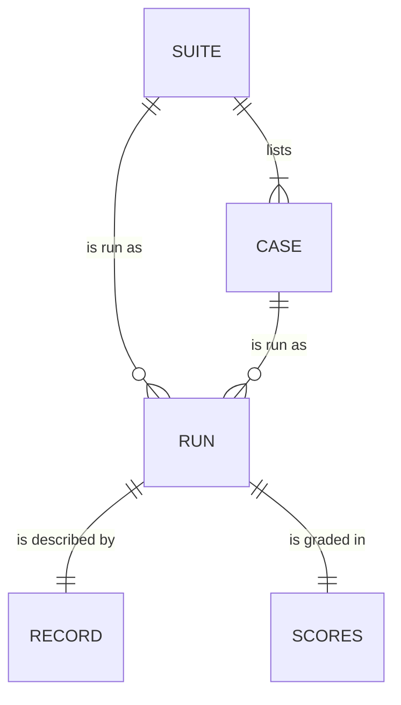

# Data model: Benchmarks

The files [the spec](spec.md) adds: a suite, a case, and each run's record and scores. All are plain
text in git, under `benchmarks/`. Internal types are the plan's.

## Suite

`benchmarks/suites/<suite>.toml`: what a benchmark runs, so many suites can sit side by side over
months.

| Field       | Type                  | Meaning                                                | Change |
| ----------- | --------------------- | ------------------------------------------------------ | ------ |
| `cases`     | list of case ids      | the cases the suite runs                               | New    |
| `arms`      | `"uraeda"`, `"plain"` | the arms run on each case, the plain one once per case | New    |
| `model`     | model id              | the model of every role, `claude-sonnet-5-5`           | New    |
| `effort`    | `low` to `max`        | the effort of every role                               | New    |
| `agent`     | adapter kind          | the harness, `claude` first                            | New    |
| `human`     | path and its commit   | the guidelines the simulated human follows             | New    |
| `max-steps` | whole number          | the loop guard: sessions before a run stalls           | New    |

## Case

`benchmarks/cases/<case-id>/`: one folder per case, with `case.toml` and its proposal.

| Field        | Type               | Meaning                                                  | Change |
| ------------ | ------------------ | -------------------------------------------------------- | ------ |
| `source`     | text               | the benchmark and its version, `swe-bench-pro-v2`        | New    |
| `task`       | text               | the task's instance id in that benchmark                 | New    |
| `image`      | text with a digest | the image the agent and the tests run in                 | New    |
| `upstream`   | URL                | the task's upstream repository, which runs must not read | New    |
| `repository` | path in the image  | where the repository sits, `/app`                        | New    |

- `proposal.md` is the task's title, description, requirements, and interface section, verbatim. It
  is the human's words that start the feature, the simulated human's whole knowledge, the plain
  arm's prompt, and the list the judge checks the spec against.

## Record

`benchmarks/runs/<date>-<suite>/<case-id>--<arm>--<n>/record.json`: how a run went, its facts.

| Field              | Type                           | Meaning                                                           | Change |
| ------------------ | ------------------------------ | ----------------------------------------------------------------- | ------ |
| `version`          | whole number                   | the record's format, `1`                                          | New    |
| `approved-by`      | text                           | who approved the run                                              | New    |
| `repository`       | commit and dirty flag          | this repository's state                                           | New    |
| `skill`            | commit and dirty flag          | the skill's state, taken from the commit                          | New    |
| `harness`          | name and version               | the adapter's kind and `claude --version`                         | New    |
| `models`           | asked, and answered            | the model asked for, and the names in each session's `modelUsage` | New    |
| `effort`           | text                           | the effort asked for                                              | New    |
| `human`            | model, guidelines commit       | the simulated human's model and persona version                   | New    |
| `task`             | source, id, image digest       | the case's task, as run                                           | New    |
| `started`, `ended` | timestamps                     | when the run began and ended                                      | New    |
| `outcome`          | text                           | `finished`, `stalled`, `usage-limit`, `failed`, or `invalid`      | New    |
| `steps`            | list of steps                  | each session, in order                                            | New    |
| `blocked`          | list of actions                | each action `auto` mode blocked, and the rule that allowed it     | New    |
| `urls`             | list of addresses              | each address the agents fetched, for the leak audit               | New    |
| `transcripts`      | list of file names and SHA-256 | the raw transcripts kept outside git                              | New    |

A step is one session:

| Field     | Type                                   | Meaning                                                             |
| --------- | -------------------------------------- | ------------------------------------------------------------------- |
| `role`    | `agent`, `human`, `judge`, or `plain`  | who ran                                                             |
| `step`    | text                                   | the workflow step `ura next --json` named                           |
| `seconds` | number                                 | the session's duration                                              |
| `cost`    | number and `reported` or `estimated`   | the session's cost, as Claude Code reports it                       |
| `tokens`  | input, output, cache read, cache write | the session's tokens                                                |
| `gate`    | text, or empty                         | what the human did at a gate: answered, approved, changes requested |

Costs are Claude Code's client-side estimates in dollars. Under a subscription they are what the
same tokens would cost on the API.

## Scores

`scores.json`, next to the record: the graders' results.

| Field          | Type                        | Meaning                                                              | Change |
| -------------- | --------------------------- | -------------------------------------------------------------------- | ------ |
| `tests`        | passed, total, and resolved | the hidden tests on the final diff, in a fresh container             | New    |
| `requirements` | covered, total, and items   | the judge's verdict per requirement of the proposal against the spec | New    |
| `rounds`       | whole number                | the rounds of questions the run asked                                | New    |
| `revisions`    | whole number                | the times the human requested changes                                | New    |
| `questions`    | whole number                | the questions asked                                                  | New    |

- A requirement's item is `covered`, `partial`, or `missing`, with the spec's line that covers it.
- The plain arm has `tests` only.
- The run's folder also holds `specs/`, a copy of the feature's folder at the end, and `final.diff`.
  The transcripts folder stays out of git.
- The results page reads these folders, and is generated at `benchmarks/report.html`, which git
  ignores.
