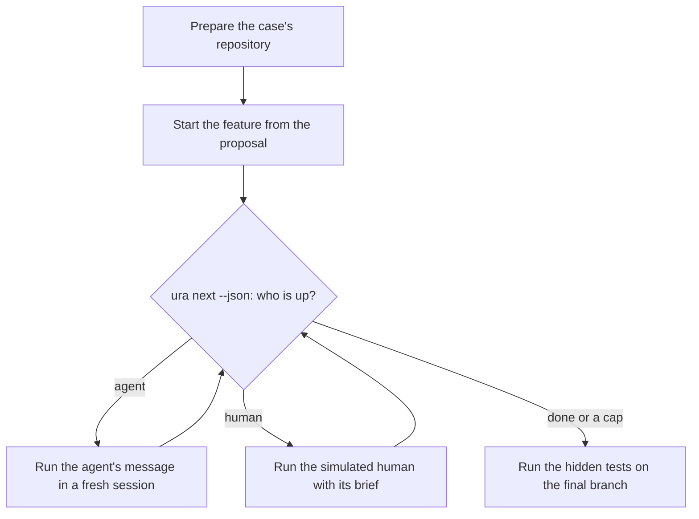

# Discovery, round 01: Benchmarks

## Summary

Benchmarking a coding workflow end to end needs five parts:

- **Tasks** with hidden, objective tests.
- **A runner** that drives the agent in an isolated environment.
- **A stand-in for the human**, for flows with human gates.
- **Metrics and a comparison**, so a result means something.
- **A results record** detailed enough to reproduce the run.

Most coding benchmarks are bug fixes with clear texts, which leave nothing to ask. A few 2026
benchmarks are feature-sized, with hidden requirements and a simulated user holding them. No
published benchmark runs a spec-driven workflow such as Spec Kit, BMAD, or superpowers against a
plain agent with hidden tests. Published scores for Claude are aggregates of one pass of a scaffold:
no per-task results were found, and no Opus 5.5 entry on the benchmarks that fit.

The [proposal](proposal.md) asks for 5 real cases, Claude Code in headless mode with Opus 5.5 as
agent and as the human, written behaviour guidelines for that human, a loose dependency on Claude
Code, and a `benchmarks` folder that holds results by skill SHA, model, and harness. It leaves open
what a run measures, what it is compared against, what the simulated human knows, and what is
committed.

This round replaces an earlier one, written when the repository held no code. Since then, the
server's runner, an agent adapter, a fake adapter, and `ura next --json` exist. The runner's
[agents decision](/specs/decisions/agents.md) names benchmarks in its **Applies to**. The loop of a
benchmark is therefore small: ask `ura next --json` who is up, run the agent or the simulated human,
repeat. Two things stand in the way: the adapter never passes a model or an effort, and the loaded
skill is whatever the working tree holds.

## How other products do it

These are benchmarks and evaluation tools. They are what the cases, the runner, and the simulated
human would reuse or follow. Facts marked "(snippet only)" were seen in search results, not on the
page.

### Feature-sized benchmarks

- **SWE-bench Pro V2** ([release](https://github.com/scaleapi/SWE-bench_Pro-os/releases/tag/v2.0.0),
  [dataset](https://huggingface.co/datasets/ScaleAI/SWE-bench_Pro),
  [gate rules](https://raw.githubusercontent.com/scaleapi/SWE-bench_Pro-os/main/v2/GATE.md)).
  - **Tasks:** released 2026-09-22. 642 tasks in 11 repositories: Go 256, Python 237, JavaScript
    145, TypeScript 4. HARD-51 is the subset that at least 2 of 5 model families failed
    ([ids](https://raw.githubusercontent.com/scaleapi/SWE-bench_Pro-os/main/v2/hard51_ids.txt)).
  - **Input:** `instruction.md` wraps a pull request description: title, description,
    `## Requirements`, and `## New Interfaces`. The dataset's fields are `problem_statement`,
    `requirements`, and `interface`. The tests are in each task's `tests/` folder, apart from the
    instruction.
  - **No leak in V2:** images are rebuilt from a sanitised bundle, with no fixing commit, stray
    refs, or stashes. DeepSWE's paper says V1 images kept the full history
    ([paper](https://arxiv.org/html/2607.07946v1)).
  - **Quality work in V2:** 529 problem statements rewritten so each graded assertion traces to the
    text, 69 contradictions fixed, and the reference patch passes 642 of 642 tasks and the empty
    patch 0.
  - **Images:** `ghcr.io/scaleapi/swe-bench_pro-v2:<instance_id>`, public, linux/amd64. A research
    agent summed the compressed layers of the 51 HARD tasks: 0.6 to 1.9 GB for most repositories,
    2.6 to 3.5 GB for teleport, 4.7 to 5.8 GB for Proton's webclients.
  - **Running:** the documented path is Harbor 0.22 or later on Modal, with a locked Claude Code
    agent that blocks the web. A local Docker run was not stated, and not tried.
  - **License:** the tooling is MIT, and each task keeps its upstream repository's license.
  - **Published Claude results**
    ([leaderboard](https://labs.scale.com/leaderboard/swe_bench_pro_public_v2)): Claude Code with
    Opus 5 at `xhigh` 98.00, with Fable 5.1 at 92.20. The page does not say whether the table is the
    full set or HARD. No Opus 5.5 entry, and no per-task scores.
- **DeepSWE** ([repository](https://github.com/datacurve-ai/deep-swe),
  [paper](https://arxiv.org/html/2607.07946v1),
  [leaderboard](https://deepswe.datacurve.ai/blog/deepswe)).
  - **Tasks:** 113 original tasks in 91 repositories (Python 34, Go 34, TypeScript 35, JavaScript 5,
    Rust 5), never merged upstream. Apache-2.0 for the authors' work, with permissive upstream
    licenses.
  - **Input:** `instruction.md` is a complete feature spec of about 2,158 characters, with goal,
    expected behaviour, constraints, and edge cases. The paper says ambiguous requests are largely
    excluded by construction. Each task also has a short `display_description` in `task.toml`.
  - **Size:** reference patches average 668 added lines in 7 files.
  - **Grading:** hand-written behaviour verifiers in a separate container, run with `pier` or
    Harbor's format. The paper reports a 1.4% disagreement with an LLM judge, against 32.4% for
    SWE-bench Pro's tests: that is the authors' own audit of a competitor.
  - **No leak:** the image's Dockerfile removes the remote, other branches, and the reflog.
    Environment: 2 CPUs, 8 GB of memory.
  - **Published results:** all on mini-swe-agent: Opus 5 at `max` 74% for $11.84 a task, Opus 4.8
    59%. No Claude Code entry, no Opus 5.5 entry, no per-task scores. A pilot of 10 SWE-bench Pro
    tasks scored Opus 4.7 at 50% on mini-swe-agent and 40% on Claude Code, which the authors call
    noise.
- **Others, read but less fitting:**
  - FeatBench ([paper](https://arxiv.org/html/2509.22237v2)): 157 Python tasks, a first-person
    request, median patch 18 lines, no Claude results.
  - Doc2Feat-Bench, formerly NoCode-bench ([paper](https://arxiv.org/html/2507.18130v3)): the input
    is the documentation change, Verified set of 114 Python tasks, old Claude results.
  - SWE-RPG ([paper](https://arxiv.org/html/2608.09072v1)) and ICAE-Bench
    ([paper](https://arxiv.org/html/2607.21217v1)): hidden requirements and a user agent. No stated
    license for either, and their images and leakage were not checked.
  - FeatureBench and FEA-Bench: snippet only. FeatureBench's 200 tasks are large, and FEA-Bench is
    older.
  - SWE-Lancer ([abstract](https://arxiv.org/abs/2502.12115)): web-app end-to-end tests and heavy
    images.
  - LoLBench, named in the earlier round: not found again, so it is not used.
- **Bug-sized benchmarks with clear texts** (SWE-bench Verified and variants) leave the questions
  step nothing to ask.

### Interactive benchmarks with a simulated user

- **SWE-Interact** ([paper](https://arxiv.org/html/2606.30573v1), Scale AI, June 2026): 75 tasks, 25
  each from SWE-bench Pro, SWE Atlas, and DeepSWE.
  - The simulated user starts vague, reveals requirements one at a time, and reads the workspace
    before approving. It never sees the tests.
  - Opus 4.8 scores 50.7% single-turn and 26.7% multi-turn, at $5.09 and $11.80 a trial.
  - Its persona, "busy colleague", is public in Harbor's example
    ([persona.md](https://github.com/harbor-framework/harbor/tree/main/examples/tasks/deepswe_tomlkit-toml-table-converters)).
- **Ambig-SWE** ([paper](https://arxiv.org/html/2502.13069)) and **Ask or Assume?**
  ([snippet only](https://arxiv.org/html/2603.26233)): the proxy holds the full original issue,
  answers only from it, briefly, and says "I don't have that information" otherwise, for at most 3
  turns.
- **AppWorld-UL** ([paper](https://arxiv.org/html/2607.20536)): the simulated user holds question
  and answer pairs and deflects otherwise. A manual review of 312 answers found 4 wrong.
- **SWE-Together** ([paper](https://arxiv.org/html/2606.29957)): built from real sessions, silent by
  default. A study of 156 trajectory pairs found annotators could not reliably tell it from real
  users: it passed 46% of the time.
- **UserBench** ([paper](https://arxiv.org/html/2507.22034)): a preference is revealed only for a
  concrete matching question, or after 3 turns without one.
- **ICAE-Bench**, above: a user agent answers from authored records, within 16 queries.

### Evaluation tools

- **Harbor** ([docs](https://docs.harborframework.com/)): about 40 agents, among them `claude-code`,
  `codex`, and `pi`. Apache-2.0.
  - **Skills:** `--skill` pins a git skill to its commit and records a content digest. It installs
    it as a user skill in the agent's configuration folder, not as a `--plugin-dir` plugin, so the
    skill's name would not be `uraeda:uraeda`.
  - **Steps:** a task lists its steps in `task.toml`, in a fixed order
    ([multi-step](https://docs.harborframework.com/tasks/multi-step.md)). A number of steps that
    depends on the human's answers cannot be written.
  - **Simulated user:** `--user-agent` and a persona file, talking to the target through a chat
    bridge, not by editing files and committing
    ([docs](https://docs.harborframework.com/jobs/simulate-a-user.md)). The docs call it slow: about
    50 minutes for the SWE-Interact example.
  - **Records:** trajectories in the [ATIF format](https://docs.harborframework.com/agents/atif.md),
    with tokens and cost. The on-disk layout of a job is not in the pages read.
- **Inspect AI** ([docs](https://inspect.aisi.org.uk/agents.html), MIT) with **inspect_swe**
  ([docs](https://meridianlabs-ai.github.io/inspect_swe/claude_code.html)): a solver can loop agent
  calls and edit state between them, so a dynamic loop is expressible. `claude_code()` runs in a
  sandbox, and a pinned version is a parameter. It has no `pi` agent. Whether it loads a
  `--plugin-dir` plugin was not confirmed.
- **`claude plugin eval`** ([docs](https://code.claude.com/docs/en/plugin-evals)): one prompt per
  case, 3 runs per case and arm by default, a baseline without the plugin, and regex, file, or LLM
  graders. Results go to `aggregate-result.json`, with cost, duration, and the Claude Code version.
  It cannot express a loop of steps and gates, and runs Claude Code only.
- **skill-creator** ([docs](https://code.claude.com/docs/en/skills)): the same with and without
  comparison for one prompt, plus a blind comparison. Read through the documentation only.
- **Result layouts.** [SWE-bench experiments](https://github.com/SWE-bench/experiments) keeps a
  `metadata.yaml` per entry and puts the large files in a separate repository. It leaves the agent's
  version out of its fields. [Inspect logs](https://inspect.aisi.org.uk/eval-logs.html) are one file
  per run, binary by default, with a JSON format. All of them record the model, the agent or harness
  version, the attempts, tokens and cost, timestamps, and a link to the transcript.

### What they have in common

Capabilities a workflow benchmark is expected to have, whether or not the proposal mentions them:

- Hidden, objective grading, run on the final state of the code.
- A comparison against a plain agent on the same tasks, because published scores come from different
  scaffolds.
- A simulated user with a hidden brief, rules against inventing or leaking, and a record of what it
  said.
- Isolation: a container per task, no future history, and an explicit network policy.
- Cost, tokens, and time, with caps.
- Everything pinned and recorded: agent, harness, model, effort, skill, task, and image.
- Kept trajectories, so failures can be read.

## Standards and libraries

### Claude Code in headless mode

Version 2.1.303 is installed here. Read from [headless](https://code.claude.com/docs/en/headless),
[model configuration](https://code.claude.com/docs/en/model-config),
[environment variables](https://code.claude.com/docs/en/env-vars),
[cost tracking](https://code.claude.com/docs/en/agent-sdk/cost-tracking), and `claude --help`.

- **Model and effort:** `--model claude-opus-5-5` needs 2.1.280 or later. The default effort is
  `medium`, and `--effort` takes `low` to `max`.
- **Fallback:** a request flagged for cybersecurity re-runs on Opus 4.8, one flagged for biology on
  Opus 5, and the session stays there. Software tasks rarely trigger it. `modelUsage` names the
  models that answered. `switchModelsOnFlag: false` or `CLAUDE_CODE_DISABLE_REFUSAL_FALLBACK=1`
  turns a flagged request into an error.
  ([support page](https://support.claude.com/en/articles/16049681-why-claude-switched-models-in-your-conversation-with-opus-5-or-opus-5-5))
- **Isolation:** `CLAUDE_CONFIG_DIR` moves settings, session history, plugins, memory, and the
  credentials file. A fresh folder with no credentials returns `is_error: true` with "Not logged in"
  at once, which a local probe confirmed. `--bare` skips CLAUDE.md, hooks, plugins and memory, and
  needs `ANTHROPIC_API_KEY`: it never reads the subscription token.
- **Authentication:** `ANTHROPIC_API_KEY` wins over `CLAUDE_CODE_OAUTH_TOKEN`, a one-year token from
  `claude setup-token`.
- **Permission mode:** a `-p` run with none set may start in `auto`, so it must be explicit.
- **Cost:** `total_cost_usd` and `modelUsage` are client-side estimates that include sub-agents. A
  resumed session reports the whole session's spend again, so results of resumed runs must not be
  added. In the streaming-input mode the server uses, they are cumulative for the process.
- **Skills:** a plugin skill is `/plugin:skill`, and the bare name works when it does not collide.
  Only the first skill on a line loads.
- **Caps:** `--max-budget-usd` works in print mode and may overshoot. `--max-turns` is absent from
  `claude --help` and from the documentation, though Harbor's adapter passes it.
- **Updates:** `DISABLE_AUTOUPDATER=1` stops background updates. `claude plugin eval` and the server
  read the version from `claude --version`.
- **Subscription or API key:** the
  [legal page](https://code.claude.com/docs/en/legal-and-compliance) says a subscription's sign-in
  is for "ordinary use of Claude Code", and that people building products or services should use API
  keys. A personal, local batch run is not named either way. A change that would move `claude -p` to
  a separate credit pool was announced for June 15 2026 and paused (snippet only).
- **Prices** ([pricing](https://claude.com/pricing)): Opus 5.5 costs
  $4 per million input tokens and
  $20 per million output tokens, cache reads $0.20, and batch is
  half.

### Other agents

- **Codex** (`codex exec`, 0.162.1 installed): `--json` events carry token counts and no dollar
  cost. It reads skills from `.agents/skills`
  ([skills](https://learn.chatgpt.com/docs/build-skills)) and is invoked with `$skill`.
  `--ignore-user-config` and `CODEX_HOME` isolate it.
- **pi** (1.2.0 installed): `--skill`, `--mode json`, and `--session-id` exist. Its cost fields and
  its Anthropic provider were not checked. Only Claude Code and Codex are listed for skills in
  Harbor.

### Measuring with five cases

- **Run-to-run noise:** a single run's pass rate moves 2.2 to 6.0 points, even at temperature 0
  ([paper](https://arxiv.org/abs/2602.07150)).
- **Infrastructure noise:** resource settings alone moved Terminal-Bench by 6 points, and Anthropic
  advises doubting gaps under 3 points
  ([note](https://www.anthropic.com/engineering/infrastructure-noise)).
- **Paired comparison, clustered errors, power analysis:** the recommendations of
  [Anthropic's statistics note](https://www.anthropic.com/research/statistical-approach-to-model-evals).
- **What 5 cases allow** (judgement): one task flipping is 20 points, so only a gross failure or a
  large gain shows. A table of paired per-task outcomes, with cost, time, and requirement coverage,
  is honest. A score is not.
- **Spec-driven flows against plain prompting:** one vendor study
  ([Uvik](https://uvik.net/spec-driven-development-benchmark/), vendor blog, 50 Python tickets, one
  run each, Claude Code with Sonnet 5):
  - Merge rate: 72% with no spec, and 80 to 84% with a spec tool.
  - Cost per merged ticket: $2.43 with no spec, and $2.35 to $4.23 with a spec tool.
  - Its own re-runs moved by 10 points.
  - Specs helped on feature and multi-file tickets, and not on bug fixes.
- **A with and without study of a skill pack**
  ([superpowers-evals](https://github.com/bartek-890/superpowers-evals), third party): benefit for
  test-first and question-first behaviour, none where the baseline already scored 1.00, at about
  1.33 times the cost.

### Simulated users

- **They are too cooperative and too wordy.** Against 451 real people
  ([Mind the Sim2Real Gap](https://arxiv.org/html/2603.11245v1)): 1.0% of GPT-4o's turns are short
  (three words or fewer) against 29.0% for humans, and simulators give more positive feedback. More
  capable models are not more faithful users.
- **The model matters:** swapping only the simulated user moves agent success by up to 9 points
  ([Lost in Simulation](https://arxiv.org/abs/2601.17087)), and by 15.2 points in UserProxyBench.
- **They leak:** 24.4% of successful episodes broke the user's private instructions, most often by
  disclosing details before they were asked ([UserProxyBench](https://arxiv.org/html/2609.38043v1)).
- **Real users push back:** about 46% of prompts in some 18,000 sessions
  ([SWE-chat](https://arxiv.org/html/2604.20779)). Agents stop to ask in 6.8% of writing turns.
- **Persona against neutral:** with the persona, user turns doubled and the resolve rate fell for 4
  of 5 models (SWE-Interact). GPT 5.5 followed the persona better than Opus 4.7.
- **Same model for agent and user:** no study isolating it for coding agents was found.
- **Guards:** answer only from a hidden brief, never see the tests, say "not sure, your call" when
  the brief is silent, never mention being a simulation (Harbor's persona), and an answer key with a
  fixed fallback (AppWorld-UL).
- **A figure in the earlier round was wrong.** "19.1% against 8.4%" in Mind the Sim2Real Gap is how
  often the simulator changes strategy in a turn, not how often it accepts suggestions. No published
  rate of accepting recommendations was found.
- **Ponytail** ([repository](https://github.com/DietrichGebert/ponytail), MIT, active, last push
  2026-10-18). It is an always-on "write less code" prompt for coding agents, with `lite`, `full`,
  and `ultra` levels, hooks, and a status band. It is not a persona or role-play tool. Its README's
  benchmark numbers are the authors' own.

### LLM judges

- A judge favours text from its own model: [Panickssery et al.](https://arxiv.org/abs/2404.13076)
  find self-recognition and self-preference correlate. The numbers the earlier round took from
  MT-Bench ([paper](https://arxiv.org/abs/2306.05685)) were not found again.
- **Coverage against a reference list:** SWE-RPG scores each hidden requirement with a judge from
  another model family, and reports 96% agreement with humans on 50 coverage decisions.
- **Mitigations:** a different family, blind to the arm, a binary check per item, and spot checks.
  No benchmark measures questions the agent could have answered itself.

## The code

### Important reads

- [`packages/server/src/runner/adapter.ts`](/packages/server/src/runner/adapter.ts): the one
  interface agents are reached through. `open` takes a working folder, a session ID, and a resume
  flag, and returns a process with `send`, `events`, `interrupt`, and `kill`. It declares
  capabilities, and exposes the agent's `version()`. It takes no model, effort, or environment.
- [`packages/server/src/runner/claude.ts`](/packages/server/src/runner/claude.ts): the Claude Code
  adapter. It runs `claude -p` with stream-json both ways, `--permission-mode auto`, `--plugin-dir`,
  and `--add-dir`. Its options take a `command`, a `configDir`, and a plugin folder. It never passes
  a model or an effort, and starts no environment of its own.
- [`packages/server/src/runner/fake.ts`](/packages/server/src/runner/fake.ts): a scripted adapter,
  which the agents decision requires for tests.
- [`packages/server/src/runner/events.ts`](/packages/server/src/runner/events.ts): the agent-neutral
  events. A result carries the session's running total, its sub-agents included, and the actions
  `auto` mode blocked.
- [`packages/server/src/runner/message.ts`](/packages/server/src/runner/message.ts): `runMessage`
  builds the workflow's message from a step, as
  "`/uraeda Continue the feature ... starting with <reference>. Stop when ...`". It is the one home
  of that text.
- [`packages/server/plugin/`](/packages/server/plugin/): the plugin folder the server loads. Its
  `skills/uraeda` is a symlink to [`skills/uraeda`](/skills/uraeda/), so a run uses whatever the
  working tree holds, edits included. The skill's version is `0.1.0` and does not move per commit.
- [`crates/cli/src/next.rs`](/crates/cli/src/next.rs): `ura next --json` returns the feature, its
  branch, and the step: its name, who it waits on (`agent` or `human`), the reference, and the file
  waiting. Every human gate is therefore readable without parsing markdown.
- [`crates/cli/src/answer.rs`](/crates/cli/src/answer.rs) and
  [`review.rs`](/crates/cli/src/review.rs): `ura answer <Q> <text>`, `ura answer --submit`,
  `ura review --comment`, `--approve`, `--request-changes`, `--risk-tier`, and `--plan-review`. They
  are the commands a human or an agent a human asked uses at each gate, and they commit.
- [`ura start`](/skills/uraeda/references/cli.md): starts a feature from a draft, with its worktree
  and branch. [`ura init`](/skills/uraeda/references/projects.md#setting-up-a-project) sets up the
  `specs/` folder and its constitution.
- [Agents decision](/specs/decisions/agents.md): the server MUST run the user's `claude`, every
  agent MUST go through one adapter, sessions MUST pass `--permission-mode auto`, and tools MUST NOT
  touch the agent's credentials, model, effort, attribution, or settings. A benchmark is named in
  its **Applies to**.
- [Stack decision](/specs/decisions/stack.md): workflow logic lives in the Rust core, and the server
  is TypeScript on Node. [Toolchain](/specs/decisions/toolchain.md): every package MUST add its
  checks to `vp run ready`. [Code quality](/specs/decisions/code-quality.md): 100 lines a function
  and 500 a file.
- [`specs/PRIORITIES.md`](/specs/PRIORITIES.md): the benchmark's entry says it is blocked until the
  harness and the Claude Code integration are ready. They are.
- No other open feature touches this: the only one in flight redesigns the session page.
- There is no `LICENSE` file at the repository's root. `packages/server/package.json` says
  `MIT OR Apache-2.0`.

### The proposal's path and existing actions

1. **Preparing the repository.** A case's repository is at its base commit in an image. Uraeda needs
   a `specs/` folder with a constitution and `PRIORITIES.md`, a branch, and, for the last step, a
   remote to push to. `ura init` and `ura start` do the first two by command.
2. **Starting the feature.** `ura start <draft> --slug <slug>` moves the draft into `proposal.md` on
   a new branch and worktree. The proposal is the task's own text, as the human's words.
3. **Discovery.** The agent writes `discovery-01.md` and `clarifications-01.md`, reading the web by
   design. It stops with `status: awaiting-human`.
4. **The human answers.** The simulated human reads the questions, runs `ura answer` for each, then
   `ura answer --submit`, which commits.
5. **The spec.** The agent writes it, and the human approves with `ura review --approve`, with a
   risk tier, or requests changes. A later step may open a new round of questions.
6. **The plan.** Auto-approved unless the spec asks for a review.
7. **Implementation.** One commit per task, a final review, a push, and a pull request. Without a
   pull request host, the step puts the description in its last commit, and the push still needs a
   remote.
8. **Grading.** The task's tests run on the final branch in a fresh container.

Points where the flow meets a benchmark:

- **Sessions.** The server resumes one session per feature, but starts a fresh one after the spec's
  approval by default (`build_in_fresh_session`). A resumed session's cost is cumulative, so a
  runner reading the result must take the last one, not add them.
- **Statuses.** A human without tools edits `status:` themselves. `ura answer --submit` and
  `ura review` do it and commit. The simulated human can use them, as the web UI does.
- **Blocked actions.** `auto` mode may block an action, and the server then offers "Allow and
  continue", which restarts with one narrow `--allowedTools` rule. A run with nobody at the screen
  needs a policy for it.
- **The web.** Discovery needs it, and a task built from a merged pull request may have its solution
  online. SWE-bench's own rules forbid looking solutions up, and the locked Pro V2 agent disables
  `WebFetch` and `WebSearch`.
- **The constitution.** Every step reads the project's, which a human writes. Case repositories have
  none.
- **Model and effort.** Settings in the configuration folder apply, and the adapter takes a
  `configDir`. A folder made for the benchmark can set the model and the effort without the adapter
  passing them.

### Rules and their owners

- **The workflow's message** has one home, `runMessage` in
  [`message.ts`](/packages/server/src/runner/message.ts), and the server's package does not export
  it. A benchmark that copies it would copy a rule.
- **Who is up at each step** has one home, the core, reached by `ura next --json`. A benchmark that
  parses `status:` fields itself would copy it.
- **Parsing Claude Code's events and cost** lives in the adapter. A second `claude -p` integration
  would copy it.

### Likely changes

- `benchmarks/README.md`, new: what is measured, how to run it, how to read results.
- `benchmarks/human.md`, new: the simulated human's guidelines, as the proposal asks.
- `benchmarks/cases/`, new: each case's reference, its proposal text, and the human's brief.
- `benchmarks/runs/`, new: one folder per run, with its record and scores.
- A runner, new, in TypeScript: where it lives depends on
  [how agents are reached](#how-agents-are-reached).
- [`packages/server/package.json`](/packages/server/package.json) `exports`, under option A of
  [how agents are reached](#how-agents-are-reached): the adapter and `runMessage`.
- [`AGENTS.md`](/AGENTS.md): the repository layout gains `benchmarks/`.
- [`specs/PRIORITIES.md`](/specs/PRIORITIES.md): the entry is removed in the last commit.
- [`specs/decisions/agents.md`](/specs/decisions/agents.md), only under option B of
  [how agents are reached](#how-agents-are-reached).
- [`.gitignore`](/.gitignore): raw transcripts, under A of [what is committed](#what-is-committed).

## The proposal

### "Not completely stupid" has no measure

The proposal wants to validate the flow but names no result that counts as a pass or a failure.
Benchmarks measure an outcome with hidden tests, or the quality of each stage, alone or against a
baseline. With 5 cases, a score cannot be read. A failure to complete, a collapse against a plain
agent, a flow that stalls, or a cost several times higher can.

### Real issues are mostly too clear, or too small

The widely used benchmarks are bug fixes with clear texts. Those that fit are a handful from 2025
and 2026. Even they are explicit: SWE-bench Pro V2's requirements list has about 20 bullets for a
task, and DeepSWE's prompts are complete specs. The questions step will find less to ask than it
would on a real proposal, unless the proposal given to the agent is shorter than the text the human
holds.

### The simulated human needs something to know

A human answers from what they want. A benchmark task holds that only as its hidden requirements and
its tests. Without a brief, the simulated human can only accept recommendations, which studies show
it does too readily.

### "Opus 5.5 everywhere" and the adapter

The proposal decides Opus 5.5 for the agent and the human. The adapter does not pass a model, and
the agents decision forbids tools from touching it. A model pinned in the benchmark's own
configuration folder satisfies both: see [how agents are reached](#how-agents-are-reached). A judge
is not mentioned.

### The agent needs its environment

The agent runs tests while it implements. A case's dependencies live in its image, so a run on the
host without them cannot test. The agents decision has the server run the user's `claude` on the
host, and the adapter's `command` option can be another program.

### Web access and solutions

Discovery needs the web. The proposal says nothing about the solutions that may be online.

### Cost and the number of runs

The proposal sets 5 cases and no number of runs, no budget, and no account. Estimates from published
costs, which are judgement: a full flow resembles SWE-Interact's
$11.80 a trial, and could reach
DeepSWE's $12 to $26 on larger tasks. A plain run is $5 to
$12. For 5 cases that is $85 to $185 for one run of each arm, and three times that for three.

## Worth it and feasibility

**Worth it.** The proposal is cheap next to what it checks: the loop is a short program over
commands that exist, and every part of the workflow has been built without ever being run on a task
it did not choose. No published benchmark covers a spec-driven flow, so the result is new, and
comparable to nothing but its own baseline.

**Feasible, checked:** `ura next --json` returns who is up; the adapter's interface suits a loop;
`CLAUDE_CONFIG_DIR` isolation; V2 and DeepSWE images carry no solution.

**Feasible, not verified yet:**

- **`auto` mode in an unattended run.** The adapter forces it. Whether it blocks a benchmark's
  commands, and how often, was not tried.
- **Claude Code inside a case's image,** through the adapter's `command`: its installation, its
  network, and mounting the plugin and the configuration folder. Not tried.
- **Local Docker for the V2 images.** The documented path is Modal.
- **Subscription tokens in a fresh configuration folder.** A token could not be minted here.
- **The five V2 candidates' tests.** None was run against its reference patch here.

**Guards relaxed:** none under the recommended options. Allowing the web with no restriction would
let a run read the published solution of a task.

## Approaches

Criteria come from the proposal, and from the constitution:

- [II](/specs/CONSTITUTION.md): results are plain text in git.
- [III](/specs/CONSTITUTION.md): work resumable by another session.
- [V](/specs/CONSTITUTION.md): the workflow works with any agent.
- [VI](/specs/CONSTITUTION.md): each rule has one home, and new code is tested.

### Where the cases come from

Which benchmark supplies the 5 cases. Relies on
[feature-sized benchmarks](#feature-sized-benchmarks).

| Option                                                                                                 | Feature-sized                 | Something to ask                          | A brief for the human         | Image cost                           |
| ------------------------------------------------------------------------------------------------------ | ----------------------------- | ----------------------------------------- | ----------------------------- | ------------------------------------ |
| A. SWE-bench Pro V2 HARD-51: 5 tasks from small-image repositories                                     | 38 to 511 lines, 1 to 8 files | Some: 20-bullet requirement lists         | Ready: the requirements field | 0.7 to 1.3 GB each                   |
| B. DeepSWE: 5 tasks, such as `httpx-streaming-json-iteration` and `fd-deterministic-multi-key-sorting` | Mean 668 lines, 7 files       | Only what a shortened proposal leaves out | The whole `instruction.md`    | Not measured; Rust adds compile time |
| C. A mix: 3 from Pro V2 HARD-51, 2 from DeepSWE                                                        | Both                          | Both                                      | Both                          | Both                                 |
| D. SWE-RPG or ICAE-Bench                                                                               | Mixed                         | Hidden requirements by design             | Their authored records        | Unchecked; no stated license         |

Five candidates from HARD-51, each read by a research agent and not run: an `ansible` multipart
helper (703 MB, about 242 lines), two `openlibrary` author-name tasks (889 MB and 1.29 GB), a
`qutebrowser` cleanup task (752 MB), and a `navidrome` password-change task (1.16 GB).

### What a run measures

Relies on ["not completely stupid"](#not-completely-stupid-has-no-measure) and
[measuring with five cases](#measuring-with-five-cases).

| Option                                                                                                         | What it tells                                                               | Cost to build         | Reliability at 5 cases             |
| -------------------------------------------------------------------------------------------------------------- | --------------------------------------------------------------------------- | --------------------- | ---------------------------------- |
| A. Hidden tests, process metrics, and one judged check: how many hidden requirements reached the approved spec | Whether code works, what it cost, whether the questions found what mattered | One judge prompt      | Tests objective, one judged number |
| B. Hidden tests and process metrics only                                                                       | Whether code works, and what it cost                                        | Lowest                | Objective, a failure not traceable |
| C. A, plus a judged quality score for each artifact                                                            | Where the flow is weak, stage by stage                                      | A rubric per artifact | Judge noise on every number        |

### What it is compared against

Relies on [published results](#feature-sized-benchmarks) and
[measuring with five cases](#measuring-with-five-cases).

| Option                                                                                     | What it isolates                                             | Extra cost                  |
| ------------------------------------------------------------------------------------------ | ------------------------------------------------------------ | --------------------------- |
| A. Plain Claude Code, same model, effort, and image, given the proposal text in one prompt | What the whole flow adds over asking directly                | One run per case, $5 to $12 |
| B. A, plus plain Claude Code given the proposal and the human's brief                      | The ceiling: how much missing information the flow recovered | A second run per case       |
| C. None: the scores stand alone, beside the published aggregates as a loose anchor         | Nothing                                                      | None                        |

B can come on top of A.

### What the simulated human knows

Relies on [simulated users](#simulated-users).

| Option                                                                                                                              | Realism                           | Leak risk                 | Measurable                                         |
| ----------------------------------------------------------------------------------------------------------------------------------- | --------------------------------- | ------------------------- | -------------------------------------------------- |
| A. A brief of the hidden requirements, in a human's words, read-only access to what a human would open, never tests or the solution | An owner who knows what they want | Low                       | The requirements double as the judged check's list |
| B. The brief plus the reference solution                                                                                            | An owner who built it already     | High: it can dictate code | Same                                               |
| C. A fixed answer key with a fallback, "decide yourself"                                                                            | Rigid                             | Lowest                    | Highest, costly to write per case                  |

### How the simulated human behaves

Relies on [simulated users](#simulated-users).

| Option                                                                                                                                                                                            | Realism                    | Risk of "easy mode" | Run length       |
| ------------------------------------------------------------------------------------------------------------------------------------------------------------------------------------------------- | -------------------------- | ------------------- | ---------------- |
| A. A busy technical owner after SWE-Interact's persona: terse answers from the brief, "your call" when it is silent, approval only when a short checklist holds, at most two requests for changes | Close to the intended user | Medium              | Bounded          |
| B. It takes every recommendation and approves everything                                                                                                                                          | Low                        | Maximum             | Shortest         |
| C. A demanding reviewer: challenges recommendations, asks for alternatives                                                                                                                        | Matches 46% pushback       | Low                 | Longer, costlier |

### How agents are reached

What the loop calls to run the agent and the human. Relies on [the adapter](#important-reads) and
[evaluation tools](#evaluation-tools).

| Option                                                                                                                                                                                 | One home per rule                      | Harness-neutral                                         | Decision change         | Effort                                               |
| -------------------------------------------------------------------------------------------------------------------------------------------------------------------------------------- | -------------------------------------- | ------------------------------------------------------- | ----------------------- | ---------------------------------------------------- |
| A. The server's adapter interface and Claude adapter, with the message from `runMessage` and the state from `ura next --json`; model and effort pinned in a fresh configuration folder | Yes                                    | Yes: a new agent is a new adapter, as the decision says | None                    | Small: exports, and a loop                           |
| B. The benchmark's own `claude -p` calls, with its own flags, as in Harbor's adapter                                                                                                   | No: a second parser of events and cost | An interface of its own to maintain                     | Narrow the adapter rule | Medium                                               |
| C. Harbor: the flow written as multi-step tasks with its simulated user                                                                                                                | Yes                                    | About 40 agents built in                                | None                    | Medium to high; steps are fixed, the human is a chat |

### Where the agent runs

Relies on [the agent needs its environment](#the-agent-needs-its-environment).

| Option                                                                                                           | Agent can run tests          | Isolation              | Effort                                                 |
| ---------------------------------------------------------------------------------------------------------------- | ---------------------------- | ---------------------- | ------------------------------------------------------ |
| A. In the case's image, through a wrapper given to the adapter as its `command`; the grader in a fresh container | Yes                          | A container per case   | Medium: Claude Code, the plugin, and the folder inside |
| B. On the host, in a copy of the repository                                                                      | No, without the dependencies | None: a shared machine | Low to start, high per case                            |
| C. A repository per case in a Nix dev shell or a container built for the benchmark                               | Yes                          | One per case           | High: an environment per case                          |

### Web access during runs

Relies on [web access and solutions](#web-access-and-solutions).

| Option                                                                                       | Fidelity to the flow               | Leak risk                                      | Effort                    |
| -------------------------------------------------------------------------------------------- | ---------------------------------- | ---------------------------------------------- | ------------------------- |
| A. Web allowed, the task's upstream repository blocked, every fetched URL logged and checked | Full discovery                     | Low: blocked at the source, checked after      | A rule per case, an audit |
| B. No web                                                                                    | Discovery without its outside half | None                                           | Lowest                    |
| C. Web allowed, no restriction                                                               | Full                               | High for tasks built from merged pull requests | None                      |

### Runs and budget

Relies on [cost and the number of runs](#cost-and-the-number-of-runs).

| Option                                                             | What it shows                            | Cost, judgement |
| ------------------------------------------------------------------ | ---------------------------------------- | --------------- |
| A. One run per case and arm, with a cap on each run                | A first reading and the failures to read | $85 to $185     |
| B. Three runs per case and arm                                     | Reliability per case                     | $255 to $555    |
| C. One run now, and repeats only for cases whose result is unclear | A first reading, then targeted           | Between A and B |

### Which account pays

Relies on [Claude Code in headless mode](#claude-code-in-headless-mode).

| Option                                         | Cost                    | Limits and terms                                                          |
| ---------------------------------------------- | ----------------------- | ------------------------------------------------------------------------- |
| A. An API key                                  | Billed per token        | API rate limits, clear terms, a cost readout per run                      |
| B. The owner's subscription, signed in locally | Within the subscription | "Ordinary use" wording, subscription limits, and the paused credit change |

### What is committed

Relies on [result layouts](#evaluation-tools).

| Option                                                                                                               | Reproducibility       | Size              | Licensing                                                               |
| -------------------------------------------------------------------------------------------------------------------- | --------------------- | ----------------- | ----------------------------------------------------------------------- |
| A. The record, scores, each run's `specs/` files and final diff; raw transcripts kept out of git, with their SHA-256 | Artifacts and outcome | Small             | Third-party diffs, some under GPL, in a repository with no license file |
| B. A, plus compressed transcripts                                                                                    | Complete              | Megabytes per run | Same                                                                    |
| C. The record and scores only                                                                                        | Numbers only          | Minimal           | None                                                                    |

### Needs no choice

- **Hidden, objective grading:** every source ships tests or verifiers, run after the flow.
- **Pinned and recorded versions:** the proposal asks for them. The fields: the commits of this
  repository and of the skill with a dirty flag, the harness and its version from `claude --version`
  and the init event, the model asked for and the models that answered from `modelUsage`, the
  effort, the task and image digest, the human's model and persona version, whether cost was
  reported or estimated, and each step with its time, cost, and gate outcome.
- **A fresh session per step:** the flow is built for it, and resumed costs are cumulative.
- **Caps:** `--max-budget-usd` and a wall-clock timeout, since `--max-turns` is undocumented.
- **Kept trajectories:** covered by what is committed.
- **Feature flow only:** the proposal asks for the full flow, so the
  [change flow](/skills/uraeda/references/change.md) stays out.
- **Ponytail:** a "write less code" prompt would change the agent under test, not play the human.

## Not checked

- Whether the Scale leaderboard's table is the full set or HARD, and any Opus 5.5 entry.
- Whether `auto` mode blocks unattended benchmark runs, and Claude Code running inside an image.
- Local Docker runs of V2 or DeepSWE images, and DeepSWE image sizes.
- That the five HARD-51 candidates' tests pass with their reference patches.
- SWE-bench Pro V1's 24% false rejections, and LoLBench: not found on any page read.
- SWE-RPG's and ICAE-Bench's licenses, images, and leakage.
- Harbor's job layout and lock file, and pi's cost fields.
- Codex's exit codes, and whether `skills/uraeda` loads unchanged under Codex or pi.
- Non-interactive sign-in of a fresh folder with a subscription token.
- MT-Bench's self-preference figures, FeatureBench, FEA-Bench, SWE-Touch, HiL-Bench, and
  Terminal-Bench pages: snippet only or unreadable.
- Facts from the research agents' pages are second-hand: each agent read them with a fetcher that
  summarizes, so quoted wording may be paraphrased.
