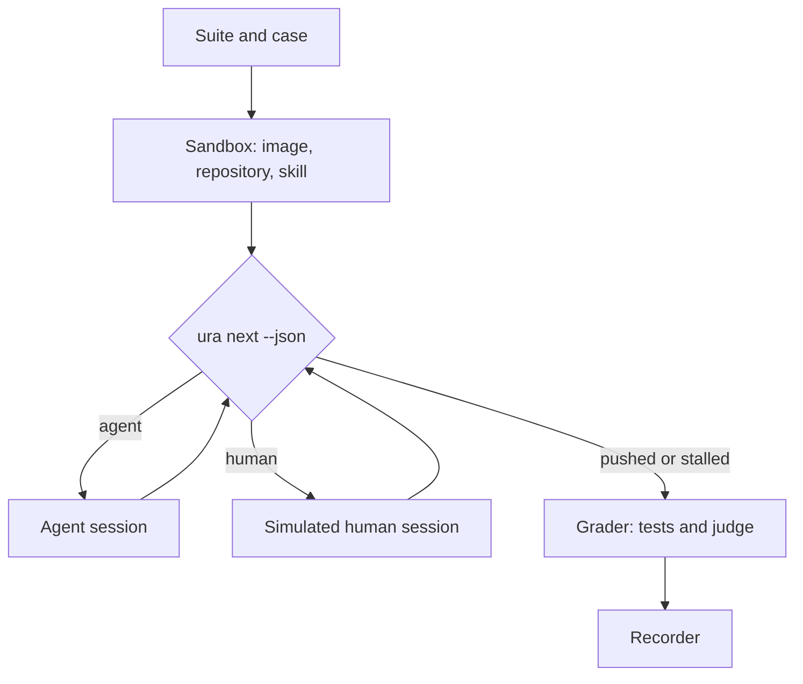

# Spec: Benchmarks

> [!NOTE]
>
> Approved on 2026-10-19.
>
> - You approve a benchmark of the full flow on five SWE-bench Pro V2 cases where plain Claude Code
>   struggles, run with Sonnet 5.5 for every role, with its results in `benchmarks/` and a page that
>   `vp run` opens in your browser.
> - Since your review: the decision no longer polices flags and no longer asks a plain run for every
>   flow run. The plain baseline is one run per case. The results page is new, with a mockup.
> - No per-task results exist for plain Claude, so the five cases are screened: the plain arm runs
>   once on about ten hard tasks, and the five it fails stay. This costs ten more plain runs.
> - The results page is standalone HTML outside the web UI, so the UI decisions do not apply. Say so
>   if you want it in the web UI.
> - New decision, Benchmarks: no run starts without your approval, and the human sees only what a
>   human would. The proposal holds the task's whole text, requirements included.
> - Not verified: Claude Code inside a case's image, a subscription token in a fresh folder, `auto`
>   mode unattended. The plan's first task checks them, and a failure returns to you.
> - No cost cap, as you asked, except 30 sessions per run. Risk tier `medium`, no plan review.

Five real cases run through the whole flow, with Claude Code playing the agent and the human, each
beside a plain Claude Code run, and every result is saved under `benchmarks/` with the versions that
produced it. It is for the project's owner, to check the flow holds up. See the
[proposal](proposal.md), [discovery](discovery-01.md), and [clarifications](clarifications-01.md).

## Your review

- **C1** (flags): done. The decision now says to use the server's adapter and reuse its code. The
  configuration folder that sets the model stays in the architecture, as how, not as a rule.
- **C2** (baseline for every run): done. The plain run is one baseline per case, reused by later
  flow runs, and the decision says so as a SHOULD.
- **C3** (cases where plain struggled): done. No per-task results are published: the hard subset
  holds tasks that at least two of five model families failed, one of them Claude Opus 5. The cases
  are screened with a plain Sonnet 5.5 run on each, in the plain arm's story.
- **C4** (results page): done. `vp run benchmarks:report` writes an HTML page, newest suite first,
  and opens it in your browser. The mockup is in the last story.

## Decisions

- **New: [Benchmarks](../decisions/benchmarks.md)**. A benchmark runs only with a human's approval,
  loads the skill from a commit, and records every version it used.

Relied on:

| Decision                                     | What it means for this spec                                              |
| -------------------------------------------- | ------------------------------------------------------------------------ |
| [Agents](../decisions/agents.md)             | the runner uses the server's adapter, in `auto` mode, with no model flag |
| [Stack](../decisions/stack.md)               | the runner is TypeScript on Node, and reads the workflow through `ura`   |
| [Toolchain](../decisions/toolchain.md)       | the new package adds its checks to `vp run ready`                        |
| [Code quality](../decisions/code-quality.md) | functions stay under 100 lines and files under 500                       |

## User stories

### US1: Run a case through the full flow (P1)

The owner approves a run of one case. The runner starts the feature from the case's proposal, then
runs the agent for each step that waits on it and the simulated human for each gate, until the
branch is pushed with its description. Each step is a fresh session.

Key scenarios:

1. **Given** the case `ansible-multipart-helper` and the owner's approval, **When** the run starts,
   **Then** a branch exists whose `proposal.md` is the task's title, description, requirements, and
   interface section, word for word.
2. **Given** a feature whose questions wait, **When** `ura next --json` says it waits on the human,
   **Then** the human's session runs, and the agent's next session starts only once the questions
   are answered.
3. **Given** a run whose agents keep asking new rounds, **When** 30 sessions have run, **Then** the
   run ends as `stalled`, and its record keeps every step so far.

More scenarios:

1. **Given** no approval on the command line, **When** a run is started, **Then** nothing starts,
   and the runner says an approval is needed.
2. **Given** a run that hits the subscription's usage limit, **When** a session reports it, **Then**
   the run ends as `usage-limit`, and a later run starts from scratch.

### US2: The simulated human answers and approves (P1)

At each gate, a fresh Sonnet 5.5 session plays a busy technical owner. It follows
`benchmarks/human.md`, as the owner who wrote the proposal, and knows nothing more. It acts with
`ura answer` and `ura review`, as a person would.

Key scenarios:

1. **Given** questions the proposal answers, **When** the human answers, **Then** each answer is a
   few words taken from the proposal, and a question it does not answer gets "your call".
2. **Given** a spec that leaves out a requirement of the proposal, **When** the human reviews it,
   **Then** it requests changes, at most twice per run, and names what is missing.
3. **Given** a spec that holds the proposal's requirements with nothing added, **When** the human
   reviews it, **Then** it approves, and confirms the spec's risk tier.

More scenarios:

1. **Given** a human turn whose commit changes a file outside the feature's `specs/` folder,
   **When** the turn ends, **Then** the run is marked `invalid`.
2. **Given** the human's session, **When** it lists the repository, **Then** the hidden tests, the
   reference solution are not in what it can read.

### US3: A plain baseline, and cases where it struggles (P1)

The plain arm is one Claude Code session on the case: one prompt with the case's proposal, no skill,
no human, the same image, model, and effort. It screens the candidate cases, and it is each case's
baseline. Its diff is graded like the flow's.

Key scenarios:

1. **Given** about ten candidate tasks of the hard subset with small images, **When** the plain arm
   runs once on each, **Then** the five that fail the hidden tests, in at least four repositories,
   become the suite's cases.
2. **Given** a case chosen this way, **When** the suite's baseline is needed, **Then** a new plain
   run is made, since the screening run was picked for failing.
3. **Given** a case with a baseline, **When** a later flow run is graded, **Then** the report pairs
   it with that baseline, and no new plain run starts.

More scenarios:

1. **Given** fewer than five candidates fail, **When** the screening ends, **Then** the ones with
   the lowest share of passed tests fill the suite, and the report names them.
2. **Given** a case's baseline, **When** the task's image digest changes, **Then** the baseline is
   run again.

### US4: Grade each run (P2)

After the flow ends, the hidden tests run on the final diff in a fresh container, and a judge
session checks each requirement of the proposal against the approved spec.

Key scenarios:

1. **Given** a finished run, **When** it is graded, **Then** the diff without the `specs/` folder is
   applied to a fresh container of the image, and the task's tests report passed and total.
2. **Given** an approved spec and a proposal whose requirements section has 22 items, **When** the
   judge reads them, **Then** each item is `covered`, `partial`, or `missing`, with the spec's line
   that covers it.

More scenarios:

1. **Given** a run that ended without a push, **When** it is graded, **Then** the tests run on what
   the branch holds, and a branch with no code change counts as failed.

### US5: Read the results in a page (P2)

Each run saves a record and its scores in a folder named by date and suite.
`vp run benchmarks:report` writes one HTML page from every run folder, newest suite first, and opens
it in the owner's browser. Each case shows its flow run beside its baseline: tests passed,
requirements kept in the spec, sessions, cost, and time.

[Results page](mockups/results.html)

Key scenarios:

1. **Given** two suites run a month apart, **When** the command runs, **Then** the page opens with
   the newer suite first, and each suite names its model, effort, harness version, and skill commit.
2. **Given** a flow run marked `invalid` or `leak-suspected`, **When** the page is written, **Then**
   its row shows the flag, and the case is left out of the comparison line.
3. **Given** a run, **When** it is committed, **Then** git holds its record, scores, `specs/` files,
   and diff, and the raw transcripts stay local, with their SHA-256 in the record.

More scenarios:

1. **Given** a session over SSH or with no display, **When** the command runs, **Then** it prints
   the page's path instead of opening it.
2. **Given** no run folder, **When** the command runs, **Then** it says there is nothing to show.

## Architecture

The runner is a small TypeScript loop over what exists. It asks `ura next --json` who is up, runs
the server's Claude adapter for the agent or the human, and starts each session with the server's
workflow message. It adds only what a benchmark needs: isolation, a simulated human, grading, and
records. The reasons are in
[how agents are reached](clarifications-01.md#q4-how-does-the-benchmark-reach-the-agents) and in the
[Benchmarks](../decisions/benchmarks.md) decision. Data lives in `benchmarks/`, code in
`packages/benchmarks/`, and the files are in [the data model](data-model.md).

- **The suite and the case** are files: which cases run, with which arms, model, and effort, and for
  each case its task, image digest, and proposal. They own what a case is.
- **The skill snapshot** builds a plugin folder from `git archive` of a commit, named `uraeda`, and
  records the commit and whether the tree was clean. It owns which skill a run uses.
- **The sandbox** copies the repository out of the case's image into a host folder, mounts it back
  at the same path, and runs the image as a container. `ura` and git run on the host, and the agent
  runs in the container through a wrapper given to the adapter as its command. It owns the
  environment, and adds the case's `specs/` folder, constitution, and a local bare repository as
  `origin`.
- **The configuration folder** is made for the run: its `settings.json` sets the model and the
  effort, and the runner's own environment sets `CLAUDE_CONFIG_DIR` and the subscription token. It
  owns the model and effort, so the adapter passes neither. Fallback to another model is off.
- **The loop** owns the order of sessions. It reads `ura next --json`, builds the agent's message
  with the server's `runMessage`, opens a fresh session, and stops when the branch is pushed, a
  session fails, or 30 sessions have run. It does not parse `status:` fields.
- **The simulated human** owns the human's turns: its prompt is `benchmarks/human.md` and the case's
  proposal, and after each turn it checks that the human's commit touched only the feature's
  `specs/` files.
- **The web guard** owns the leak rules: the case's upstream repository is denied to the agent's web
  tool, and every fetched address goes into the record for an audit.
- **The grader** owns grading: the task's tests in a fresh container, and the judge session over the
  proposal's requirements and the approved spec.
- **The recorder** owns the record's fields and the run folder.
- **The results page** owns the report: one self-contained HTML file, written by the
  `benchmarks:report` task and opened with the server's `openBrowser`. It reads only the run
  folders, and is not committed.
- **The server package** exports its adapter, its events, `runMessage`, and `openBrowser`, which the
  runner needs. It owns them still: the runner copies nothing.

Tradeoffs:

- The agent in a container needs Claude Code, `ura`, and the plugin inside an image the task authors
  made for other tools.
- Results are paired outcomes on five cases, never a score: one task flipping is 20 points.
- A subscription ties the runs to rate limits and to terms that may change.
- The simulated human's model is the agent's model, a shared blind spot that studies could not rule
  out. It is recorded, and its sessions share no context.

## Edge cases

| Importance | Situation                                                        | What happens                                                                    |
| ---------- | ---------------------------------------------------------------- | ------------------------------------------------------------------------------- |
| High       | A session answers with a model other than Sonnet 5.5             | the run fails, and its record names the model that answered                     |
| High       | The human's commit touches a file outside the feature's `specs/` | the run is `invalid`, and is excluded from the report's comparison              |
| High       | An agent fetches a URL of the task's upstream repository         | the run is flagged `leak-suspected` in its record, and the report says so       |
| High       | `auto` mode blocks an action                                     | it is allowed once with the adapter's narrow rule and recorded, a repeat fails  |
| Normal     | The usage limit is reached mid-run                               | the run ends as `usage-limit`, and a later run starts over                      |
| Normal     | The image's tests fail on the reference patch                    | the case is dropped from the suite, and the next smallest hard task replaces it |
| Normal     | The dirty flag is set on the skill's snapshot                    | the run goes on, and the record shows the flag                                  |
| Normal     | The flow opens a new round of questions late                     | the human answers it like the first, and the session count still applies        |
| Normal     | No display, or an SSH session                                    | the report command prints the page's path instead of opening it                 |
| Normal     | A candidate task passes the plain screening run                  | it is dropped, and the next candidate is screened                               |
| Niche      | The repository already has a `specs/` folder                     | the case is rejected when the suite is checked                                  |
| Niche      | A flagged request would fall back to another model               | fallback is off, so it is an error, which fails the run                         |

## Success criteria

- **SC-001** (one command): A run of one case, from approval to its record, is one command with the
  suite and case.
- **SC-002** (five cases): The first suite holds five cases where plain Sonnet 5.5 failed its
  screening run, from at least four repositories, each with a flow run and a fresh plain baseline.
- **SC-003** (every field): Every record holds the fields the decision lists, checked by the
  record's schema test.
- **SC-004** (no hidden files): In the human's session, the hidden tests and the reference solution
  are unreadable, checked by a test on the real session's folder.
- **SC-005** (no copy): The runner holds no copy of the workflow's message, the step logic, or the
  event parser, checked by review.
- **SC-006** (a fake agent): The loop's tests run end to end with the fake adapter, without a model
  or a container.
- **SC-007** (one command to a page): `vp run benchmarks:report` opens the results page from a run
  folder in one command.

## Assumptions

The points settled in the [clarifications](clarifications-01.md#settled-without-the-human) hold as
written there, except where your answers changed them: Sonnet 5.5 is the model of every role,
including the judge, and the first suite has no cost cap. Settled while writing this spec:

- **The candidates** start from the five hard tasks a research agent read: an `ansible` multipart
  helper, two `openlibrary` author-name tasks, a `qutebrowser` cleanup, and a `navidrome` password
  change. Five more with small images join them for screening, taken from the hard subset. See
  [discovery](discovery-01.md#where-the-cases-come-from).
- **Screening** is part of the approved runs: about ten plain runs, at about half the earlier
  estimate per run, since Sonnet 5.5 costs half of Opus 5.5.
- **The results page** is standalone HTML in `benchmarks/`, not a view of the web UI. The preview
  and UI components decisions govern the web UI, so they do not apply. It is generated and not
  committed.
- **The proposal is the task's whole text**, requirements and interface included, as the benchmark
  gives it to its agents. The plain arm gets the same text. The judge's check then measures whether
  the spec keeps every requirement, not whether the questions found them.
- **The effort is `medium`**, and Sonnet 5.5's supported levels are unverified. The record shows the
  effort asked for.
- **Authentication** is a subscription token from `claude setup-token`, set in the runner's
  environment. It is a prerequisite you provide, not stored in the repository.
- **The 30-session guard** is the only cap. It is not a cost cap, and the plan may raise it once a
  real run shows how many sessions the flow needs.
- **Web access** denies `github.com` and its raw and API hosts to the agent's web tool for cases
  whose upstream is on GitHub, because that tool matches whole domains. The audit of fetched
  addresses covers the rest, `curl` included.
- **No pull request is opened.** The cases have no remote host, so the description stays in the last
  commit, and the run ends there.

## Constitution check

| I. Humans in control | II. Plain text | III. Async | IV. Review effort | V. Tools optional | VI. Checked code |
| -------------------- | -------------- | ---------- | ----------------- | ----------------- | ---------------- |
| ✅                   | ✅             | ✅         | ✅                | ✅                | ✅               |

## Risk tier

**Medium**: a new package that starts containers and spends your subscription, with no stored user
data and no change to an existing interface.

## History

> [!NOTE]
>
> Changes requested on 2026-10-19: 4 comments in spec-review.md.
>
> - You approve a benchmark of the full flow on five SWE-bench Pro V2 cases, run with Sonnet 5.5 for
>   every role, and compared with a plain Claude Code run. Its runner and results live in
>   `benchmarks/`.
> - New decision, Benchmarks: no run starts without your approval, the skill comes from a commit,
>   and the human sees only what a human would. You approved running them for this feature, in your
>   answer on the budget.
> - Following your chat, the proposal holds the task's whole text, requirements included, as the
>   benchmark gives it. The human then knows nothing the proposal does not say, and the questions
>   have less to find. Your answer on a brief of hidden requirements is superseded.
> - Sonnet 5.5 replaces the proposal's Opus 5.5 for the agent, the human, and the judge. Effort is
>   assumed `medium`.
> - Not verified: Claude Code inside a case's image, a subscription token in a fresh folder, `auto`
>   mode unattended. The plan's first task checks them, and a failure returns to you.
> - No cost cap, as you asked. The one cap is 30 sessions per run, against a loop that never ends.
> - Risk tier `medium`, with no plan review: a new package and containers, and no user data.
