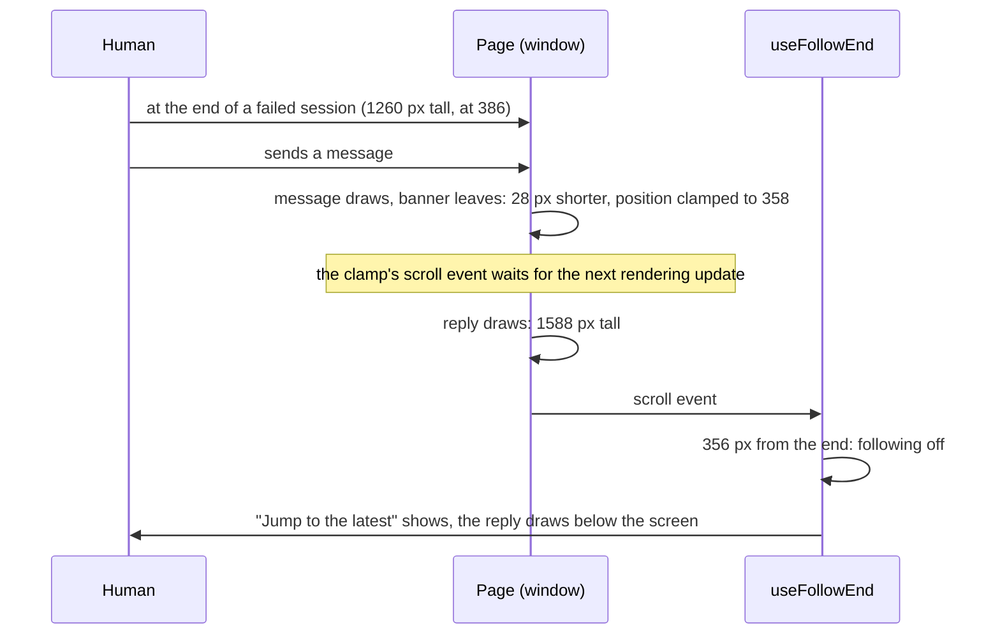

# Discovery, round 03: Fix testing

## Why this round

The implementation is blocked in
[Task 7](plan.md#task-7-reconcile-current-main-and-deliver-complete-evidence), after its steps 1
to 3. Two findings need a choice the approved spec and the decisions do not make:

- **SC-002 is not met for every edit it names.** The spec's
  [success criteria](spec.md#success-criteria) ask that fast take under a minute after a one-file
  edit, and that a budget conflict go back to the human rather than be waived. A root configuration
  edit takes 82 to 94 seconds by design, and the core, skill, and server edits are close to the
  limit. The measurements are in
  [R72](rulings.md#r72-task-7s-validation-coverage-comparison-and-edit-matrix-sc-002-is-not-met-for-a-root-configuration-edit).
- **A browser case fails under load because of a product race.** The phone case "idle at the end,
  send: the reply stays in view and no button shows" stops passing when the machine is busy. The
  cause is in [`useFollowEnd`](/packages/web/src/following.ts), the transcript's following of its
  end, and exists on main today. The [toolchain decision](../decisions/toolchain.md) forbids retries
  and asks that a test failing without a bug be fixed in the pull request that finds it. Fixing it
  changes what the human sees, so the choice is the human's. The trace and two failed attempts are
  in
  [R80](rulings.md#r80-the-load-sensitive-idle-at-the-end-send-case-is-a-product-race-found-and-not-yet-fixed).

Tasks 1 to 6 and the first review fixes, through commit `6a7c7d30`, are already on main: they
reached it through the `2026-10-20-ui-sandbox` branch (merge `058726fe`, pull request 52). This
round does not revisit them.

## Summary

**Fast's budget.** On this 32-thread machine with no other checkout running checks, six of the
eleven measured edits take 12 to 16 seconds: the type check sets that floor. A binding test helper
takes 47 seconds. A core Rust edit takes 49 to 63 seconds, a skill edit 51 (68 at a load of 47 to
64), and a server `limits.ts` edit 50 to 57. A root configuration edit selects every test family and
the Rust workspace, 82 to 94 seconds. Under the load other checkouts put on the machine (a load
average of 80 to 216), no edit meets a minute. The spec does not say which machine state counts, nor
whether one slow sample fails the criterion.

**Following the end.** Chat and transcript interfaces keep the end in view while the reader is
there, and stop when the reader scrolls away. The hard part, everywhere, is telling the reader's
scroll from one the layout causes. Uraeda's hook reads every scroll event as the human's, and
measures the page when the event is dispatched. A browser dispatches a scroll event at its next
rendering update, so content drawn in between is already measured. When an attention banner leaves
and the reply draws before that update, the clamp the banner caused reads as a scroll up.

## How other products do it

### use-stick-to-bottom

[use-stick-to-bottom](https://github.com/stackblitz-labs/use-stick-to-bottom) is a React hook
"intended mainly for AI chat applications". From
[its source](https://raw.githubusercontent.com/stackblitz-labs/use-stick-to-bottom/main/src/useStickToBottom.ts):

- A `ResizeObserver` on the content records each height change in `resizeDifference`. Content that
  grows scrolls to the end; content that shrinks keeps the lock when the reader was near the end.
- A scroll event is judged one millisecond later, so that a resize in the same moment is recorded
  first. While `resizeDifference` is not zero, the scroll is not the reader's.
- The scroll's direction decides: up escapes the lock, down near the end takes it back. The hook's
  own scrolls are recognised by the position they set.
- A `wheel` event upward escapes at once, before any scroll event. A mouse selection inside the
  container escapes too.
- Its comments say scroll and resize events can come in either order: the guard is a timing
  heuristic, not a guarantee.

### What they have in common

Following stops on a reader's move up and resumes at the end. Layout changes, growing or shrinking,
never stop it by themselves. A button brings the reader back to the end. Uraeda's
[session view record](../done/2026-10-14-session-view.md#behaviour) states the same rule: "only the
human's scroll stops following, never the transcript growing".

## Standards and libraries

### When a scroll event is dispatched

The HTML standard's
[update the rendering](https://html.spec.whatwg.org/multipage/webappapis.html#update-the-rendering)
runs, for each document, "the resize steps", then "the scroll steps", then the animation frame
callbacks, then layout and the resize observations. A scroll event caused by a clamp is therefore
dispatched at the next rendering update, after every task that ran meanwhile, React's commits
included. Its handler measures the page as those tasks left it.

### CSS scroll anchoring

[CSS Scroll Anchoring](https://drafts.csswg.org/css-scroll-anchoring-1/) keeps an anchor node, near
the top of the viewport, in place when content above it changes. It says nothing about keeping a
scroller's end in view, nor about a clamp when content shrinks. `overflow-anchor`, its opt-out, is
in Safari only from version 27
([browser-compat-data](https://github.com/mdn/browser-compat-data/blob/main/css/properties/overflow-anchor.json)).
The browser tests run WebKit 26.6 (Playwright 1.63), and
[`reading-place.test.tsx`](/packages/web/src/__browser__/reading-place.test.tsx) already turns
anchoring off to test the page's own place-keeping.

### `scrollend`

[`scrollend`](https://developer.mozilla.org/en-US/docs/Web/API/Document/scrollend_event) fires once
a scroll has ended, for wheel, keyboard, and API scrolls alike. Safari has it from 26.2
([browser-compat-data](https://github.com/mdn/browser-compat-data/blob/main/api/Document.json)). It
says when a scroll ends, not who started it. [`RoundNav.tsx`](/packages/web/src/RoundNav.tsx)
already uses it, with a timer where it is missing.

### Input in the browser tests

Vitest 5's browser mode has `userEvent.wheel(element, { delta })`
([its declaration](/node_modules/.pnpm/@vitest+browser@5.0.1_@types+node@24.19.1_esbuild@0.28.2_jiti@2.7.0_typescript@6.0.3_vitest@5.0.1/node_modules/@vitest/browser/context.d.ts)).
The repository's browser commands drive real mouse moves, presses, and releases
([`vite.browser.config.ts`](/packages/web/vite.browser.config.ts)). No helper drives a touch drag.
Today's browser tests scroll with `scrollTo`: 16 calls in
[`session.test.tsx`](/packages/web/src/__browser__/session.test.tsx), one each in `session-look`,
`session-tail`, and `scroll`.

## The code

### Important reads

- [`following.ts`](/packages/web/src/following.ts): `useFollowEnd(ref, enabled)` keeps
  `followingNow`, set by every scroll event of the window to whether the page is within 24 px of its
  end. A `ResizeObserver` on the transcript scrolls to the end while the session works and
  `followingNow` holds. Nothing else sets `followingNow` but "Jump to the latest".
- [`SessionPage.tsx`](/packages/web/src/SessionPage.tsx): `SessionLog` draws the header, the
  transcript in the observed `div`, then [`Attention`](/packages/web/src/SessionAttention.tsx), the
  banner of a session that failed, stopped, or halted. The banner sits outside the observed `div`,
  so its leaving changes the page's height but not the transcript's.
- [`useKeepPlace.ts`](/packages/web/src/useKeepPlace.ts): puts the reading place back across the 768
  px width breakpoint; `useFollowEnd` ignores scrolls of a layout drawn for the other width.
- [`session.test.tsx`](/packages/web/src/__browser__/session.test.tsx), browser: "idle at the end,
  send" ends a run, scrolls to the end, sends two lines, and expects the reply in view with no
  button.

### The proposal's path and existing actions

The race, from R80's trace of a failing run:

Without load, the scroll event comes before the reply draws, and following holds. Every banner of
`Attention` (failed, stopped, halted) leaves the same way when a message is sent. Pressing "Jump to
the latest" follows again.

Two fixes were tried and reverted (R80): ignoring a scroll that comes with page growth swallowed the
human's own scroll; judging each position where a draw first leaves it still failed, because no
observable moment lies between the shortening and the reply.

On the other branches in flight, `2026-10-20-merge-chats` adds `keepsEnd` to `following.ts` and
changes `openWorkingSession` in the same test file. A fix here meets it at the next rebase.

### Rules and their owners

- **Following the end** is owned by `useFollowEnd`, for the session page only. The rule "only the
  human's scroll stops following" comes from the
  [session view record](../done/2026-10-14-session-view.md#behaviour). No decision holds it.
- **The fast selection's broadening** of a root configuration file is owned by `selectFast` in
  [`fast-selection.ts`](/scripts/fast-selection.ts). A root file matching `vite*.ts`, `*.config.*`,
  `tsconfig*.json`, `package.json`, `pnpm-*`, `flake.*`, or `rust-toolchain.toml` selects every
  family and the Rust workspace; `Cargo.toml` and `Cargo.lock` select the workspace.

### Likely changes

- [`following.ts`](/packages/web/src/following.ts): with either product fix, the hook changes; with
  the input-based one, every caller scrolling for the human stays as it is.
- [`session.test.tsx`](/packages/web/src/__browser__/session.test.tsx): a deterministic case for the
  race, or its `scrollTo` calls turned into input with the input-based fix, or a loosened case.
- [`spec.md`](spec.md): SC-002 amended in a revision 3, with the amended budget.
- [`fast-selection.ts`](/scripts/fast-selection.ts) and its tests: only with a narrowed root
  configuration selection.
- [`rulings.md`](rulings.md), [`plan.md`](plan.md): the outcome recorded in Task 7.

## The proposal

### SC-002 cannot hold for a root configuration edit

A root configuration file can change how every test runs, so the spec's
[edge cases](spec.md#edge-cases) make uncertain selection broaden. That selection costs the type
check (about 15 s), a Vitest run of 75 files and 1,115 tests (about 50 s), and the workspace's Rust
chain (about 22 s). It cannot meet a minute without running less.

### SC-002 does not say what a sample is

The criterion says "on the development machine" and "without waiving a failed sample". The machine
is shared with other checkouts, whose checks drive the load to 80 to 216. Three core samples on a
quiet machine took 49.3, 52.4, and 62.6 s: one fails, two pass.

### Fixing the race is product work

The spec's scope leaves out "unrelated product fixes". This one is related: the feature's own test
found it, and the toolchain decision asks that it be fixed in this pull request. It still changes
what users see.

## Worth it and feasibility

**The budget.** Amending SC-002 costs a spec revision and no code. Keeping it as written costs
nothing now, and leaves the record saying unmet. Shrinking the slow paths has levers in the
evidence, none measured as a fix yet:

- Vite Task saves the built binding to its cache: 8 s of a core edit at a load of 36
  ([Task 2 evidence](plan.md#task-2-prove-composer-and-real-native-contracts-within-the-fast-budget)).
- The Rust test build takes 14 to 25 s, and nextest 14 to 23 s for 756 to 1,078 tests.
- The reverse-dependent crates `uraeda-cli` and `uraeda-lsp` add about 3 to 5 s to a core edit.
- The type check, about 15 s, is every edit's floor; it runs beside the Rust chain (R7).

**The race.** Each product fix is small in code. The deterministic reproduction it needs, shortening
and growing the page in one task with a forced layout between, is unverified: it is the first step
of either fix. Accepting the race costs a test change and leaves an approved behaviour broken under
load. Nothing here relaxes a security guard.

## Approaches

Criteria: the approved [spec](spec.md) (SC-002, edge cases, scope), the
[toolchain decision](../decisions/toolchain.md) (no retries, a failing test fixed in its pull
request), [UI behaviour](../decisions/ui-behaviour.md) (the human's place is never lost),
[UI coherence](../decisions/ui-coherence.md) (one shared hook), and the session view's following
rule.

### Holding SC-002

How the one-minute criterion reads, given the measurements. Links:
[the proposal](#sc-002-cannot-hold-for-a-root-configuration-edit),
[samples](#sc-002-does-not-say-what-a-sample-is).

| Option                                      | Spec change | Protection | Core, skill, server | Root configuration  |
| ------------------------------------------- | ----------- | ---------- | ------------------- | ------------------- |
| A. Amend: edit kinds, quiet machine, median | revision 3  | unchanged  | met, 7 to 10 s left | reported, no budget |
| B. Keep as written, report unmet, follow-up | none        | unchanged  | met by most samples | unmet               |
| C. Narrow root configuration selection      | none        | reduced    | unchanged           | possibly met        |

### Following the end through a layout clamp

How following survives a shortening followed by growth. Links:
[the race](#the-proposals-path-and-existing-actions),
[scroll dispatch](#when-a-scroll-event-is-dispatched).

| Option                                    | What users see                                    | Code                         | Tests                                               |
| ----------------------------------------- | ------------------------------------------------- | ---------------------------- | --------------------------------------------------- |
| A. Keep the page's height while following | a blank strip, briefly, where a banner was        | `following.ts`, small        | unchanged, plus one deterministic case              |
| B. Only input stops following             | a scroll without input never stops following      | `following.ts`, input events | `scrollTo` calls become wheel input; touch untested |
| C. Accept, loosen the case                | sometimes "Jump to the latest" after sending      | none                         | the case accepts the button                         |
| Discarded: scroll anchoring               | none in Safari before 27; no end pinning          | CSS                          | WebKit 26.6 cannot exercise it                      |
| Discarded: a reversed column scroller     | the transcript scrolls inside a box, not the page | layout, place-keeping, Back  | many                                                |

### Needs no choice

- **"Jump to the latest"** keeps its behaviour under every option: it shows when the human is away
  from the end, and brings them back.
- **Retries and a longer `LIVE` bound** are forbidden or useless: the state the case waits for never
  comes back (R80).

## Not checked

- The three sibling cases that failed once each under load share the race's family, not a proven
  cause. A fix's stress run is their evidence.
- The deterministic reproduction of the race (a forced layout between shortening and growth in one
  task) is designed, not written.
- How VoiceOver and other screen readers scroll the page (with or without input events) was not
  tested. It weighs on the input-based option.
- Other chat products' following code (ChatGPT, Claude.ai, Slack) is not public; only
  use-stick-to-bottom's source was read. Which products use that library was not checked.
- The Rust build levers (debug information, profile changes) were not measured.
