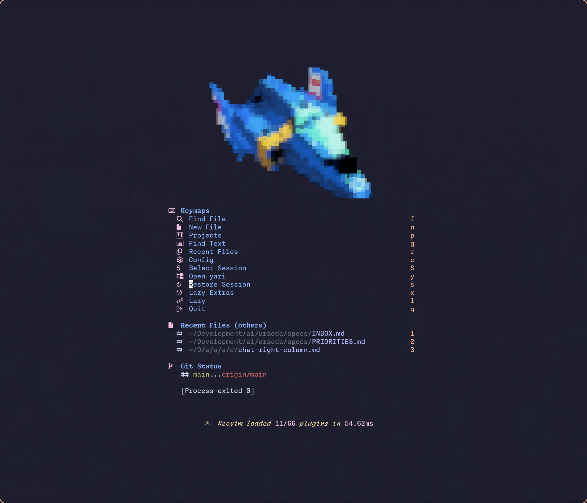
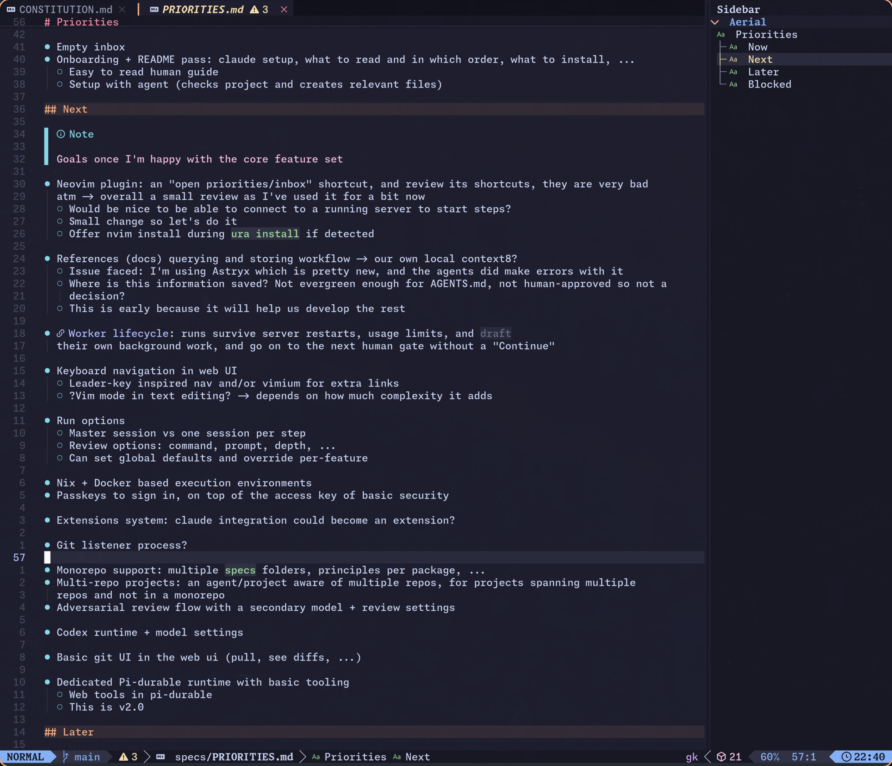
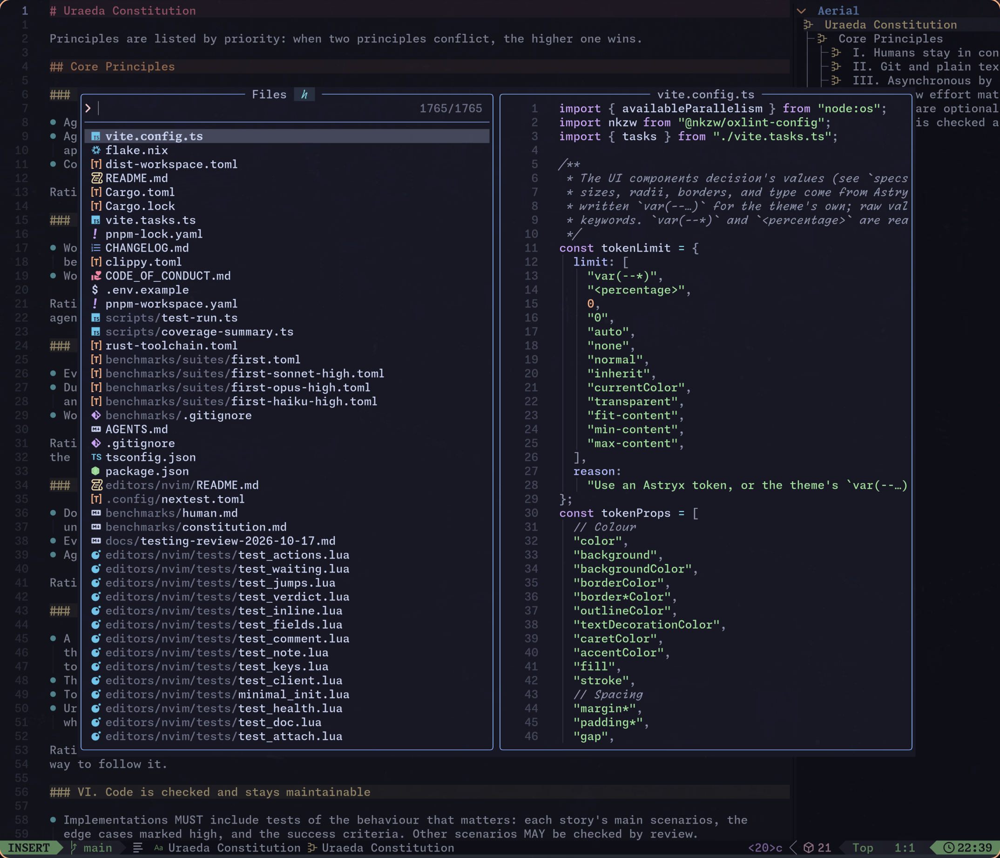

# Layout and look and feel

## What

One design pass over the whole web UI: its layout and its visual identity, decided together, since a
visual direction comes with opinions on layout (cards or flush columns, density, how many panes
fit).

1. I set the information architecture below: what each view must show, what is primary, and what
   must stay visible together. It holds no geometry: no widths, no pane positions.
2. The agent builds 3 to 5 complete directions as throwaway prototypes, each one a layout and a
   visual identity over the same information architecture, and asks which one, with a link to each.
   - This could be raw HTML, or even image generation with an external LLM. It's about vibes.
3. The spec writes the chosen direction down: the layout's behaviour (folding, resizing, movable or
   dynamic panes), the design tokens, the icons, the logo. The prototypes are then deleted.

This is a visual and layout pass: functionality does not change except extremely minor changes if
required.

Polish left over after this pass is a batch of small changes, not part of this feature.

## Why

The UI works, but it is vanilla and does not look like a finished tool: it should look good, and be
memorable, before v1.0.0. Its layout also grew view by view, and breaks in places, such as at half a
screen's width.

## Visual Inspiration

I want to explore the following directions:

- A very green, "natural" feeling UI: the name is uraeda, it comes from bonsai terminology
  - The home could for example look like a growing tree, with one branch per feature, ...
  - In this case the tones should be woody and green, and organic
- A cyberpunk, agressive look
  - The look I usually go for in my websites
  - https://shop.tolki.dev/ with source at /home/tolki/Development/keyboards/tolkeebs-website
  - https://ghost.tolki.dev/ with source at /home/tolki/Development/keyboards/tolkeebs-website
  - The vibe would be hacky, glitchy, maybe some "VR like" paralax effect with panes overlaying like
    a HUD
- A terminal-like look, inspired by LazyVimx
  - It opens with a very simple list of icons and actions with associated keys:
    
  - It uses left/right panes for info with top/bottom one-line tabs/status bars:
    
  - It uses overlays for temporary windows and pickers:
    
  - I'm not saying we should _copy_ it, but it's an inspiration: a minimal, highly textual UI
- Apple-inspired
  - Liquid Glass design: frosted glass panes, overlaying content

You can add extra styles there. Search for modern trends, ideas that would fit, ...

## Layout inspiration

- DeepSeek Harness: https://www.deepseek.com/en/harness/
  - Interesting view of sessions with a waterfall-like graph
- Kiro Crew: very much panel-driven, a bit floating: https://kiro.dev/crew/
- Zed IDE: https://zed.dev/

## Information architecture

For each view: what it must show, what is primary, and what must stay visible together.

I'll write CF for "Change or Feature".

### Shell

Everywhere in the app, in both desktop and mobile, we need to be able to access:

- One click Inbox draft
- New session/CF
- Running sessions
- In-progress CF

And extra widgets:

- 5h limit of provider
- Navigation/settings access...

The shell should get out of the way for content/readability when needed, particularly on half
widescreen (I often use it that way).

### Home

The home needs to highlight important information and be visually striking.

There's no hard goal on the content here: the shell should provide all core navigation anyways.

What matters is that the home looks unique and interesting while staying useful. It's the first page
users see when they reach the app, and the first they come back to after features have been built.

### Inbox

We need to be able to see a good list of notes with categories and be able to re-order them and
create/delete categories

The primary goal is NOTE READABILITY and HIERARCHY. The goal of this view is to review recent quick
notes, organize them, delete them, prioritize them, then act on them.

When acting on a note, we need to:

- See its full content (but it will be extremely short, if it's a full draft it should go in
  priorities)
- Be able to open a session with the composer containing the text of the note and decide if we want
  to turn it into a CF (same picker as main session view)

### Priorities

Very similar to inbox, with a more rigid hierarchy:

- Ongoing > Now > Next > Later
  - Inside each group, the ordering is very important
- Drafts should open in a full editor page, would be great if it could be a bit WYSIWYG
  - Pane approach doesn't really work, I just go to the draft page every time
- Could be vertical panes, horizontally scrollable. Not a requirement, just an idea.

Once again the #1 priority is CLEARLY SEEING THE HIERARCHY OF TASKS + their status AND reading them
being very comfortable.

### Feature and change home

The current page content is pretty much good as-is:

- Progress timeline
- Current state
- Sessions list and access
- Diff, tokens, any other interesting metric that could be interesting
- Access to files (could look better though)

Remove the storybook access though, it does not really work

### Proposal and discovery

I never read those pages really? It's just rendering markdown from a file.

The one important thing I'd say is making a GOOD editor for proposals: right now I'm stil using
neovim because it's just smoother and faster.

If this is too much work as part of this rework let's keep it being a big text input.

### Clarifications

The most important page tbh:

- Context (messages before the questions) is the first feedback from the agent to the human on a
  feature > should have a clear, unique look, and hierarchy. Icons, borders, text sizes/fonts, ...
  You can use anything that makes the different paragraphs better represent their content.
- Then questions: we always need to see at least the question text while we answer. The question
  context is also crucial and should be extremely readable and visual, with special rendering for
  "Why it matters" and Examples
- Then the extra info, "Check these" in particular should have high weight

Secondary level of info here is navigation/progress, and access to a session.

It should be simple for the user to ask a question in the existing CF session, _from this page_, and
reading the answer should be easy, not cramped in a small side panel. This is not really a new
feature: the session exist, it's only presentation that changes.

The session could maybe be a modal/overlay, or come from the bottom, or be a floating panel from the
right... your call

### Spec, plan, and data model

The primary content is really the full spec, in the defined format, allowing up to have control over
the rendering and look and feel of each part.

Decisions diff are the highest importance imo, since they will impact all features downstream.
Storybook embeds need to be CLEARLY outlined as such, could be with a mock monitor/phone bezel. Not
a requirement.

Secondary level of info is once again navigation, but with comments, and a session like above.

### Session

The primary information is user messages and agent textual messages. They're what actually makes the
content.

Secondary information is sources fetched, files changed, sub-sessions, ...

The industry has pretty much converged on the same look and feel everywhere, we won't reinvent the
wheel, just use the standard "chatbot look" for this page

### New session/CF

There should be a clear visual distinction between the three options, so a new user can select the
right one from the first time.

Creating a new session and deciding to attach it to a CF or not should be guided and smooth, and
lead to either:

- The session page for a simple session
- A picker to pick the proposal/priorities line/inbox line for BOTH change or feature
  - A changer should also be able to write text directly and lead to the session
- An editor to write the proposal
  - Once the proposal is written, a single click should start the session and start tailing it

### Decisions and constitution

Primary info is the constitution, each principle should be readable and visually striking

Then comes the decisions, with the options to filter/search them

Clicking a decision brings to its page, a rendered view of the content, with an option to edit it

### Settings

No preferences there, it's a settings page

## Notes

### Look and feel

- A visual identity: colors, shapes, mood, a logo, a favicon.
- Many more icons, to make everything more readable: the sidebar, agent statuses, a feature's step,
  a spec's layout and paragraphs, inbox and priorities.
- Icons for the harnesses (Claude Code, Codex, Pi, ...).
- Remove the color option on features: it looks bad, and it's pointless in the end. A session/CF can
  be renamed still.

### Constraints

- Almost only UI: minimal core and server changes, and no new operational concept.
- The prototypes are investigation, not code to keep. The workflow does not yet say whether
  throwaway prototypes are part of an investigation: this feature decides it.
