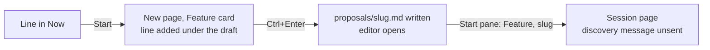

# Clarifications, round 01: Proposal start flow

> [!NOTE]
>
> Answered on 2026-10-30.
>
> - Verdict: worth building as proposed: the core already starts a change from a typed text, and a
>   feature can start the same way.
> - Typed features start at once too, so the New page no longer writes a proposal for later.
> - Skipping the editor's page skips its research effort: it needs a new place.
> - Whether the discovery runs at once decides if the research effort can still be changed after the
>   start.
> - Feature images, now allowed, and the Start's text without its "From PRIORITIES.md" link: check
>   them.
> - Built on the Feature state branch, which changes the same start code: it merges first.

## Context

### Goal

Starting planned work from the web UI takes too many steps, and the New page's composer mixes texts.
The [proposal](proposal.md) asks for three fixes. A line's Start must not add to an existing draft.
The Session, Change, and Feature cards share one text. A feature start lands on its session.

### Today

A line of **Now** without a file of its own starts in four steps:

- The Start adds the line, its nested lines, and a "From PRIORITIES.md" link under whatever the
  Feature card's text holds ([`NewPage.tsx`](/packages/web/src/NewPage.tsx)). Sent, the old text
  goes into the proposal too.
- Each card keeps its own text: switching cards shows another draft. A reload forgets which line the
  text came from, so the feature asks a title and adds a second line to **Now**.
- The Change card already starts at once: `Ctrl+Enter`, a slug the core proposes, then the session,
  its agent at work ([`NewChangePage.tsx`](/packages/web/src/NewChangePage.tsx)).
- The research effort, the proposal's `discovery` field, is set only on the editor's page
  ([`EditorPage.tsx`](/packages/web/src/EditorPage.tsx)). Without the field, the effort is High.

### Scope

The New page's composer and its three cards, the Start of a line of the priorities, and the feature
start from a text. A line or note with its own file still opens its page, whose Start pane is
unchanged. The cards under the composer keep their behaviour, apart from sharing the one text.

### Sources

- The New page, [`NewPage.tsx`](/packages/web/src/NewPage.tsx),
  [`NewChangePage.tsx`](/packages/web/src/NewChangePage.tsx),
  [`NewEntries.tsx`](/packages/web/src/NewEntries.tsx),
  [`useStartFrom.ts`](/packages/web/src/useStartFrom.ts), and the editor's Start,
  [`ProposalStart.tsx`](/packages/web/src/ProposalStart.tsx).
- The core's start, [`start/mod.rs`](/crates/core/src/actions/start/mod.rs) and its typed change,
  [`typed.rs`](/crates/core/src/actions/start/typed.rs); the server's
  [`starts.ts`](/packages/server/src/fate/starts.ts) and
  [`change-starts.ts`](/packages/server/src/fate/change-starts.ts).
- The UI guide's [flows](/specs/ui/flows.md), and the Feature state branch's start changes.
- How GitHub Copilot, Claude Code on the web, Cursor, Linear, and Codex start agents from one box
  and from an issue, from their official documentation.
- The full investigation is in [discovery](discovery-01.md).

## Check these

- **Images in a feature**: the shared composer takes images for all three cards. A feature's images
  go into its folder's `images/`, linked at the end of its proposal, as a change's do today. See
  [discovery](discovery-01.md#images-in-a-feature).
- **The Start's text**: a line's Start fills the composer with the line and its nested lines,
  without the "From PRIORITIES.md" link line. The start replaces the line in **Now** by itself, so
  the link only adds noise to the proposal. The cards under the composer keep their link. See
  [discovery](discovery-01.md#the-proposals-path-and-existing-actions).
- **Built after Feature state**: that branch changes the same start code, so a change started from a
  line replaces it in **Now**. This feature builds on its merge, and gives a feature the same
  replacement. See [discovery](discovery-01.md#overlap-with-features-in-flight).

## Q1: Does the Feature card start the feature for every text, or only for a text from a line?

Example: you type "Dark mode: follow the system theme" in the Feature card, then press `Ctrl+Enter`.

Your proposal names the start "from a single priorities row". Today a typed feature also goes
through a proposal file and the editor. That is the New page's only way to write a proposal without
starting it. The priorities' Add, then Expand on the line, still writes one elsewhere. More in
[discovery](discovery-01.md#what-the-feature-cards-send-does).

Why it matters: it decides whether the New page keeps a second path for features, with its own
dialog, code, and tests.

- **A (recommended). `Ctrl+Enter` in the Feature card starts the feature for every text: a slug
  dialog, then its session page. A proposal for later is written from the priorities.**
  - Example: "Name the feature" asks `dark-mode`; Enter opens the session of `2026-10-31-dark-mode`.
  - [pro] one path, the same as the Change card's.
  - [con] writing a proposal for later leaves the New page.
  - Why recommended: the New page is for starting; one path is simpler to learn and to keep.
- **B. `Ctrl+Enter` starts the feature when the text came from a line of the priorities. A typed
  text still writes a proposal file and opens its page, as today.**
  - Example: "Title the proposal" asks a title; Enter opens `proposals/dark-mode.md` in the editor.
  - [pro] the New page still writes proposals for later, with the editor to finish them.
  - [con] the same card does two things, by where its text came from, which is invisible.
- **C. `Ctrl+Enter` starts the feature for every text, and a second button, "Save as proposal",
  writes the proposal file instead.**
  - Example: Enter starts `dark-mode`; "Save as proposal" opens `proposals/dark-mode.md`.
  - [pro] both paths, chosen openly.
  - [con] two buttons for one action, against [the UI guide](/specs/ui/flows.md#one-primary-action).

**Answer:** A

## Q2: Does the feature's discovery start running as soon as the feature starts?

Example: you start "Dark mode" from the New page, and its session page opens.

Today the editor's Start opens the session with the discovery's message in the composer, unsent.
[The UI guide](/specs/ui/flows.md#starting-the-agent) says "the agent never starts unseen". A change
started from the New page sends its first run at once, its agent at work when the page opens. GitHub
Copilot, Claude Code, Cursor, and Codex all start the agent at once. More in
[discovery](discovery-01.md#whether-the-discovery-run-is-sent).

Why it matters: it sets the keys from the composer to an agent at work. Unsent, it also leaves time
to fix the proposal or its research effort before the agent reads it, which the research effort's
question relies on.

- **A (recommended). The session opens with the discovery's message in its composer, unsent, as the
  editor's Start does.**
  - Example: the session shows the message; Enter sends it.
  - [pro] the agent never starts unseen, as the UI guide asks, and both feature starts behave alike.
  - [con] one more key than a change's start.
  - Why recommended: a discovery is a long run; one key to confirm it is cheap.
- **B. The discovery's run is sent at once, as a change's first run is.**
  - Example: the session opens with the agent already investigating.
  - [pro] fewest steps, the same as the Change card.
  - [con] a wrong research effort or slip in the text costs a stopped run and a fix by hand.

**Answer:** A

## Q3: Where do you pick the research effort of a feature started from the New page?

Example: you start "Dark mode", a small feature, and want Low rather than High.

The research effort is the proposal's `discovery` field: Low, Medium, or High. Today it is set only
on the proposal's editor page, which the new path skips. Without it, the effort is High. Codex puts
an effort picker on its prompt box. More in [discovery](discovery-01.md#the-research-effort).

Why it matters: the effort sets how long and how deep every discovery round of the feature runs.

- **A (recommended). In the start dialog, under the slug, as the editor's Low, Medium, High control,
  starting at High. Enter confirms both.**
  - Example: "Name the feature" shows `dark-mode`, then the control; you press Low, then Enter.
  - [pro] picked where the feature is named, with no extra step when High suits.
  - [con] the dialog grows from one field to two.
  - Why recommended: it is the one moment between the text and the start.
- **B. Not asked: a feature started from the New page gets High. To change it, edit the proposal in
  the feature's folder before sending the message.**
  - Example: the session opens; you edit `proposal.md` to `discovery: low`, then send.
  - [pro] the dialog stays one field.
  - [con] the effort is hidden; with the run sent at once (B in Q2), it cannot be changed.
- **C. A Low, Medium, High control under the composer, shown while the Feature card is picked.**
  - Example: you press Low under the box, then `Ctrl+Enter`.
  - [pro] visible while writing.
  - [con] a control on the page for one card of three.

**Answer:** A

## Q4: What happens to a text the composer already holds when you press Start on a line?

Example: the composer holds "Widen the sidebar", a draft from yesterday. You press Start on the line
"Proposal start flow" of the priorities.

Today the line goes under the draft, and both become the proposal. With one composer for the three
cards, the draft may be a session's message or a change's. More in
[discovery](discovery-01.md#a-draft-already-in-the-composer).

Why it matters: it decides whether a forgotten draft can be lost, or block the Start.

- **A (recommended). The line replaces the text, and a toast offers Undo, which puts the old text
  back, as the inbox's Undo of a delete does.**
  - Example: the composer reads "Proposal start flow", and "Draft replaced · Undo" shows a moment.
  - [pro] Start always lands on the line alone, with a way back.
  - [con] the old text is lost once the toast is gone.
  - Why recommended: the line is what you asked for; Undo covers the rare draft that mattered.
- **B. The line replaces the text, without a toast.**
  - Example: the composer reads "Proposal start flow"; "Widen the sidebar" is gone.
  - [pro] nothing to see.
  - [con] a draft is lost without a word.
- **C. When the composer holds text, a dialog asks first: Replace, or Cancel.**
  - Example: "Replace your draft?" opens; Replace fills the composer with the line.
  - [pro] no draft lost by surprise.
  - [con] one more step on every Start with a draft, the path this feature shortens.

**Answer:** A

## Settled without the human

### Behaviour

- **One text for the three cards**: switching between Session, Change, and Feature keeps the text,
  its images, and the line it came from. The text stays across a reload, as the Change and Feature
  texts do today. See [discovery](discovery-01.md#needs-no-choice).
- **The line Start opens**: a line's Start still picks the Feature card; switching to Change or
  Session keeps the line. See [discovery](discovery-01.md#important-reads).
- **Naming the feature**: `Ctrl+Enter` asks the slug in the change's dialog, "Name the feature",
  prefilled with the slug the core proposes. The title is the text's first line, cut at 80
  characters, as a change's is. See [discovery](discovery-01.md#the-cores-start).
- **The line in Now**: a feature started from a line replaces that line by the feature's link. It
  does so in the start's commit, as a proposal file's start does. Its nested lines go into the
  proposal. See [discovery](discovery-01.md#the-proposals-path-and-existing-actions).
- **A refused slug**: a slug already taken shows its reason in the dialog, and the text stays. See
  [discovery](discovery-01.md#how-the-feature-starts-from-a-text).

### Under the hood

- **A typed feature start in the core**: the core's typed start, change-only today, starts a feature
  too, in one commit, research effort included. A browser drafting a file then starting it would
  leave a file and a line behind on a refused slug. See
  [discovery](discovery-01.md#how-the-feature-starts-from-a-text).
- **The draft and its sources kept together**: what the text came from is stored with it, so a
  reload no longer forgets the line. See
  [discovery](discovery-01.md#the-proposals-path-and-existing-actions).

**Notes:**
