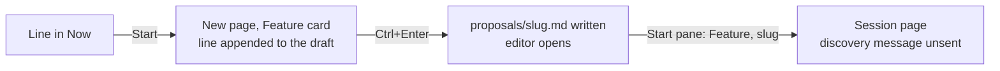

# Discovery, round 01: Proposal start flow

## Summary

Agent tools that start work from text usually offer one prompt box and let the user pick what the
text starts. Starting from a backlog item usually means one action on the item, which lands on the
agent's session or log. Products differ on whether the agent starts at once, and on how the task's
name is set.

The proposal asks for three fixes to the web UI's New page, behind the sidebar's "＋ New":

1. A proposal's Start, on a line of the priorities, must stop appending the line under what the
   composer already holds.
2. The three kinds, Session, Change, and Feature, share one composer text instead of three.
3. Starting a feature goes straight to its session page, the composer's text being the proposal,
   instead of the four hops of today.

Today each kind has its own draft, the Feature card writes a proposal file and opens the editor, and
the feature only starts from the editor's Start pane. The core can start a change from a typed text
in one commit, but not a feature: a feature needs a proposal file first.

## How other products do it

### GitHub Copilot cloud agent

- One prompt box, on the Agents tab, the agents panel, and github.com/copilot, with pickers for the
  repository, environment, base branch, custom agent, and model; images can be pasted. "Start task"
  or Enter submits, and the new session appears in the list under the box: the user is not taken to
  it
  ([use cloud agent](https://docs.github.com/en/copilot/how-tos/use-copilot-agents/cloud-agent/use-cloud-agent-on-github)).
- From an issue: Assignees, then Copilot, opens "Assign to Copilot", with an **optional prompt** and
  the repository, branch, agent, and model. Copilot receives "the issue title, description, existing
  comments, and your extra instructions", and starts at once (same page).
- The branch reads `copilot/BRANCH-NAME`; the user is never asked for it
  ([research, plan, iterate](https://docs.github.com/en/copilot/how-tos/use-copilot-agents/cloud-agent/research-plan-iterate)).

### Claude Code on the web

- One input box, with a repository, a branch, and a permission mode (Auto, Accept edits, Plan),
  picked "both when you create the task and while the session runs". Each task gets its own session
  and branch ([on the web](https://code.claude.com/docs/en/claude-code-on-the-web)).
- A failed session creation puts "your prompt back in the box you sent it from"
  ([quickstart](https://code.claude.com/docs/en/web-quickstart)).
- No issue start: URL parameters (`prompt`, `prompt_url`) **prefill** the box, "such as a button in
  your issue tracker", and the user edits before pressing Enter. What a prefill does to a text
  already in the box is not said (same page).
- Branches and pull request titles are generated, not asked.

### Cursor

- One chat input; Agent and Plan are modes of it, switched with Shift+Tab or a dropdown
  ([modes](https://cursor.com/docs/agent/modes)). A cloud agent starts from the same box, by picking
  "Cloud" ([cloud agent](https://cursor.com/docs/cloud-agent)).
- From Linear: assign the issue to Cursor, or `@Cursor` with extra instructions in a comment;
  options like `[branch=…]` go inline ([Linear](https://cursor.com/docs/integrations/linear)).

### Linear, for every agent

- "Delegate issues by assigning the issue to the agent", or mention it; no editing step before the
  start ([agents in Linear](https://linear.app/docs/agents-in-linear)).
- The agent session is "created automatically" on delegation, with the issue's title, description,
  and comments as its prompt context, and the agent must answer "within 10 seconds"
  ([agent interaction](https://linear.app/developers/agent-interaction)).

### OpenAI Codex

- One "Do anything" box, with a project, an approval control, and a model and effort picker
  ([cloud](https://learn.chatgpt.com/docs/cloud)). "Work in" (Local, Worktree, Cloud) is a control
  on it ([modes](https://learn.chatgpt.com/docs/environments/modes)).
- From Linear, assigning or mentioning Codex sends the issue content, and it "starts work and posts
  updates back to the issue" ([Linear](https://learn.chatgpt.com/docs/third-party/linear)).

### What they have in common

- **One box for every kind of start**: the kind or mode is a picker on the box, never a box of its
  own. None documents what a switch does to the text, since the text never moves.
- **A start from a tracked item is one action**, its text the prompt. Only GitHub shows a dialog
  first, with an optional extra prompt.
- **An effort or depth setting at the start**: Codex's effort picker, Claude's Plan mode, both on
  the box.
- **The agent starts at once** everywhere.
- **Names are generated**, never asked: branches and pull request titles.
- **Drafts are barely documented**: only Claude says a failed start puts the text back. None says
  what a prefill does to a draft already there.

## Standards and libraries

### The core's start

- A start, on the default branch, moves the proposal to the top of **Now** in `PRIORITIES.md` as a
  link, moves the proposal file into the dated folder, commits, then makes the branch and its
  worktree ([`start/mod.rs`](/crates/core/src/actions/start/mod.rs)).
- A change can start from a typed text: its first written line is the title, cut at 80 characters,
  the rest the body, and its images go into the change's `images/` folder, linked at the end of the
  proposal ([`start/typed.rs`](/crates/core/src/actions/start/typed.rs),
  [`run_text_with`](/crates/core/src/actions/start/mod.rs)). It refuses anything but a change: "a
  change needs a text".
- A typed start's slug is proposed from its title by
  [`propose_slug`](/crates/core/src/actions/start/mod.rs), which the New page's change dialog
  already reads (`useSlugProposal`).
- A drafted proposal, [`draft_proposal`](/crates/core/src/api/drafts.rs), inserts a line in **Now**,
  expands it into `specs/proposals/<slug>.md`, and writes the body under its heading. The file it
  writes has no frontmatter, so no `discovery` field
  ([`expand.rs`](/crates/core/src/actions/expand.rs)): its effort is `high`, the skill's default
  ([discovery effort](/skills/uraeda/references/discovery.md#discovery-effort)).

### The server's starts

- `feature.start` plans a proposal file's start, answers with the plan and the workflow's message at
  once, and queues the start's write; the session opens with that message in its composer, unsent
  ([`fate/starts.ts`](/packages/server/src/fate/starts.ts)).
- `change.start` starts a typed change and then sends its first run at once: "a proposal's change
  starts with its agent at work"
  ([`fate/change-starts.ts`](/packages/server/src/fate/change-starts.ts)). The session gets the
  message unsent only when no agent is available.

### The UI guides

- [Flows](/specs/ui/flows.md#starting-the-agent): "The agent never starts unseen. A commit that
  hands the feature over opens its session with the workflow's message in the composer, unsent."
- Same section: "A proposal's Start fills the New page's composer with the proposal's link, rather
  than starting a feature without a word", and "A new feature, change, or session is written first,
  then named: its slug or title is asked for after `Ctrl+Enter`, in one short dialog."
- [One primary action](/specs/ui/flows.md#one-primary-action): a step offers one primary button;
  variants of the same action are one button.
- The editor's undo toast, [`useUndoToast`](/packages/web/src/layout/useUndoToast.ts), already backs
  the inbox's Undo of a delete ([`InboxList.tsx`](/packages/web/src/InboxList.tsx)).

## The code

### Important reads

- [`NewPage.tsx`](/packages/web/src/NewPage.tsx), 408 lines: the cards, then one composer per kind,
  each with its own text. The session's is `useDraft()`, in memory, gone with the view; the change's
  and the feature's are `useTextField("new-change")` and `useTextField("new-feature-proposal")`,
  kept in `localStorage` ([`fields/unsaved.ts`](/packages/web/src/fields/unsaved.ts)). What each
  composer was filled from, its `sources`, is React state: a reload forgets it while the text stays.
- `LineInsert`, in the same file: a proposal's Start opens `/new?kind=feature` with
  `insert: "line:<id>"` in the history entry, and inserts the line once, through `insert`, which
  calls [`withAdded`](/packages/web/src/NewEntries.tsx): the line goes under the text already there,
  after a blank line.
- [`insertion`](/packages/web/src/NewEntries.tsx): what an entry becomes in the composer, its text,
  its nested lines as bullets, and a last line `From [PRIORITIES.md](/specs/PRIORITIES.md)`.
- `FeatureComposer`, in `NewPage.tsx`: `Ctrl+Enter` asks a title in
  [`StartDialog`](/packages/web/src/StartDialog.tsx) when typed, or none when filled from an entry,
  then [`useStartFrom`](/packages/web/src/useStartFrom.ts) writes a proposal file, through
  `proposals.draft`, `inbox.toProposalFile`, or `proposals.expand`, and opens it in the editor. It
  takes no image (`hasAttach={false}`).
- [`NewChangePage.tsx`](/packages/web/src/NewChangePage.tsx): `Ctrl+Enter` asks the slug the core
  proposes, starts the change through `change.start`, and opens its session. Its images come from
  `useDraft()`.
- [`ProposalStart.tsx`](/packages/web/src/ProposalStart.tsx) and
  [`useStart.ts`](/packages/web/src/useStart.ts): the editor's Start pane, Feature or Change, the
  slug, and the button; the session opens with the plan's message unsent.
- [`EditorPage.tsx`](/packages/web/src/EditorPage.tsx): the editor also holds the "Research effort"
  control, which writes the proposal's `discovery` field. It is the only place the web UI sets it.
- [`PrioritiesList.tsx`](/packages/web/src/lists/PrioritiesList.tsx) (`onStart`, key `s`) and
  [`ProposalPane.tsx`](/packages/web/src/pane/ProposalPane.tsx) (the Start button): both send a line
  without a file to the New page, and a line with a file to its editor page.

### The proposal's path and existing actions

The path from a line of the priorities, today:

- **Start on a line, the composer holding text**: the line goes under the old text. Sent as a
  feature, `proposalWritten` expands the line into its file and writes the whole composer, old text
  included, under its heading ([`useStartFrom.ts`](/packages/web/src/useStartFrom.ts)).
- **A reload between the Start and `Ctrl+Enter`**: the text stays, its source is forgotten, so the
  feature's composer asks a title and drafts a second line in **Now**, the first line staying there.
- **Switching cards**: each card shows its own text; the line inserted in the Feature card is not in
  the Change card.
- **A list card under the composer**: a note or a line without a file is appended, with its link,
  the same way; one with a file opens its page. Combining several notes into one change relies on
  this.
- **A line with a file of its own**: Start opens its editor, whose Start pane starts it in one step.
  Unchanged by the proposal.
- **The change's start from a line**: in flight on the
  [Feature state](/specs/2026-10-30-feature-state/proposal.md) branch, `change.start` takes the
  line's text and replaces that line in **Now** by the change's link in the start commit (commit
  `92f10532`, its spec's US6). A feature's start from a proposal file already does so.

### Overlap with features in flight

- **Feature state** (`2026-10-30-feature-state`) changes
  [`NewChangePage.tsx`](/packages/web/src/NewChangePage.tsx),
  [`NewEntries.tsx`](/packages/web/src/NewEntries.tsx) (`Source` gains its `text`),
  [`NewPage.tsx`](/packages/web/src/NewPage.tsx),
  [`useStartFrom.ts`](/packages/web/src/useStartFrom.ts), and the core's
  [`start/plan.rs`](/crates/core/src/actions/start/plan.rs), for the line a change replaces. This
  feature touches the same code: it should build on that branch's merge.
- **Leader key** (`origin/2026-10-26-leader-key`) touches `NewPage.tsx` and `PrioritiesList.tsx`
  lightly.

### Rules and their owners

- **What a typed text becomes as a proposal** (title, body, images): the core's `Typed`, change-only
  today. The browser's `titleOfText` in `NewPage.tsx` copies the title rule for the feature's
  dialog.
- **What an entry inserts in the composer**: `insertion` and `withAdded`, in
  [`NewEntries.tsx`](/packages/web/src/NewEntries.tsx).
- **Which line a start replaces in Now**: the core's start plan, for a proposal file and, once
  Feature state merges, for a typed change's line.

### Likely changes

- [`NewPage.tsx`](/packages/web/src/NewPage.tsx): one composer for the three kinds, one text, its
  images, and its sources kept together; `LineInsert` replaces rather than appends. Under every
  option.
- [`NewEntries.tsx`](/packages/web/src/NewEntries.tsx): the Start's insertion without the
  `From [PRIORITIES.md]` line.
- `FeatureComposer` and [`useStartFrom.ts`](/packages/web/src/useStartFrom.ts): replaced by a
  feature start shaped like the change's, with
  [an immediate start for every text](#what-the-feature-cards-send-does); kept for typed texts with
  the other option.
- [`StartDialog.tsx`](/packages/web/src/StartDialog.tsx): the feature's question becomes a slug, and
  may hold the research effort, with [the effort in the dialog](#the-research-effort).
- The core: a typed start for features, [`typed.rs`](/crates/core/src/actions/start/typed.rs) and
  [`start/mod.rs`](/crates/core/src/actions/start/mod.rs), with the effort written as the proposal's
  frontmatter; the binding and a server mutation, `feature.startText` or `change.start` with a kind.
- [`draft-mutations.ts`](/packages/server/src/fate/draft-mutations.ts) and
  [`drafts.rs`](/crates/core/src/api/drafts.rs): unused once the Feature card starts at once, with
  their tests.
- Tests that guard the behaviour changed:
  - [`keys-pages.test.tsx`](/packages/web/src/__tests__/keys-pages.test.tsx): "US3 5: on the New
    page, `i` focuses the composer of the kind picked", which finds the "Write Proposal" box.
  - [`new-page.test.tsx`](/packages/web/src/__tests__/new-page.test.tsx): "a start that answers late
    clears only the text it sent", for the change's own text.
  - [`start-dialog.test.tsx`](/packages/web/src/__tests__/start-dialog.test.tsx): "Enter pressed
    again while the start runs, and its button, start nothing more".
  - [`crates/core/tests/proposal.rs`](/crates/core/tests/proposal.rs):
    `a_drafted_proposal_writes_its_line_and_its_file_in_one_call`,
    `a_refused_draft_leaves_the_priorities_and_the_folder_as_they_were`; and
    [`crates/core/tests/cache.rs`](/crates/core/tests/cache.rs):
    `a_draft_after_a_start_seen_by_the_watcher_goes_below_it`, if the draft goes.

## The proposal

### "Should not append text to the dialog"

The proposal says the Start "should not append text to the dialog". The text goes into the New
page's composer, not a dialog: read as the composer. It does not say what happens to a text the
composer already holds, which the shared composer makes more likely: a session's or a change's draft
is now in the same box.

### Which starts go straight to the session

The third point names the start "from a single priorities row", then asks that "new feature start"
lands on the session. Whether a feature typed in the composer, not filled from a line, also starts
at once is not said. Today it writes a proposal file, which is also the New page's only way to write
a proposal for later.

### The research effort has no place in the new path

Today the editor's page is where the research effort is set, between writing the proposal and
starting it. Going straight to the session skips that page. Without a choice, a drafted proposal has
no `discovery` field, and its effort is `high`.

### Images in a feature

The Feature card takes no image today; the Session and Change cards do. A shared box holds images
whatever the card.

## Worth it and feasibility

The gain is the main path for starting planned work: from four steps, and a draft that mixes texts,
to two. The cost is moderate: a typed start for features in the core, a mutation, and a New page
rewritten around one composer, on code the Feature state branch is changing.

Outside behaviour relied on: none new. The core's typed start already writes a proposal and images
in one commit; extending it to features follows the same plan. No guard is relaxed.

## Approaches

Criteria: the proposal's three points; [one primary action](/specs/ui/flows.md#one-primary-action)
and [the agent never starts unseen](/specs/ui/flows.md#starting-the-agent), from the UI guides; the
constitution's [Asynchronous by default](/specs/CONSTITUTION.md#iii-asynchronous-by-default), since
the start commits the proposal before any session.

### What the feature card's send does

What `Ctrl+Enter` in the Feature card does, for a typed text and for a text from a line. See
[which starts go straight to the session](#which-starts-go-straight-to-the-session).

| Option                                     | Steps from a line | Write a proposal for later on New | Paths to keep            |
| ------------------------------------------ | ----------------- | --------------------------------- | ------------------------ |
| A. Start at once, every text               | 2                 | no: priorities' Add, then Expand  | one                      |
| B. Start at once from a line, typed writes | 2                 | yes, typed only                   | two, by origin           |
| C. Start at once, plus "Save as proposal"  | 2                 | yes                               | two, against one-primary |

### Whether the discovery run is sent

Whether the session opens with the discovery's message unsent, as the editor's Start does, or with
the run sent, as a change's start does. See [the server's starts](#the-servers-starts).

| Option              | Matches                          | Keys to the agent at work |
| ------------------- | -------------------------------- | ------------------------- |
| A. Message unsent   | the editor's Start, the UI guide | `Ctrl+Enter`, Enter, send |
| B. Run sent at once | the change's start               | `Ctrl+Enter`, Enter       |

### The research effort

Where the human picks the effort once the editor's page is skipped. See
[the research effort has no place](#the-research-effort-has-no-place-in-the-new-path).

| Option                                  | Extra step                   | Default         |
| --------------------------------------- | ---------------------------- | --------------- |
| A. In the start dialog, beside the slug | none: Enter confirms         | High, shown     |
| B. Not asked                            | edit the proposal, if unsent | High, not shown |
| C. A control under the Feature composer | none                         | High, shown     |

### A draft already in the composer

What a line's Start does to a text the composer already holds. See
["should not append text"](#should-not-append-text-to-the-dialog).

| Option                           | Old text                     | Clicks |
| -------------------------------- | ---------------------------- | ------ |
| A. Replace, with Undo            | back with Undo, for a moment | 0      |
| B. Replace silently              | lost                         | 0      |
| C. Ask first, when it holds text | kept on Cancel               | 1      |

### How the feature starts from a text

How the browser's text becomes a started feature.

| Option                                                | Requests | A refused slug leaves              |
| ----------------------------------------------------- | -------- | ---------------------------------- |
| A. The core's typed start, extended to features       | 1        | nothing: the start commits nothing |
| B. The browser drafts a proposal file, then starts it | 2        | a proposal file and a line in Now  |

### Needs no choice

- **Kinds keep the text when switching**: follows from the shared composer, the proposal's second
  point.
- **The line replaced by the feature's link in Now**: what a proposal file's start already does, and
  what Feature state adds for a change.
- **Naming by a generated slug without asking**: products never ask, but
  [the UI guide](/specs/ui/flows.md#starting-the-agent) asks the name in one short dialog, which the
  change already does; the feature follows it.
- **A draft kept across reloads**: the change's and the feature's texts already are; the shared one
  keeps that, with its sources.

## Not checked

- Devin and Jira with Rovo: not researched.
- Codex's former Ask and Code buttons: seen only in a search snippet of an older page; the page that
  described them now redirects.
- Linear's branch-name format: its GitHub integration page returned only a stub.
