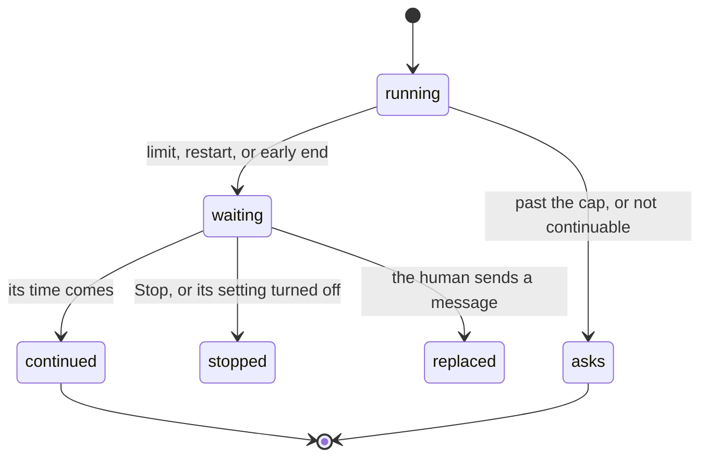

# Data model: Worker lifecycle

The stored data and file formats that [the spec](spec.md) adds or changes. Internal types are the
plan's.

A turn waiting to continue by itself moves through these states:

## Turn, in the runner's cache

The `turns` table of `runner.sqlite`, in Uraeda's data folder: a cache, never in a repository.

| Field             | Type                                             | Meaning                                                     | Change |
| ----------------- | ------------------------------------------------ | ----------------------------------------------------------- | ------ |
| `state`           | `queued`, `running`, `done`, `failed`, `stopped` | how the turn ended, as today                                |        |
| `reason`          | text                                             | why it ended: the limit's text, the restart's, or the error |        |
| `continue_at`     | integer, epoch ms, or null                       | when Uraeda continues the run; null when no continue waits  | New    |
| `continue_reason` | `restart`, `limit`, `gate`, or null              | why the run continues, for the session's line and the cap   | New    |

## Session, in the runner's cache

The `sessions` table of `runner.sqlite`.

| Field                 | Type    | Meaning                                                                                           | Change |
| --------------------- | ------- | ------------------------------------------------------------------------------------------------- | ------ |
| `automatic_continues` | integer | automatic continues in a row, set back to 0 by a commit on the branch or a message from the human | New    |

## Settings file

The `[runs]` table of `config.toml`, in Uraeda's config folder. Each key has its flag and
environment variable, as the [settings](../decisions/settings.md) decision asks.

| Key                      | Type              | Meaning                                              | Change |
| ------------------------ | ----------------- | ---------------------------------------------------- | ------ |
| `build_in_fresh_session` | boolean           | as today                                             |        |
| `continue_after_restart` | boolean, `true`   | continue a run the server's restart cut              | New    |
| `continue_after_limit`   | boolean, `true`   | continue a run a session limit stopped, at its reset | New    |
| `continue_before_gate`   | boolean, `true`   | ask a run that ended before its gate to continue     | New    |
| `automatic_continues`    | integer 1–10, `3` | automatic continues in a row before the run asks     | New    |
