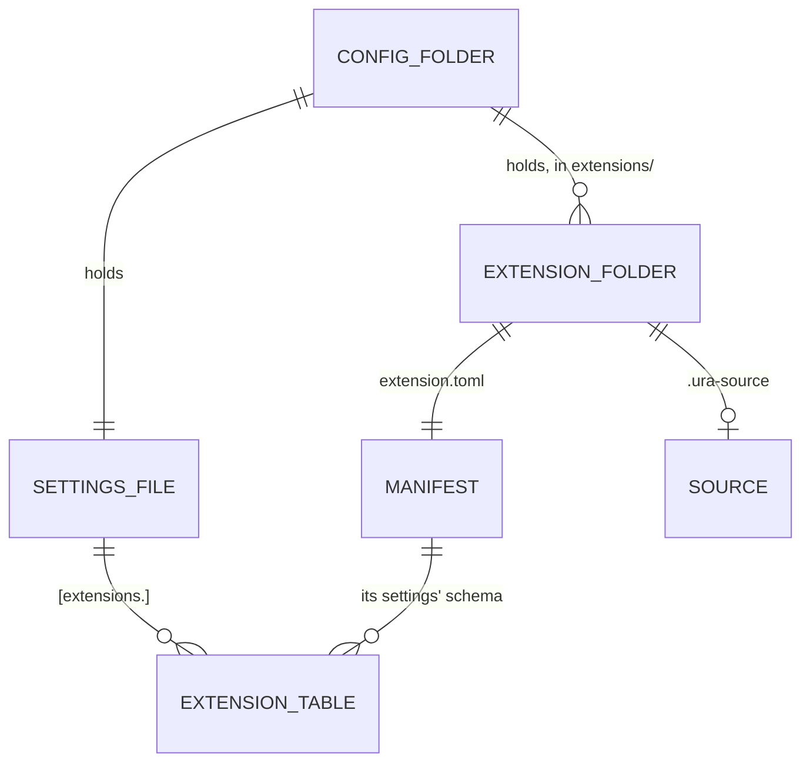

# Data model: Extensions system

The stored data and file formats that [the spec](spec.md) adds or changes. Internal types are the
plan's.

## Extension folder

One folder per extension in `<config>/extensions/`, beside the settings file and the themes folder.
Its name is the extension's name. A linked extension is a symbolic link to the folder you write in.

| Path               | Type    | Meaning                                                       | Change |
| ------------------ | ------- | ------------------------------------------------------------- | ------ |
| `extension.toml`   | TOML    | The manifest, below                                           | New    |
| `server.ts`        | TS      | The server entry, when the manifest names one                 | New    |
| `page.tsx`         | TSX     | The page entry, when the manifest names one                   | New    |
| other `.ts`/`.tsx` | TS, TSX | Files the entries import by relative path                     | New    |
| `skills/<name>/`   | Folder  | Agent skills, in the Agent Skills format, passed to the agent | New    |
| `themes/*.toml`    | TOML    | Colour themes, in the existing theme format                   | New    |
| `.ura-source`      | TOML    | Where `ura` installed it from, absent for a linked folder     | New    |

## Manifest, `extension.toml`

| Field          | Type                         | Meaning                                                                        | Change |
| -------------- | ---------------------------- | ------------------------------------------------------------------------------ | ------ |
| `name`         | string                       | Kebab-case, unique, the folder's name; built-ins' names are reserved           | New    |
| `title`        | string                       | Shown on the settings page                                                     | New    |
| `description`  | string                       | One line, shown under the title                                                | New    |
| `version`      | string                       | The extension's own version, shown on the settings page                        | New    |
| `api`          | integer                      | The extension API version it is built for                                      | New    |
| `icon`         | string                       | An icon name of the app's set                                                  | New    |
| `scope`        | `"global"` or `"repository"` | Where `ura extension add` suggests turning it on first                         | New    |
| `server`       | path, optional               | Its server entry                                                               | New    |
| `page`         | path, optional               | Its page entry                                                                 | New    |
| `[settings.*]` | tables                       | Each setting: `type` (bool, integer, string, list), `default`, `label`, `help` | New    |

## Source, `.ura-source`

Written by `ura extension add` and `ura extension update`, read by the settings page.

| Field    | Type   | Meaning                            | Change |
| -------- | ------ | ---------------------------------- | ------ |
| `url`    | string | The git URL it was cloned from     | New    |
| `commit` | string | The commit it is pinned to         | New    |
| `ref`    | string | The branch or tag `update` follows | New    |

## Settings file, `config.toml`

| Field                                     | Type                     | Meaning                                                                          | Change |
| ----------------------------------------- | ------------------------ | -------------------------------------------------------------------------------- | ------ |
| `[extensions.<name>] on`                  | `"all"` or list of names | The repositories it is on in, by their names; `[]` turns it off; default `"all"` | New    |
| `[extensions.<name>]` other keys          | per its manifest         | Its settings for every repository, checked against its manifest's schema         | New    |
| `[extensions.<name>.repositories.<repo>]` | table                    | Its settings for one repository, over the ones above                             | New    |

## Status file, `run/extensions-status.json`

In the data folder's `run/`, written by the running server, whole and atomically, as the
`Extensions` record changes, and removed as it stops; read by `ura extension list`.

| Field                     | Type                                     | Meaning                                                     | Change |
| ------------------------- | ---------------------------------------- | ----------------------------------------------------------- | ------ |
| `version`                 | number                                   | The format's version, `1`: another reads as no file         | New    |
| `at`                      | ISO 8601 string                          | When the server wrote it                                    | New    |
| `extensions[].name`       | string                                   | The extension's name                                        | New    |
| `extensions[].state`      | `"on"`, `"off"`, `"broken"`, `"waiting"` | Its state, as the settings page shows it                    | New    |
| `extensions[].problems[]` | `{file, line?, message}`                 | Its problems: manifest, settings, loading, compiling, pages | New    |
| `extensions[].waitingFor` | string or null                           | The session a runtime's reload waits for                    | New    |

## Session cache

| Field   | Type   | Meaning                                                          | Change  |
| ------- | ------ | ---------------------------------------------------------------- | ------- |
| `agent` | string | The runtime's extension name; `claude` stays the built-in's name | Changed |
