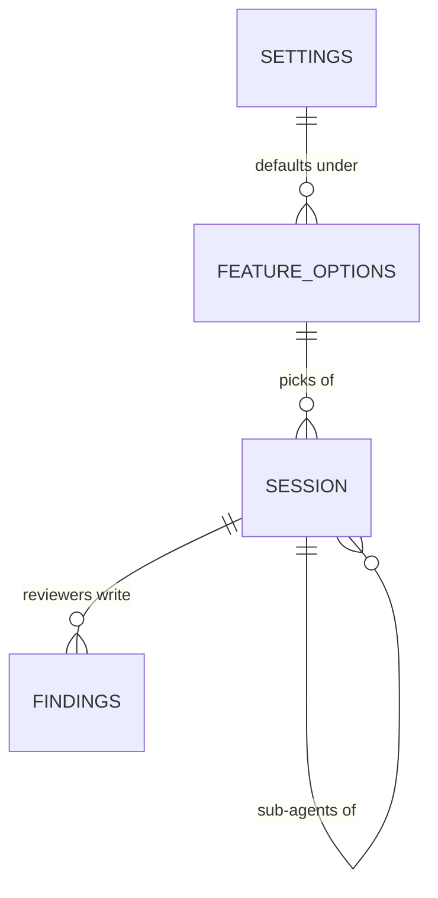

# Data model: Run options

The stored data and file formats that [the spec](spec.md) adds or changes. Internal types are the
plan's.

## `[runs]` in `config.toml`

The settings file's runs table, as the [Settings](/specs/decisions/settings.md) decision keeps it.
The continues' keys are unchanged.

| Field                    | Type    | Meaning                                                            | Change  |
| ------------------------ | ------- | ------------------------------------------------------------------ | ------- |
| `build_in_fresh_session` | boolean | read once if present: `false` joins the plan to the spec's session | Removed |
| `review_depth`           | string  | `waves`, each wave and the branch, or `branch`; `waves` when unset | New     |

## `[runs.steps.<step>]` in `config.toml`

One table per step: `discovery`, `spec`, `plan`, `build`, `review`, `comments`. A missing table or
field means "Default".

| Field         | Type    | Meaning                                                               | Change |
| ------------- | ------- | --------------------------------------------------------------------- | ------ |
| `agent`       | string  | the runtime's name, `claude` or `codex`; else the first runtime on    | New    |
| `model`       | string  | a model the agent lists; else the agent's default                     | New    |
| `effort`      | string  | an effort the model takes; else the model's default                   | New    |
| `new_session` | boolean | whether the step starts a clean session; `true` for `plan` when unset | New    |

`new_session` is ignored on `discovery`, which always starts one, and forced on a step whose agent
or model differs from the step before.

## `[runs.implementers]` in `config.toml`

| Field    | Type   | Meaning                                     | Change |
| -------- | ------ | ------------------------------------------- | ------ |
| `agent`  | string | the implementers' runtime; else the build's | New    |
| `model`  | string | a model the agent lists; else its default   | New    |
| `effort` | string | an effort the model takes; else its default | New    |

## `[[runs.reviewers]]` in `config.toml`

An array of tables, in the order the reviewers run. An empty or missing array means one agent
reviewer on the review step's agent and its defaults.

| Field          | Type   | Meaning                                                           | Change |
| -------------- | ------ | ----------------------------------------------------------------- | ------ |
| `agent`        | string | an agent reviewer's runtime; absent on a command reviewer         | New    |
| `model`        | string | its model; else the agent's default                               | New    |
| `effort`       | string | its effort; else the model's default                              | New    |
| `instructions` | string | text added to the review's prompt; optional                       | New    |
| `command`      | string | a command reviewer's shell command, run in the feature's worktree | New    |

A table holds `agent` or `command`, never both.

## A feature's options

A row per feature or change, in the database of Uraeda's data folder, beside the session cache but
never cleared with it. It holds only what the feature changed: every other value comes from the
settings.

| Field        | Type | Meaning                                                              | Change |
| ------------ | ---- | -------------------------------------------------------------------- | ------ |
| `repo`       | text | the repository's path, as Uraeda lists it                            | New    |
| `folder`     | text | the feature's or change's folder                                     | New    |
| `options`    | JSON | the same fields as the settings' tables above, only those it changed | New    |
| `updated_at` | text | when it last changed                                                 | New    |

## Session

The session cache's rows gain where they sit in the run.

| Field    | Type | Meaning                                                           | Change  |
| -------- | ---- | ----------------------------------------------------------------- | ------- |
| `step`   | text | the step the session started for; null for a chat                 | New     |
| `parent` | text | the session whose run started it, for a sub-agent; null otherwise | New     |
| `role`   | text | `implementer` or `reviewer` for a sub-agent; null otherwise       | New     |
| `effort` | text | the effort picked; now also set by the step it runs               | Changed |

## `findings-NN.md`

A new workflow file in the feature's or change's folder, one per review: `NN` counts the reviews of
the branch, the waves' included. Uraeda writes and commits it once every reviewer has answered; a
run without Uraeda writes it by hand. The record of a finished feature leaves it out, as it leaves
the rest of the folder.

| Part                      | Meaning                                                                | Change |
| ------------------------- | ---------------------------------------------------------------------- | ------ |
| frontmatter `reviewed`    | what was reviewed: `wave 2`, or `branch`                               | New    |
| frontmatter `commits`     | the range reviewed, `<base>..<head>`                                   | New    |
| `## <Reviewer>`, one each | the reviewer's name, as the map shows it: "Codex · GPT-6.1-Sol"        | New    |
| its findings, as a list   | each finding as the reviewer wrote it, with its grade when it gave one | New    |
