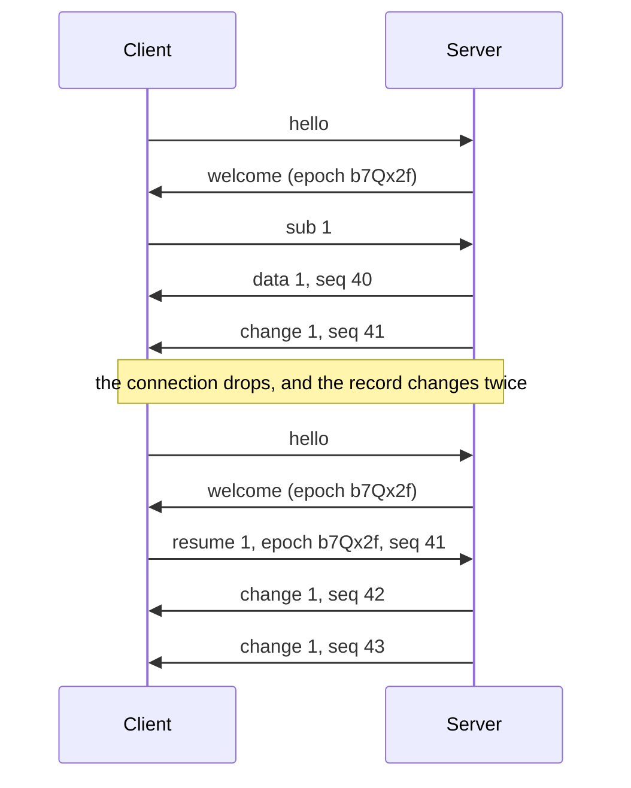

# Contract: the protocol

How a client talks to `ura serve`, at version **1**. It implements the
[protocol decision](../../decisions/protocol.md).

- The messages are defined once, in [`crates/protocol/`](/crates/protocol/src/message.rs). The
  server uses those types, and the client's types,
  [`app/store/protocol.d.ts`](/app/store/protocol.d.ts), are written from them by
  `vp run protocol:types`. A test of the crate fails when that file is stale.
- The examples below are those of
  [`fixtures/protocol/messages.json`](/fixtures/protocol/messages.json), which the crate's tests
  read. [`fixtures/protocol/changes.json`](/fixtures/protocol/changes.json) holds pairs of values
  with the change between them, for the tests of anything that applies a change.

## The connection

- One WebSocket, at `/live`. Each message is one text frame holding one JSON object, with its
  `type`.
- A receiver ignores a field it does not know. A client ignores a message whose `type` it does not
  know. A server answers a message it cannot read with an `error`, code `bad-message`.
- Bytes stay on HTTP: see [the HTTP routes](#the-http-routes).

## The handshake

The first message of a connection is the client's `hello`: its version, and how it signs in.

```json
{ "type": "hello", "protocol": 1, "signIn": { "by": "cookie" } }
```

```json
{ "type": "hello", "protocol": 1, "signIn": { "by": "token", "token": "p8Zk1mQ4" } }
```

- `cookie` signs in with the session cookie of the request that opened the connection, as a browser
  does. `token` signs in with a paired device's token. [Signing in](#signing-in) says where each
  comes from.
- The server answers `welcome`, and the connection is open:

```json
{ "type": "welcome", "protocol": 1, "epoch": "b7Qx2f", "timeZone": "Europe/Paris" }
```

- `epoch` is a random text the server draws each time it starts. A
  [sequence number](#sequence-numbers) means something under its own epoch only.
- `timeZone` is the server's time zone, by its IANA name, `UTC` where its machine names none. A
  client shows every time in it, whatever the device's zone.
- Or the server answers `refused`, with its own version, and closes the connection:

```json
{ "type": "refused", "reason": "client-too-old", "protocol": 2 }
```

| `reason`         | When                                             | What the client says   |
| ---------------- | ------------------------------------------------ | ---------------------- |
| `client-too-old` | The client's version is lower than the server's  | Update this app.       |
| `server-too-old` | The client's version is higher than the server's | Update the server.     |
| `not-signed-in`  | The session or the token is unknown, or revoked  | Sign in, or pair again |

- **Versions.** The two sides have the same version, or the server refuses. It reads a `hello`'s
  `type` and `protocol` first, and nothing else of a `hello` of another version, since another
  version may write the rest another way. So `hello`'s `type` and `protocol`, and `refused`, keep
  their shape in every version. `handshake` in the crate holds this rule.
- Any other first message gets an `error`, code `not-signed-in`, and the connection closes.
- The server closes a connection whose sign-in ends, as a revoked device's.

## Ids

A `sub`, a `call`, and a `resume` carry an `id`, a whole number the client picks. It is unique among
the subscriptions and the calls the client has open on the connection, both together. Every answer
names it.

- A subscription's `id` is open until the client's `unsub`, or an `error` that names it.
- A call's `id` is open until its `result` or its `error`.

## Records

A record is what a client reads: it has a name, arguments that pick one, and a value. The client
subscribes, and gets the value whole once, then only changes.

```json
{
  "type": "sub",
  "id": 1,
  "record": "Feature",
  "args": { "repo": "uraeda", "id": "2026-11-10-nsh-migration" }
}
```

A record or an action of one repository names it as `repo`, its name in the server's list, the
`<name>` of `/r/<name>/`. A record with no arguments takes `null`:

```json
{ "type": "sub", "id": 2, "record": "Settings", "args": null }
```

The server answers `data`, the whole value:

```json
{ "type": "data", "id": 1, "seq": 40, "value": { "id": "t7", "items": [] } }
```

Then a `change` each time the value changes: [operations](#changes) to apply, in order, to the value
the client holds.

```json
{
  "type": "change",
  "id": 1,
  "seq": 41,
  "ops": [
    { "op": "set", "path": ["state"], "value": "running" },
    { "op": "append", "path": ["items", "m2", "text"], "text": "ld" },
    { "op": "insert", "path": ["items"], "value": { "id": "m3", "text": "" } },
    { "op": "insert", "path": ["items"], "value": { "id": "m0", "text": "" }, "before": "m1" },
    { "op": "remove", "path": ["items", "m1"] },
    { "op": "move", "path": ["items", "m3"], "before": "m2" },
    { "op": "move", "path": ["items", "m0"] }
  ]
}
```

`unsub` ends a subscription. Nothing answers it:

```json
{ "type": "unsub", "id": 1 }
```

- A `data` or a `change` for an `id` the client no longer has open is ignored: one may already be on
  its way when the client unsubscribes.
- An `error` that names a subscription ends it: `unknown-record`, `bad-args`, or what stopped the
  server from reading the record.

### Sequence numbers

- `data` carries the `seq` its value is at. It need not be 0.
- Each `change` carries the `seq` before it plus 1. A client applies a change only then.
- `data` may come again at any time, as when the client fell too far behind: its value replaces the
  one held, and its `seq` the one held.
- There is no acknowledgement message. On one connection, messages arrive in order, and none is
  lost. A number that is not the next one means the client missed a change: it sends `resume` with
  what it holds.
- A change that does not apply to the value held means the two differ: the client sends `unsub`,
  then `sub` again.

### Resume

After a connection drops, the client connects again, says `hello`, and sends one `resume` for each
record it still holds: the `seq` of the last change it applied, and the `epoch` of the `welcome` it
got that value under.

```json
{
  "type": "resume",
  "id": 1,
  "record": "Feature",
  "args": { "repo": "uraeda", "id": "2026-11-10-nsh-migration" },
  "epoch": "b7Qx2f",
  "seq": 41
}
```

- The subscription is open again under `id`, as after a `sub`.
- When the `epoch` is the server's own and it still has every change after `seq`, it sends them as
  `change` messages, numbered from `seq` plus 1. It sends nothing when none was missed.
- Otherwise it sends `data`: after a restart of the server, or when the client is too far behind.
  How many changes a server keeps is its own choice.
- A `resume` under an `id` that is open replaces that subscription.



## Changes

A change is a list of operations. Each has a `path`: the steps from the top of the value to one
place in it.

- A step is a field's name in a record, or an item's `id` in a list. `["items", "m2", "text"]` is
  the field `text` of the item `m2` of the list `items`. The empty path is the whole value.
- **A list's items carry an `id`**: each is a record with a field `id`, a text no other item of the
  list has. Such a list changes item by item. Any other list, such as a list of texts, changes
  whole, by `set`.

| `op`     | Fields                    | What it does                                                         |
| -------- | ------------------------- | -------------------------------------------------------------------- |
| `set`    | `path`, `value`           | What is at `path` becomes `value`. A record's field may be new.      |
| `append` | `path`, `text`            | The text at `path` grows by `text`, at its end.                      |
| `insert` | `path`, `value`, `before` | The list at `path` gains the item `value`, before the item `before`. |
| `remove` | `path`                    | The field or the item at `path` goes.                                |
| `move`   | `path`, `before`          | The item at `path` moves before the item `before` of its list.       |

- `before` is an item's `id`. Without it, the item goes to the end of the list.
- A text that only grew is always one `append`: a streamed reply never sends its text again.
- `diff` and `apply` in the crate make and apply changes: `apply(old, diff(old, new))` gives `new`.
  A record's fields have no order.

## Actions

An action is what a client does: it has a name, an input, and an output.

```json
{
  "type": "call",
  "id": 3,
  "action": "proposals.add",
  "input": { "repo": "uraeda", "section": "Next", "text": "Pair a phone", "hash": "9c1f" }
}
```

The server answers `result`, with the output, which is `null` for an action that gives nothing:

```json
{ "type": "result", "id": 3, "output": { "hash": "41be" } }
```

Or it answers `error`:

```json
{ "type": "error", "id": 3, "code": "conflict", "message": "the priorities changed since" }
```

- What an action changed in a record reaches that record's subscribers as a `change`, before or
  after the `result`.
- A call is never sent again by itself. When the connection drops before its answer, the client does
  not know whether it ran: it says so, and the records show what is true.

## Errors

An `error` has a `code`, for the client, and a `message`, for a person. It names the `id` of the
`sub`, `call`, or `resume` it answers. It has no `id` when it answers a message the server could not
read:

```json
{ "type": "error", "code": "bad-message", "message": "expected value at line 1 column 1" }
```

| `code`           | When                                                               |
| ---------------- | ------------------------------------------------------------------ |
| `not-signed-in`  | A message came before a `hello` that was welcomed.                 |
| `bad-message`    | The message is not JSON, or not a message of this version.         |
| `unknown-record` | No record has this name.                                           |
| `unknown-action` | No action has this name.                                           |
| `bad-args`       | The arguments are not the record's.                                |
| `bad-input`      | The input is not the action's.                                     |
| `refused`        | The server will not do it, as things are. The message says why.    |
| `conflict`       | What the client acted on changed since it read it.                 |
| `hook`           | A git hook of the repository stopped it. The message is its output |
| `internal`       | The server failed.                                                 |

`refused`, `conflict`, and `hook` are the core's three refusals, which the Node server sent as the
start of a message.

## What raises the version

- A new record, a new action, a new field, a new `code`, or a new message an older side can ignore
  keeps the version.
- A removed or renamed message, field, or operation, or a new one an older side must understand,
  raises it. There is one version at a time: an older client is refused, and updated.

## Signing in

Every route answers 401, with `{ "error": "Sign in to Uraeda." }`, to a request that carries neither
of these:

- **A browser's session cookie.** `POST /session` with `{ "key": "ura_…" }`, the server's access
  key, sets it and answers 204. So does a one-time link, `GET /session/<token>?to=<path>`, which the
  host makes, and which redirects to its path. A browser then sends the cookie by itself, on routes
  and on the request that opens `/live`.
- **A paired device's token.** `POST /pair` with `{ "code": "7KQ2-M9XA-0TBD", "name": "Phone" }`
  answers `{ "token": "<id>.<secret>", "id": "<id>" }`, once: the code is the one `ura pair` shows
  on the host, good for one device, for 10 minutes. The device keeps the token, gives it in its
  `hello`, and sends it on a route as `Authorization: Bearer <token>`. Its `id` is the part before
  the dot, and names it in the record `Devices`.

The routes open without either are the ones that sign in: `/live`, which checks its `hello`,
`/session`, `/session/<token>`, and `/pair`. So is `/mcp`, which is no client's: an agent's process
gives the token the server issued it. A path that is no route answers the client's own files.

A preview's path is open with the frame secret, since a sandboxed frame and a web view send no
cookie: `/r/<name>/preview/<secret>/<folder>/`. A client never builds one. It shows the path a
record gives it, `Preview.base` or `Story.frame`, on the server's own address. The secret changes
whenever a session or a device ends: the records then change, and name the new path. A path with
another secret answers 404 to a frame and to who is signed in, and 401 to anyone else.

A mockup's path carries the same secret, `/r/<name>/mockups/<secret>/<path>`, for the same reason. A
signed-in client that asks for a mockup under no secret, or under another, is sent to the path under
the current one, with 303: a frame follows it.

Every answer but a mockup's and a preview's carries `X-Frame-Options: SAMEORIGIN`: no other site
frames a page of Uraeda.

- A wrong key or code is answered 401 a second later, and never locks anyone out.
- `GET /session` answers 204 when the request is signed in, and 401 when it is not.
- `DELETE /session` signs the browser out, or unpairs the device that sends it. `DELETE /sessions`
  ends every session and every device.
- A session or a device ends after 30 days without use. An open connection is a use.
- Nothing a device sends holds a time: a code, a cookie, and a token last by the server's clock.

## The HTTP routes

A client reaches the server through `/live` and these routes only. Each task that adds a route adds
its line. The routes marked "host" are not a client's: the host's own `ura` and app call them, with
the host token of the server's status file, as `Authorization: Bearer <token>`.

| Route                                                        | For                             | Task |
| ------------------------------------------------------------ | ------------------------------- | ---- |
| `GET /live`                                                  | The WebSocket of this contract  | 4    |
| `POST /open`                                                 | Host: a second start's folder   | 4    |
| `GET`, `POST`, `DELETE /session`, `DELETE /sessions`         | Signing in and out with the key | 5    |
| `GET /session/:token`                                        | Signing in from a link          | 5    |
| `POST /pair`                                                 | Pairing a device, for its token | 5    |
| `POST /pair/code`                                            | Host: a pairing code            | 5    |
| `POST /session/key`                                          | Host: a new access key          | 5    |
| `/r/:name/raw/*`, `/images/*`, `/chat-images/:id`            | Files and images, as bytes      | 16   |
| `GET /r/:name/mockups/:secret/*`                             | Mockups, for a sandboxed frame  | 16   |
| `DELETE /r/:name/chat-images/:id`                            | A chat's image, taken back      | 16   |
| `POST /r/:name/attach`, `POST /r/:name/inbox/note-image`     | Uploads                         | 16   |
| `/mcp`                                                       | The agents' MCP endpoint        | 16   |
| `GET /r/:name/preview/:secret/:folder/*`, and its WebSockets | Previews, proxied               | 18   |
| `GET /extensions/:name/page`                                 | An extension's page, signed     | 19   |
| `GET /extensions/key`                                        | The key the pages are signed by | 19   |
| The web build's files                                        | The client itself, in a browser | 56   |

### Extension pages

An extension's page reaches a client as a signed NSH package, which the client runs only when it
verifies under the key this server gave it. Both routes ask for a sign-in, as every route does.

- `GET /extensions/key` answers 200, `text/plain`: the public key, 32 bytes in base64, with
  `Cache-Control: no-store`. A client asks for it on each connection, and trusts no other key for
  this server's pages.
- `GET /extensions/:name/page` answers 200, `application/octet-stream`: the package's bytes, with
  `X-Uraeda-Page-Version: <version>`, `ETag: "<version>"`, and `Cache-Control: private, no-cache`.
  With `If-None-Match: "<version>"` naming the running version, it answers 304 with the same headers
  and no body. It answers 404, `<name> has no page`, for an extension without a page, off, or whose
  page never built.
- The version is the row's `pageVersion` in the record `Extensions`, and the package's build number.
  It only grows, across the server's restarts too: a client loads the page again when it changes,
  and refuses a build older than one it ran.
- The package's app id is `dev.uraeda.extension.<name>`. Its capabilities are
  `{ "host": PAGE_HOST }`, `start`, `loaded`, `ready`, `problem`, `alive`, `record`, `call`, and
  `navigate`: the page may call these functions of its host, and reaches nothing else of the
  machine. Its build starts from `page_entry`, which posts `start` first, answers the host's `ping`
  with `alive`, then runs the page's code and posts `loaded`, or `problem` with what it threw. Both
  are in [`page.rs`](/crates/protocol/src/page.rs), and [`host.tsx`](/app/extensions/host.tsx) says
  what each message of the channel carries.
- A page that does not build keeps the package before it, and its problem is in the row's
  `problems`.

## Declaring a record or an action

A record or an action is declared in the crate before either side uses it:

```rust
/// Which counter.
#[derive(Serialize, Deserialize, TS)]
pub struct CounterArgs {
    pub id: String,
}

/// A counter.
#[derive(Serialize, Deserialize, TS)]
#[serde(rename_all = "camelCase")]
pub struct Counter {
    pub id: String,
    pub count: u64,
}

impl Record for Counter {
    const NAME: &'static str = "Counter";
    type Args = CounterArgs;
    type Value = Self;
}
```

- A type that crosses the protocol derives `Serialize`, `Deserialize`, and `TS`, of `ts-rs`. Fields
  are camelCase in JSON.
- Its line goes in `catalog()`, in [`registry.rs`](/crates/protocol/src/registry.rs):
  `.record::<Counter>()`, or `.action::<CounterAdd>()`. Then `vp run protocol:types` writes the
  client's types, where `Records["Counter"]` has its `args` and its `value`.
- Two types of the protocol never share a name: the client's types are one file.
