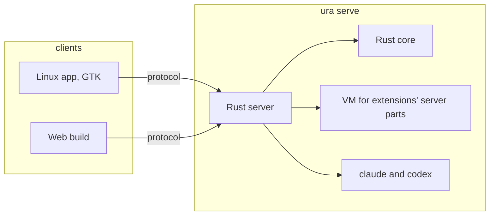

# Spec: Migration to Native Shell and a Rust server

> [!IMPORTANT]
>
> Spec to review, about 15 minutes.
>
> - You approve replacing the React web UI and the Node server with Native Shell clients and a Rust
>   server, on Linux and the web.
> - Eleven decisions change, and one is new: see [Decisions](#decisions). The plan drafts their
>   text, and stops until you approve it.
> - Compatibility breaks, on purpose: the extension API is rewritten in place, and today's
>   extensions stop loading.
> - Two design gates stop the build: the design language, then the component gallery.
> - Session history is imported once, by a tool removed after the port.
> - Three outside behaviours are not verified: signed extension packages, diagrams, and pacing at
>   120 frames a second.
> - The risk tier is high: sign-in, stored data, and the agents' runs are all rewritten.

Uraeda's UI moves to [Native Shell](https://github.com/longbridge/nsh) (NSH), a framework that draws
one TSX and Rust codebase natively and in the browser. Its server moves to Rust, inside `ura`. The
new UI gets a component library of its own, with glass, blur, and neon light. This spec was written
from a conversation with the human on 2026-11-10, recorded in
[clarifications](clarifications-01.md), and two spikes. It has no proposal. iOS and macOS are out of
scope: the human builds them later, on a Mac.

## Decisions

- **Changed: [Stack](../decisions/stack.md)**. The server is Rust inside `ura`, and the UI is TSX on
  NSH over Rust modules, fed through Uraeda's own protocol.
- **Changed: [Distribution](../decisions/distribution.md)**. Uraeda ships as the `ura` binary and a
  desktop app, and no longer as an npm package.
- **Changed: [Toolchain](../decisions/toolchain.md)**. The React Compiler rule goes, and NSH's
  checks join `ready`.
- **Changed: [Extensions](../decisions/extensions.md)**. Uraeda builds and signs extension pages,
  each page runs in a view of its own, and the built-in agent runtimes are Rust.
- **Changed: [Sign-in](../decisions/sign-in.md)**. A device pairs once and then signs in with its
  own token, which the owner can revoke.
- **Changed: [Text editing](../decisions/text-editing.md)**. Vim's keys come from Uraeda's own Vim
  layer, a named subset, in place of CodeMirror's.
- **Changed: [UI components](../decisions/ui-components.md)**. Components come from Uraeda's own
  library, in place of Astryx.
- **Changed: [UI look](../decisions/ui-look.md)**. Glass, blur, and glow are part of the look, and
  the terminal direction stays.
- **Changed: [Colour themes](../decisions/colour-themes.md)**. Themes gain roles for glass and glow,
  in the same TOML format.
- **Changed: [Preview](../decisions/preview.md)**. Previews draw in a web view on native clients,
  and the component gallery replaces the app's own Storybook.
- **Changed: [Performance](../decisions/performance.md)**. A frame budget of 8.3 ms joins the 100 ms
  target.
- **New: [Protocol](../decisions/protocol.md)**. Clients reach the server only through one versioned
  protocol, over a WebSocket and a few HTTP routes.

Relied on:

| Decision                                       | What it means for this spec                                     |
| ---------------------------------------------- | --------------------------------------------------------------- |
| [Keyboard](../decisions/keyboard.md)           | The key registry, the leader menu, and their rules stay.        |
| [UI layout](../decisions/ui-layout.md)         | The three width classes and their rules stay.                   |
| [UI behaviour](../decisions/ui-behaviour.md)   | Behaviour rules stay, and the new components follow them.       |
| [Undo](../decisions/undo.md)                   | Undo keeps its keys, its stack of 50, and its rules.            |
| [Run lifecycle](../decisions/run-lifecycle.md) | Runs keep their states and their automatic continues.           |
| [Testing](../decisions/testing.md)             | The stage stays `early`: UI tests are rare.                     |
| [Sandbox](../decisions/sandbox.md)             | The sandbox serves the new app over sample projects.            |
| [Diagrams](../decisions/diagrams.md)           | A diagram never runs scripts, and shows its source if it fails. |

## User stories

### US1: The Linux app (P1)

The owner opens a desktop app on Linux. It starts the server when none runs, and shows everything
the web UI shows today.

Key scenarios:

1. **Given** no server is running, **When** the owner opens the app, **Then** it starts `ura serve`
   and shows the home page.
2. **Given** an agent is replying, **When** the owner watches the session, **Then** the reply
   streams in and the transcript follows its end.
3. **Given** the owner edits a text field with Vim on, **When** they type `d2w`, **Then** two words
   are deleted, as in Vim.

### US2: The same app in a browser (P1)

The owner opens the server's address in a browser, on a desktop or a phone. They get the same app,
with the same components and behaviour.

Key scenarios:

1. **Given** a signed-in browser, **When** the owner opens a feature's address, **Then** that
   feature shows, and Back returns to the previous page.
2. **Given** a phone, **When** the owner taps a text field, **Then** the keyboard opens and stays
   open.

### US3: Extensions (P1)

The owner drops an extension folder in the config folder. Uraeda builds it, shows its page inside
the app, and reloads it on every save.

Key scenarios:

1. **Given** a running app, **When** the owner saves an extension's page, **Then** the new page
   shows without a restart.
2. **Given** an extension that throws or never stops computing, **When** it loads, **Then** the app
   keeps working and names the broken extension.

### US4: A coherent, glassy look (P2)

Every screen is built from one component library, with glass surfaces, blur, and neon light, in a
terminal style. The owner approves its design language, then its gallery, before screens are built.

### US5: A remote device (P2)

The owner pairs another device with the server once. That device then signs in with its own token,
and the owner can revoke it.

## Replaced behaviour

- The React web UI, its Storybook, and its tests go, with [`packages/web/`](/packages/web/).
- The Node server and its tests go, with [`packages/server/`](/packages/server/).
- The Node binding and the npm package go, with [`packages/binding/`](/packages/binding/),
  [`crates/binding/`](/crates/binding/), and `packages/uraeda/`.
- Today's extension API goes, rewritten in place under the same version: its tests are rewritten.
- CodeMirror's Vim engine goes: its behaviour tests are replaced by the Vim layer's.

## Architecture

- **One server, in `ura`.** `ura serve` holds what the Node server does today, on the Rust core,
  with no binding between them.
- **One protocol.** A client subscribes to records and calls actions over a WebSocket. A record
  arrives whole once, then as changes, so a streaming reply never resends a transcript.
- **One client codebase.** Screens and the component library are TSX on NSH. Heavy logic is Rust:
  the Vim layer, and what the UI needs from the core.
- **Extensions in two parts.** A server part runs as TypeScript in a VM inside the server. A page
  runs in a view of its own inside the app, from a package the server builds and signs.
- **Two servers until the end.** The frozen Node server and React UI keep working until the web
  phase removes them. The Rust server has its own data folder and port.

The [plan](plan.md) holds the details, and the measurements behind each choice.

## Edge cases

| Importance | Situation                                         | What happens                                                 |
| ---------- | ------------------------------------------------- | ------------------------------------------------------------ |
| High       | The connection drops while a reply streams        | The client reconnects and resumes from what it has.          |
| High       | A client and a server of different versions meet  | The client says which side to update, and does nothing else. |
| High       | A device's token is revoked while it is connected | Its connection closes, and it shows the pairing screen.      |
| Normal     | The server stops while the app is open            | The app says so, and starts or waits for a server.           |
| Normal     | A diagram cannot be drawn                         | Its source shows, as today.                                  |

## Success criteria

- Every route of the React UI has a screen in the new app, or a line saying why it went.
- Streaming and fast scrolling of a 20,000-message session cost at most 8.3 ms a frame at the 99th
  percentile, on the Linux app.
- Every navigation and action draws within 100 ms, as the performance decision asks.
- A broken extension never stops the app or another extension.
- The repository builds and releases without Node.

## Assumptions

- NSH keeps its TSX API compatible, as its
  [compatibility page](https://github.com/longbridge/nsh/blob/main/website/docs/compatibility.md)
  promises. Its Rust API may change, so NSH is pinned.
- NSH draws at the display's rate. Its own measurements say so, and no 120 Hz display was available
  to check.
- A signed extension package loads in an embedded view on Linux. The spike loaded compiled source,
  not a signed package.
- The diagram library can draw without a browser. If it cannot, diagrams show their source on the
  Linux app until a later feature.

## Constitution check

| I. Humans stay in control | II. Git and plain text first | III. Asynchronous by default | IV. Review effort matches impact | V. Tools are optional |
| ------------------------- | ---------------------------- | ---------------------------- | -------------------------------- | --------------------- |
| ✅                        | ✅                           | ✅                           | ✅                               | ✅                    |

## Risk tier

High. The migration rewrites sign-in, stored session data, and the code that runs agents, and it
changes eleven decisions.

## History
