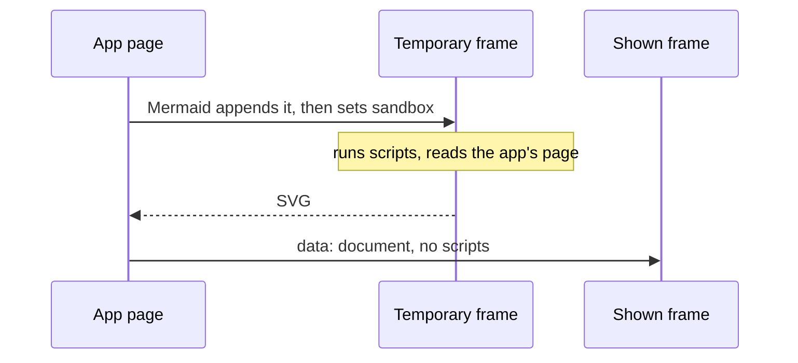

# Clarifications, round 01: Diagram frames

> [!NOTE]
>
> Answered on 2026-10-18.
>
> - Verdict: worth building, with changes: the first item's cause is confirmed, and replacing
>   Mermaid with Pele fixes it more simply than the frame the proposal describes.
> - The diagrams decision changes: its library goes from `mermaid` to `pele`, a young library from
>   the Obsidian team, so its look differs from GitHub's and its advisories become ours to follow.
> - Whether Pele's SVG still goes in a sandboxed frame decides what a bug in a young library could
>   reach.
> - Links in a diagram can no longer replace the app's tab: they open in a new tab.

## Context

### Goal

The [proposal](proposal.md) lists three things. A crafted diagram must not reach the app, even if
the library's sanitizer fails. A diagram fixed by a live edit must scroll with the keyboard like any
other. And the diagram's frames must lose their small defects: a clashing id, a link that takes over
the tab, a size that is not capped, no loading state, and the same title for every frame.

### Today

[`Diagram.tsx`](/packages/web/src/Diagram.tsx) asks Mermaid to draw at its `sandbox` level, as the
[diagrams decision](../../decisions/diagrams.md) requires. Mermaid
[appends a temporary frame to the app's page, then sets its `sandbox` attribute](https://github.com/mermaid-js/mermaid/blob/mermaid%4012.2.0/packages/mermaid/src/mermaidAPI.ts).
It draws in that frame, and removes it after.

A frame's sandbox applies when the frame is created, not when the attribute is set. I checked in
Chromium, Firefox, and WebKit with Playwright: a script in a frame made this way runs, reads
`top.document`, and posts messages to the app. Only the final frame, the one the UI shows, is
sandboxed. A sanitizer bypass would run in the temporary one.

The proposal's fix keeps Mermaid, and draws in a frame of its own that runs scripts with an opaque
origin. Mermaid's `strict` level cannot be drawn in a frame without scripts, since WebKit gives such
a frame no `contentDocument`. The server's guard would also have to answer that frame's reads of
`/assets/*`.

[Pele](https://pele.run/) is another way. It is a library from the Obsidian team, version 1.6.0,
MIT, that reads Mermaid's syntax and returns an SVG string, with no dependency and no frame. I tried
it on this repository:

|                                        | Mermaid 12.2.0                             | Pele 1.6.0                |
| -------------------------------------- | ------------------------------------------ | ------------------------- |
| Drawing the repository's four diagrams | 54 to 655 ms                               | 2 to 25 ms                |
| SVG size                               | 8 to 24 KB                                 | 2 to 4 KB                 |
| Script size                            | 5.5 MB, a chunk of about 500 KB in the app | 680 KB, 250 KB compressed |
| Dependencies                           | about 114 packages                         | none                      |
| Needs a frame to draw                  | yes                                        | no                        |

The sequence diagram, the flowchart, and the entity diagram all drew correctly, in a lighter style
than Mermaid's. Five hostile diagrams, with `onerror` images, `javascript:` links, a CSS `url()`,
`<script>` in a message, and a `foreignObject`, gave no script or event handler: Pele prints such
text as text. Its [security page](https://pele.run/security) says it never turns diagram text into
HTML labels, and offers a `sanitize` hook for the app. It does not describe a general SVG sanitizer.

### Scope

The diagram component, its dependency, the diagrams decision, and the tests of each. Other frames,
such as mockups and Storybooks, keep their rules. Diagrams in the repository stay Mermaid syntax, so
GitHub still draws them.

### Sources

- [`Diagram.tsx`](/packages/web/src/Diagram.tsx) and its
  [browser tests](/packages/web/src/__browser__/diagram.test.tsx).
- The [guard](/packages/server/src/guard.ts), which allows a sandboxed frame's `Origin: null` reads
  only for previews and mockups.
- Mermaid's
  [`mermaidAPI.ts`](https://github.com/mermaid-js/mermaid/blob/mermaid%4012.2.0/packages/mermaid/src/mermaidAPI.ts)
  and [security levels](https://mermaid.js.org/config/usage.html#securitylevel).
- Pele's [site](https://pele.run/), [security page](https://pele.run/security), and
  [repository](https://github.com/obsidianmd/pele), and the package, which I installed and ran.
- The [diagrams decision](../../decisions/diagrams.md), edited on this branch for answer A.

## Q1: Should the web UI draw diagrams with Pele instead of Mermaid?

The decision's rule on the library changes: `pele`, pinned to an exact version, in place of
`mermaid`. The sandbox rule changes too, in the follow-up below. The edit is on this branch, against
`main`.

With Pele, the temporary frame disappears: the SVG string needs no page to draw in. A failed draw
leaves nothing behind, and the clashing id goes away.

Pele targets Mermaid 12.1.0's syntax with its own layout and style. A diagram may look different
from GitHub's, and a feature added to Mermaid since may not draw. I tried only the diagram types the
repository uses. It is also young: I did not check how many people maintain it.

Why it matters: it decides whether the first item is fixed by a simpler design, and whether the
project depends on a young library or on the better-known one. It amends a decision you approved.

- **A (recommended). Draw diagrams with `pele`, pinned to an exact version, and replace `mermaid`.**
  - [pro] no frame that runs scripts, no guard change, and about 114 fewer packages.
  - [pro] much faster, and a smaller chunk that only pages with a diagram load.
  - [con] a younger library, with less track record in security advisories and releases.
  - [con] a look that differs from GitHub's, and Mermaid syntax newer than 12.1.0 may not draw.
  - Why recommended: it removes the cause of the first item instead of containing it, and no diagram
    in the repository needs more than it draws.
- **B. Keep `mermaid`, and draw it at its `strict` level in a frame of its own that runs scripts
  with an opaque origin, with the guard answering that frame's reads of `/assets/*`.**
  - [pro] Mermaid's full syntax, and its look, as GitHub draws it.
  - [con] the frame runs scripts, and a mockup could read the built UI's public files.
  - [con] a more complex design: a message round trip, and a change to the server's guard.

**Answer:** A: We don't need to pin it that hard. I trust the dev. I know him.

### Q1.A: Should the SVG Pele returns still be shown in a sandboxed frame?

Only if you picked A in Q1. Today the UI shows each diagram in a frame without scripts or the app's
origin. The same frame can show Pele's SVG: the UI builds its document, with Pele's colours set for
the frame, as it builds one today for Mermaid's.

The other way inserts the SVG in the page. Sizing, theming, fonts, and the keyboard become simple,
since the diagram is part of the page. But a bug in Pele's output would run with the app's rights.
Pele's SVG has no scripts, but it is the library's own promise, from a young project.

Why it matters: it decides what a bug in a young library could reach, against the code the frame
costs. It changes the second sandbox rule of the decision.

- **A (recommended). Show the SVG in a frame whose sandbox has no scripts, no `allow-same-origin`,
  and no top navigation.**
  - [pro] a bug in Pele's output cannot reach the app.
  - [pro] the component's sizing and scrolling code stays, with its tests.
  - [con] the frame's size must be measured, and its theme is set apart from the page's.
  - Why recommended: it keeps the decision's promise whatever the library does, at no new cost.
- **B. Insert the SVG in the page.**
  - [pro] simpler code, and the page's fonts and colours apply.
  - [con] a bug in Pele's output would run with the app's rights.

**Answer:** B: It's ok

### Q1.B: Should the decision also stay on Mermaid's `sandbox` level, as it is?

Only if you picked B in Q1. The decision keeps its text and the first item is not fixed: a sanitizer
bypass reaches the app through the temporary frame.

Why it matters: it decides whether the hole stays open.

- **A (recommended). No: draw at `strict` in the frame of its own, as B in Q1 says.**
  - [pro] closes the hole.
  - [con] the same costs as B in Q1.
  - Why recommended: the hole is real, and reproduced in three browsers.
- **B. Yes: leave the decision and the hole as they are.**
  - [pro] no work.
  - [con] a crafted diagram reaches the app, which can commit and start agents.

**Answer:**

## Settled without the human

### Check these

- **Links in a diagram** no longer replace the app's tab: in a frame, the sandbox drops
  `allow-top-navigation-by-user-activation` and keeps `allow-popups`, so a link opens in a new tab.
  Pele only allows relative links and `http`, `https`, `mailto`, and `tel`. A link that takes over
  the app's tab loses the reader's place.
- **This is a change, not a feature**: the proposal already says the decision needs amending, and
  swapping its library is a change to its rules, not a new decision. Say so if you want a spec.
- **A check that every diagram of the repository draws** is added to the tests: the workflow files,
  templates, examples, and fixtures. A diagram Pele cannot draw then fails the tests, not a reader.

### Behaviour

- **A diagram fixed by a live edit** measures its width again each time it is drawn, so it gets its
  keyboard-scrollable region when it is wider than its card.
- **A diagram's size** is clamped: a width over 4,000 pixels or a height over 3,000 is scaled down
  to fit, so a crafted `viewBox` cannot make a huge frame.
- **A diagram being drawn** shows "Drawing the diagram…" in its place, so the page does not jump
  without a sign.
- **Each frame's title** names its diagram type and its place on the page, as "Flowchart diagram, 2
  of 3", with the type from Pele's `detectType`, instead of "Diagram" for all.
- **The dark mode** sets Pele's colour variables for the frame, as the UI sets Mermaid's theme
  today.

### Under the hood

- **The tests** reproduce each item first, and the first by a script placed in a frame appended the
  way Mermaid appends it, which reads the app's page. A test of the new component then shows a
  hostile diagram producing no script, handler, or `javascript:` link in its output.

**Notes:**
