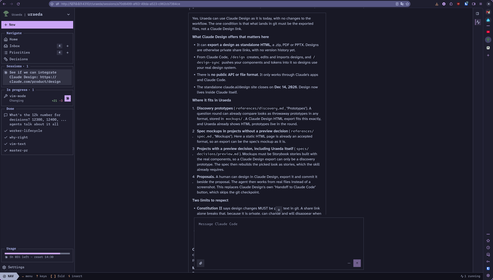

# Reading long responses is not comfortable because the composer always stays…

Reading long responses is not comfortable because the composer always stays visible.

It shouldn't: the composer should just always be at the end, after the messages. There should be all
the vertical space for the agent messages.

