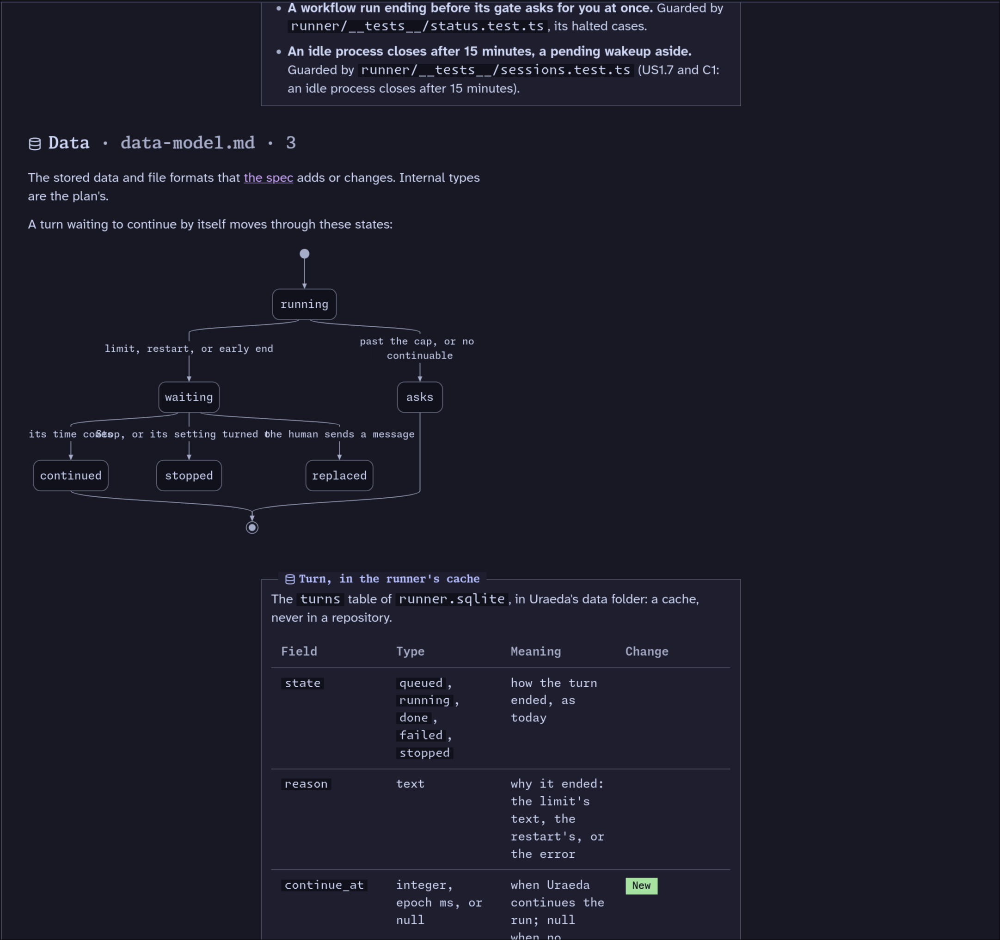

# Some stuff is weirdly left-aligned, like sections titles, headers, and graphs.

## What

Some stuff is weirdly left-aligned, like sections titles, headers, and graphs.

Review all components in the clarifications and spec page, and make sure they look good. Run a full
pass as a "user" by driving a headless chrome instance. Stop if you can't.

You're allowed to change a bit more on clarifications/specs: a bit more padding where needed, some
more distance, ... Whatever needed to make those two pages read well.

## Why

They're the two most important pages and the hardest to read. They need to be _perfect_.

## Notes
