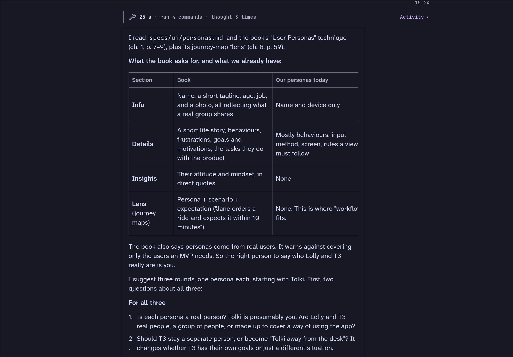

# When there's table in a message, they look small.

They should spread to the right, expanding the border around them.

Scrolling them should move the left side to the left of the pane too, outside of the pane like on
the right. This way a widescreen can be used to see the whole table + it still starts "left-aligned"
inside the main pane.

