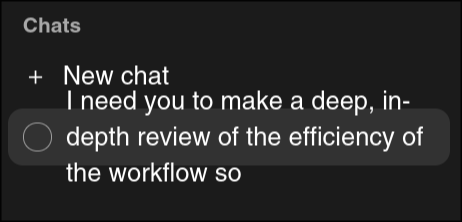

# Layout and look and feel

## What

One design pass over the whole web UI: its layout and its visual identity, decided together, since a
visual direction comes with opinions on layout (cards or flush columns, density, how many panes
fit).

1. The human sets the information architecture below: what each view must show, what is primary, and
   what must stay visible together. It holds no geometry: no widths, no pane positions.
2. The agent builds 3 to 5 complete directions as throwaway prototypes, each one a layout and a
   visual identity over the same information architecture, and asks which one, with a link to each.
3. The spec writes the chosen direction down: the layout's behaviour (folding, resizing, movable or
   dynamic panes), the design tokens, the icons, the logo. The prototypes are then deleted.

This is a visual and layout pass: functionality does not change. A view that needs new data from the
core or the server is a feature of its own, which lands first.

Polish left over after this pass is a batch of small changes, not part of this feature.

## Why

The UI works, but it is vanilla and does not look like a finished tool: it should look good, and be
memorable, before v1.0.0. Its layout also grew view by view, and breaks in places, such as at half a
screen's width.

## Information architecture

For each view: what it must show, what is primary, and what must stay visible together.

### Shell

[The left sidebar, the right column, and what stays on screen across every view.]

### Home

### Inbox and triage

### Priorities

### Feature and change home

### Proposal and discovery

### Clarifications

### Spec, plan, and data model

### Reviews

[The spec review and the final review.]

### Session

[A feature's session and a chat.]

### New chat and new change

### Decisions and constitution

[The decisions, a decision, a principle, and the decisions check.]

### Settings

### Storybook and mockups

### Editor

## Notes

### Layout

- The desktop layout is unusable at half a screen's width (vertical split): it needs to fold
  automatically when the center is too narrow. 
- The folded left sidebar should keep icons for the main categories (inbox, priorities), and unfold
  temporarily on hover.
- Make a coherence pass: why is the sidebar on the right on mobile?
- Look at Kiro Crew's UI for better concepts than ours: it is very panel-based, which might fit us.
- Ask the agent in a side column: the session opens beside a round of questions or a spec, rather
  than leaving the page, which decides what the right column holds on every page. Needs a change to
  the [layout decision](/specs/decisions/ui-layout.md) (from Q1 of the clarifications redesign; also
  in [Chat's right column](/specs/drafts/chat-right-column.md)).

### Look and feel

- A visual identity: colors, shapes, mood, a logo, a favicon.
- Many more icons, to make everything more readable: the sidebar, agent statuses, a feature's step,
  a spec's layout and paragraphs, inbox and priorities.
- Icons for the harnesses (Claude Code, Codex, Pi, ...).
- Remove the color on features: it looks bad, and needs a more thoughtful approach.
- Screenshots from 2026-10-17, before the page redesigns: the home's colored cards, and a chat's row
  overlapping "New chat" in the sidebar. 
  

### Constraints

- Almost only UI: minimal core and server changes, and no new operational concept.
- The prototypes are investigation, not code to keep. The workflow does not yet say whether
  throwaway prototypes are part of an investigation: this feature decides it.
