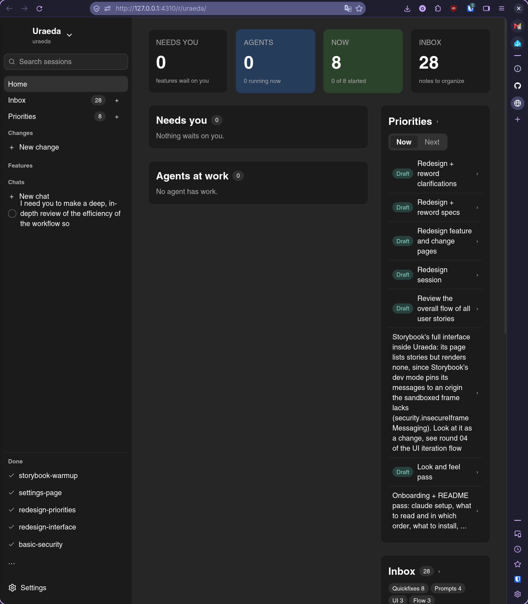

# Look and feel pass

## What

Look and feel pass: components style, logo, favicon, ... Until this feature we focus on the
_functional_ part of the UI: the goal here is for it to look _good_.

- Generally, the happy path should look good
- We need _many more icons_ to make everything more readable: sidebar, agent statuses, feature step,
  spec layout and paragraphs, ...
- Icons for the different harnesses (claude code, codex, pi, ...)
- A home icon/logo
- In failures in the sidebar the `x` is not centered in the circle
- Home is cramped in a half-screen layout, and feel
  empty fullscreen. - -> needs an
  "archive" option + only take one line with `...`
- The right sidebar is not resizable, at least in priorities -> it was an important feature so not
  sure where that went
- The constitution and decisions view is a bit _too_ hidden, likely deserves a small sidebar entry

## Why

The UI works, but it does not look like a finished tool yet: it should look good before v1.0.0.

## Notes

This feature should ideally be almost ONLY about UI: minimal core and server-side changes. There is
no new operational concept introduced in this feature.

It comes last: after the page redesigns, the settings page, and the
[overall flow review](flow-review.md).
