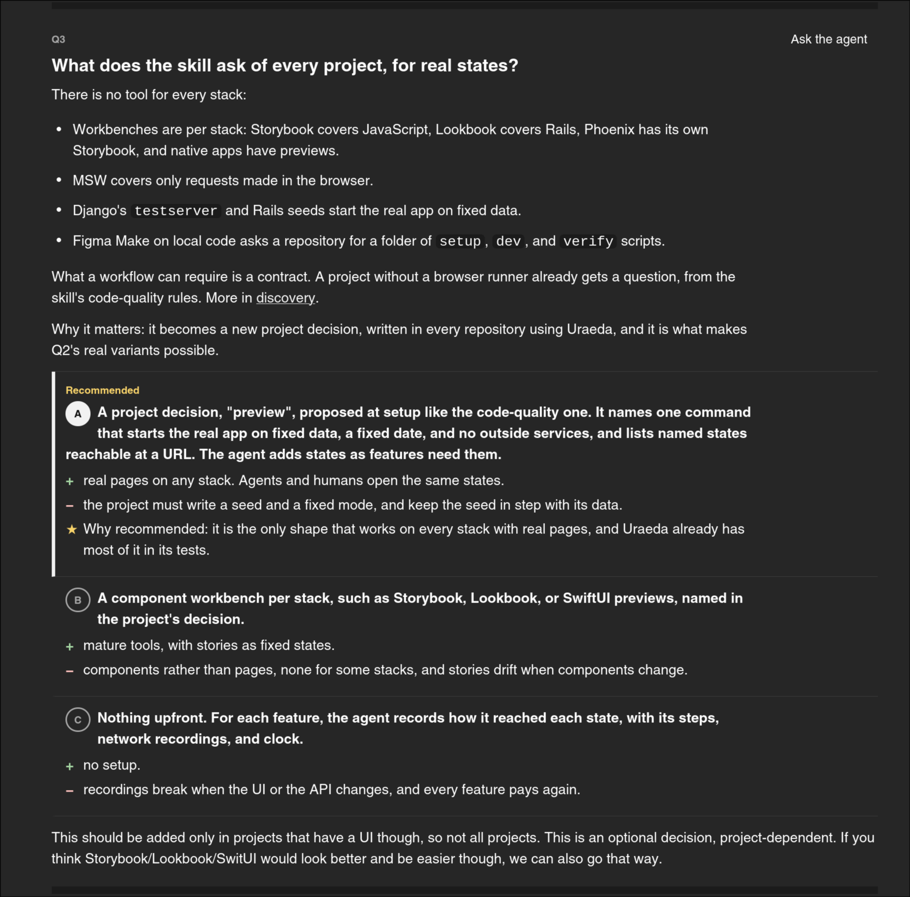

# Redesign clarifications

## What

I want to redesign clarifications. The goal is READABILITY and EFFICIENCY.

Desktop + mobile:

- The first paragraphs should be structured
  - 0 fluff or info that's not needed for decision making
  - Clear categories:
    - Sources (code/web)
    - Goal (big picture)
    - Current state of the codebase compared to the goal
    - PROPOSE CATEGORIES BASED ON REVIEWING ALL CLARIFICATIONS ROUND SO FAR
- The page needs to be EASY TO PROCESS LINEARLY FOR A HUMAN
  - Right now it starts with a TL;DR that lacks context, then a pointless retelling of the proposal
    in different terms, then sometimes some ramblings, ...
- There needs to be better ways to represent the information when it's relevant. Right now it's
  verbose and hard to navigate as it's a sea of bullet points:
  - We could have tables, mermaid charts, priority levels for "settled without you", ...
  - Even when using bullet points, we could use sub-headers for grouping and structure
  - This is about the intro, the questions, and the outro ("settled without you"). They all are hard
    to digest for a human.

Desktop:

- 
- Each question should feel like its own card, with good separation
  - Question text should be even bigger than it is now
  - I feel like overal the content is hard to read: lines are too long, there's not enough line
    jumps, the width of a wide page is not used...
  - We could have two columns for example, with question + context on the left, and options on the
    right? I'm not sure
- Sub-questions in particular really have almost no separation with the real question, it's really
  off-putting. It could be an arrow from card to card? A card appearing on selecting the parent
  option?
- Ask the agent should not leave the page but open the session in the right sidebar

## Why

It's hard to read and overwhelming at the moment.

## Notes

- Small extra change: we should be allowed to not select any answer if there's a comment (happens
  when we don't like any of the options)
- For all the points I raise, we can change the wording of the skill and the template for
  clarifications: rewording and redesign go together
- An important piece of work is making the clarifications wording and style model-agnostic. We need
  to be extremely clear as to the format expected, the tone, ... Same work as in the
  [specs redesign](../redesign-specs.md)
