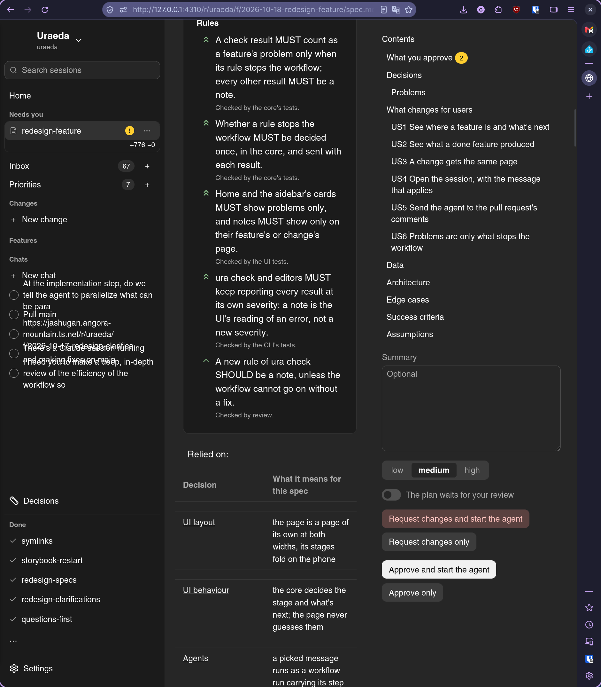

# Some layout reviews

## What

Some layout reviews:

- The desktop layout is completely unusable at half screen (vertical split):
  
  - Need to have AUTO FOLD when the center is too big
- The folded left sidebar should keep icons for the main categories (inbox, priorities), and also
  unfold temporarily on hover
- Make a coherence pass in the UI: why is the sidebar on the right in mobile?
- Look at Kiro Crew UI and see what we could use ourselves, if there are better concepts than what
  we have. It seems very panel-based.

## Why

## Notes
