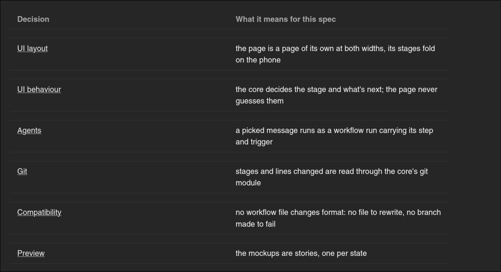
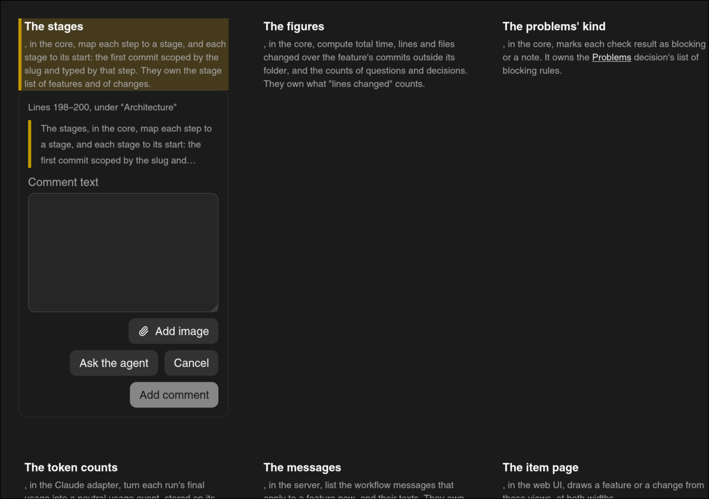

# Some layout reviews

## What

Some layout reviews:

- The desktop layout is completely unusable at half screen (vertical split):
  
  - Need to have AUTO FOLD when the center is too big + animations for folding
- Decisions table in specs is too big for the decision
  column:
- "Architecture" on the specs page looks weird af:
  
- I don't like the validation buttons in the sidebar in the specs stage: should be at the bottom, I
  don't remember asking or validating them being in the right sidebar, and it makes no fucking
  sense.
- The text in the "What you approve" part of specs is too small (except the first line)
- The folded left sidebar should keep icons for the main categories, and also unfold temporarily on
  hover
- Constitution check in specs looks pretty bad
- Make a coherence pass in the UI: why is the sidebar on the right in mobile? And look at Kiro Crew
  UI and see what we could use ourselves

## Why

## Notes
