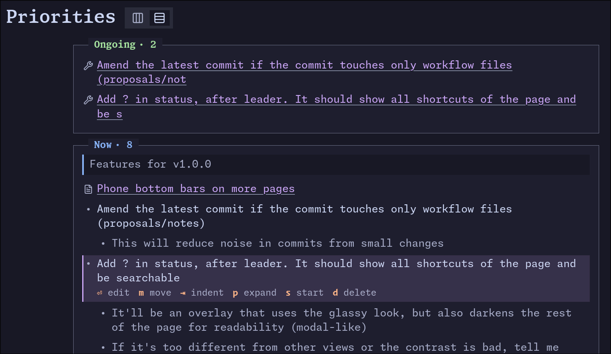

# Feature state pass

## What

Feature state pass

- [testing-communication] A stopped session marks the feature as "needing attention" even if another
  session is running
- After approving a spec the feature stayed in "needs you" until I ran a full refresh
- Many, many issues with the "state" of a run: if a PR is up, it's "done" even if I restarted the
  session
  - If a session is running, it should always be visible in the sidebar/card/feature page
  - Generally we need better handling of "corner cases" of feature state/session state

## Why

## Notes

### Changes were started but still showed up in "Now"

