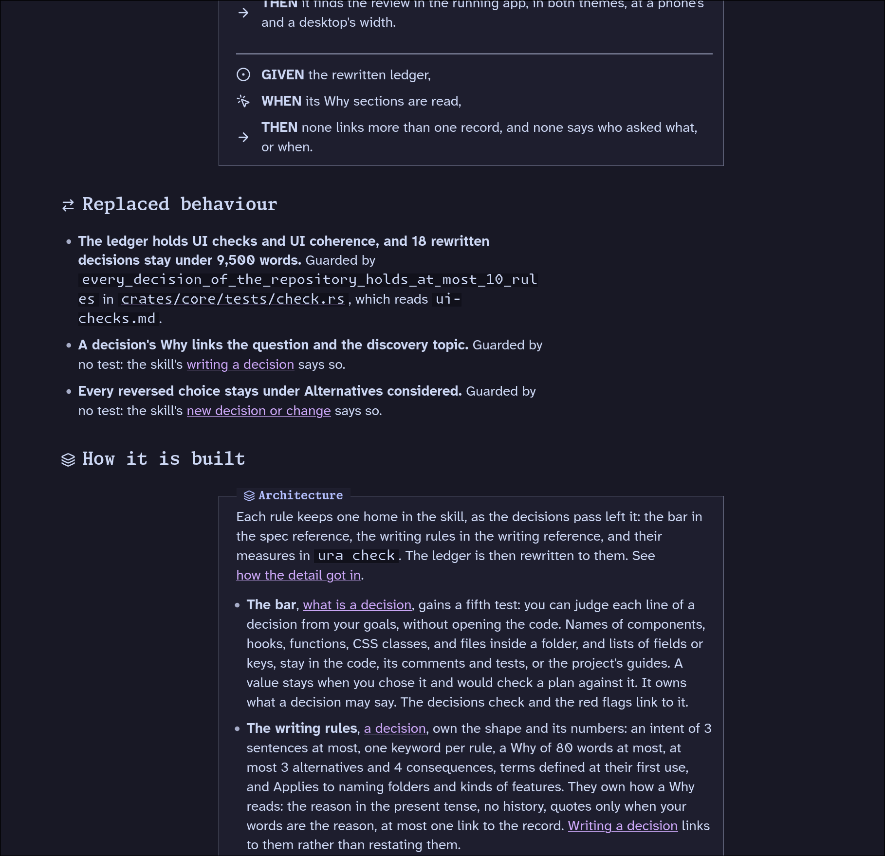

# Reading and layout pass

## What

- Need a bit more left/right padding on mobile and slightly smaller text (same as discord messages
  on mobile)

## Notes

### The "replaced behaviour" block looks weird in the specs. Needs a review together with decisions changes.

### We need a good way to show tables in our reading panes

### The home columns are not centered on a wide screen

